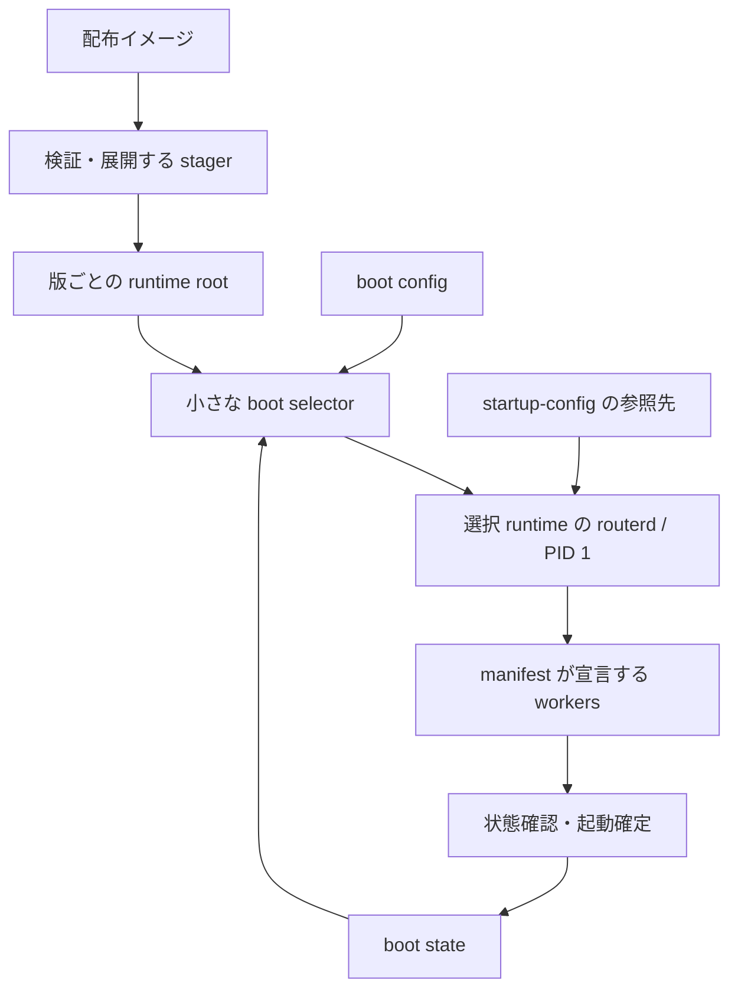

# ADR 0001: 配布イメージ、展開済み runtime、boot config、startup-config の分離

日付: 2026-10-24（Asia/Tokyo）

状態: **設計方針として採用。native runtime catalogを部分実装。**

2026-10-25追記: manifest v3でnative ELFのformat宣言を署名へ結び付ける。
publisherは実readonly recordから宣言を導出し、全nativeとmanifestの一致をreceiverで再検証する。
旧v1/v2 readerは置かない。現時点で異なる宣言のprepare/起動/fallbackは、移行policy未実装のため拒否する。
観測versionの純粋比較だけでstate移行、失効policy、engine/kernel capabilityを受入済みとは扱わない。

2026-10-25追記: manifest v2、可変static native/data、verified role catalogと独立logging commandを実装した。
旧二ELF readerは置換済み。明示startup-config参照、独立した小さなbootstrap、engine/kernel/config/state ABIの完全化は未完了。
[実装・個別受入と残作業](../evidence/2026-10-25-runtime-catalog.md) を参照。

routerd2 は未リリースで、現在の二バイナリー形式の利用者はいない。
稼働中の routerd は機能を引き継ぐ参照元であり、未リリースの routerd2 とは別製品である。
prototype の配布形式・boot schema・設定/journal・内部APIに後方互換性を要求しない。
新しい展開済み runtime 形式へ直接置換する。製品としての更新・復旧保証は初回リリースを起点に定義する。

利用者が指定した次の要件を採用する。

- 配布・更新時に扱うイメージは、対象 architecture / profile ごとに一つにする。
- runtime environment は、そのイメージファイルをファイルシステムへ展開した複数バイナリーの束とする。
- runtime の実行ファイル数を二つに固定しない。native module も必要に応じて独立 binary にする。
- 起動の責務を `boot config → load runtime → load startup-config` と分ける。
- イメージの受信・検証・展開、次回起動する版の選択、実際の起動を別の操作にする。

以下の path、schema 名、CLI 名は設計例であり、現在の実行ファイルが受理する仕様ではない。
最初の boot 実装方式には、検証済み runtime へ exec して PID 1 を引き継ぐ方式を推奨する。
具体的な disk layout、圧縮形式、最初に分割する binary 数は実装時に確定する。

2026-10-25追加: [永続store identityと不変snapshot](../startup-config.md) の保存・検証を実装した。
現在のjournalを通常起動の正本とし、snapshotの明示startup採用とruntime/configurationを結ぶtransactionはまだ実装していない。
[個別受入の証跡](../evidence/2026-10-25-config-snapshots.md) を参照。

2026-10-25追加: 固定runtimeのstartup参照をjournalへ一度だけ採用する処理を実装した。
同一選択の再実行で後続commitを上書きせず、採用世代とstable eventを保持する。
[個別受入と初回失敗の記録](../evidence/2026-10-25-startup-adoption.md) を参照。
signed runtime/configurationの組をprepare/attempt/confirmation/fallbackへ結ぶtransactionは引き続き未実装。

2026-10-25追加: 候補の採用前後を区別する条件付き設定復旧と、runtime/config参照を同一世代で公開するrelease journalの内部APIを実装した。
[証跡と未接続の境界](../evidence/2026-10-25-paired-startup.md) を参照。
実snapshot/互換性検証・writer fence・paired loader/healthを結ぶcoordinatorは未実装で、現commandはpaired選択を起動しない。

## 1. 五つの対象を区別する

| 対象 | 責務・保持するもの | 更新の主体 |
| --- | --- | --- |
| 配布イメージファイル | manifest、署名、runtime の binary/library/plugin/data、必要な配布資料を一つに収容する | build / release publisher |
| 展開済み runtime | manifest digest で特定する、変更しないファイル集合。supervisor と各 module を実行する | installer / stager |
| boot config | 起動対象 runtime、startup-config の参照、fallback と起動 policy。起動に必要な最小 schema | 認可された boot-control 操作 |
| startup-config | 起動時に採用するネットワーク・サービスの永続設定。resource schema は runtime が解釈する | config coordinator |
| boot state / runtime state | 起動試行・確認結果、identity/鍵、lease、event cursor、各種 journal | それぞれの責任 module |

boot config に WAN、firewall、BGP 等の resource 宣言を混ぜない。
startup-config に executable path、任意 argv、runtime の選択を書き込まない。
boot の実行履歴は operator の boot config と論理的に分け、試行回数を通常の設定編集で初期化しない。

`running-config` は現在採用・適用している operator intent、`candidate` は編集途中の設定とする。
DHCP 取得値や BGP 学習経路は観測・動的状態であり、operator の設定へ自動的に混入させない。

## 2. runtime は通常の展開済みディレクトリ

例えば `/var/lib/routerd/runtimes/<manifest-digest>/` を一つの runtime root とする。
その下の配置例は次のとおり。

| 相対 path の例 | 内容 |
| --- | --- |
| `manifest.json` / `manifest.sig` | exact artifact 集合、署名、互換条件 |
| `bin/routerd` | 選択 runtime の PID 1 supervisor / lifecycle |
| `bin/routerctl` | 必要なら分離する運用 CLI |
| `routerd-modules/control` | 設定、resource coordinator |
| `routerd-modules/network` | kernel object の適用・観測 |
| `routerd-modules/management` | SSH / 管理 API |
| `routerd-modules/logging` | ログ収集・保存 |
| `routerd-modules/bgp` / `dns` / `sam` | 専用 binary に分ける module の例 |
| `routerd-modules/protocols` | 小さな関連 protocol をまとめる場合の multicall binary |
| `engines/...` | 固定版の外部 engine と必要な adapter |
| `lib/...` / `share/...` | 宣言した loader/library/plugin/data |
| `licenses/...` | 版と対応づけた license / source / build 資料への情報 |

この一覧の全 binary を最初から作ることや、一つの resource kind ごとに binary を作ることは要求しない。
**module、binary、process、instance は一対一に固定しない。**
複数 DHCP instance は同じ binary を別 process で起動できる。
関連する小さな protocol を multicall にまとめてもよい。
後から分割・統合するときは、manifest の role binding を変更し、resource の公開契約は維持する。

初期の分割候補は、supervisor、control、network、management、logging と、
大きい依存や独立した engine を持つ BGP/DNS/Tailscale/DPI 等である。
判断には権限、依存 library、調査・保守、起動時間、圧縮配布サイズ、RSS/PSS を使う。
binary の数だけを軽量化の指標にはしない。

通常 boot は展開済み runtime を読む。毎回 archive を展開する方式にしない。
runtime を単一の実行可能ファイルへ再結合することや、filesystem image の mount を必須にすることもない。
そのような別方式を後から導入する場合は、この採用方針を変更する別の判断が必要になる。

## 3. boot と runtime の境界

小さな bootstrap（名称例 `routerd-boot`）は、boot config と署名・互換条件を解釈し、
選択した runtime の entrypoint へ引き継ぐ。
イメージ downloader、archive 展開器、network resource compiler、SSH server は bootstrap の責務に含めない。
stager は管理 runtime の module または installer として実装できる。
空の装置へ入れる場合も、installer が同じ manifest / 展開検証を利用する。

最初の方式は次を推奨する。



bootstrap が最初は PID 1 として動き、検証済み runtime の `routerd` を exec する。
選択した runtime が PID 1 と reaping/shutdown を引き継ぐ。
現在の [release_boot.go](../../cmd/routerd/release_boot.go) と
[supervisor](../../internal/supervisor/supervisor_linux.go) の方向を維持できる。

この方式では bootstrap は引継ぎ後に常駐しない。
runtime の PID 1 が hang した後に bootstrap が監視して救済する、とは扱わない。
watchdog / hypervisor の reset と、次回 boot の試行回数・fallback を組み合わせる。
reset を伴わない復旧は、応答できる runtime 自身の failure path に限る。
startup-config の検証・適用が失敗した場合も、検証済みの runtime/configuration の組へ戻す。
有効な fallback がない場合は失敗を記録して明示的な recovery 経路へ入り、空設定や任意の最新 directory を起動しない。
bootstrap 自体に管理 SSH を追加せず、必要な recovery 管理機能も署名された既知の runtime と設定で提供する。

bootstrap を常駐 PID 1、runtime supervisor を子 process とする方式は、
PID 1 判定、reaping、shutdown、readiness、権限を二層に設計する追加作業になる。
現在の要件を満たすための必須条件にはしない。

boot config / runtime store を読む前に state volume の mount が必要な装置では、
volume locator と必要な storage driver を boot image 側に持たせる。
選択 runtime や WAN 設定を読めなければ runtime 自体を見つけられない、という依存循環を作らない。
通常の起動で disk を初期化する処理も追加しない。

## 4. boot config の例と権威

次は将来 schema の概念例である。digest は省略表記であり、現在の boot JSON へ入力する設定ではない。

```yaml
schema: routerd.boot/v1
runtime_store: /var/lib/routerd/runtimes
startup:
  runtime: "sha256:<runtime-B-manifest>"
  configuration:
    store: system
    revision: committed
fallback:
  runtime: "sha256:<runtime-A-manifest>"
  configuration:
    store: system
    revision: "snapshot:<compatible-config>"
policy:
  trial_attempts: 1
  ready_timeout_seconds: 120
  stable_seconds: 10
```

表示・選択時に human-readable な version label を使っても、保存する runtime 参照は厳密な digest に解決する。
directory 名の順番、最新らしい version、可変の `current/bin/...` を実行権威にしない。
`committed` という設定参照も、起動 transaction では実際の store identity / revision / digest に解決する。
fallback の設定は、旧 runtime に対して検証した互換な参照を持たせる。単に一つ前の番号を採らない。

boot config の編集には validation、expected generation、durable commit を設ける。
設定意図と boot state は異なるデータだが、selection / attempt / confirmation の更新は
同じ boot-control transaction / generation に結びつけ、電源断で半分だけ公開しない。
YAML の編集・表示用 view と内部 journal を独立した二つの正本にしない。
通常の書込みは管理 API または明示した offline import を通す。

boot state は、boot ID、attempt token、選んだ runtime/configuration、試行数、確認・失敗の理由を保持する。
trust anchor とその rotation/revocation は認可された独立 policy で管理する。
展開した bundle の内容だけで自身の trust policy を差し替えたり、boot の履歴をリセットしたりはしない。

## 5. load startup-config と新しい設定 store

startup-config、running-config、candidate、初回 seed、永続 journal の意味を新仕様として定義する。
空の config store だけに初回 seed を取り込み、通常 boot では選択された永続設定を使う。
破損した store を seed で黙って上書きしない。
未公開実装の serialized record、native schema v1、旧 boot.Config の読取互換は作らない。
開発用 fixture と state は新形式に合わせて更新・再生成できる。

新しい boot entry で startup-config を明示的に切り替えた場合は、
選択した config store / revision を runtime が検証し、authoritative config journal に対する
明示的な selection / import transaction として採用する。
別 revision の journal があるという理由で operator の選択を無視せず、
逆に毎 boot 外部 YAML で保存済み設定を無条件に上書きすることもしない。

`startup-config.yaml` や `running-config.yaml` は編集・export に向いた表現として提供できる。
新仕様では通常の `commit` が設定の適用と永続保存を行い、次回 startup の `committed` 参照にも反映する。
CLI で保存のタイミングと対象 revision を明示し、独立した YAML と journal を二つの正本にしない。
named snapshot を選ぶ場合だけ、その明示選択を区別する。

bootstrap は BGP、DHCP、firewall 等の設定内容を解釈しない。
選択 runtime が schema/capability を検証し、必要な migration、依存評価、worker の起動、kernel 適用を行う。
設定が壊れた場合に空設定で「起動成功」と扱わない。

一回の起動を、少なくとも以下の組合せで追跡する。

- runtime manifest digest と boot/runtime ABI。
- config store / selected snapshot、実際に採用した revision/schema/digest。
- migration plan と fallback に使える互換な設定・state の方針。
- kernel boot ID、attempt token、worker generation。

health confirmation は、選択 runtime と実際に採用した設定・required worker の組合せを確認する。
設定 commit や worker の再起動があれば安定時間を取り直す。
試行中に設定を変更する場合も fallback 互換性を再確認し、安全な戻し方がない変更は
確定まで拒否するか、明示的に試行を取り消して扱う。古い設定 snapshot へ黙って巻き戻さない。
confirmed config が未確認のまま再起動した場合の rollback も、新 journal の受入条件にする。

## 6. 配布、展開、選択、起動を別々に実行する

| 操作 | 効果 |
| --- | --- |
| receive | イメージを bounded な一時領域へ受信する |
| stage | 署名・manifest を確認し、未公開 directory へ展開・全 component 検証・同期後に runtime root を公開する |
| prepare | runtime/configuration の互換性を確認し、boot config の次回対象を generation 付きで変更する |
| boot | 選択済み runtime を固定し、startup-config の参照を引き継いで起動する |
| confirm | 起動した組合せの健全性を確認し、last-known-good として記録する |
| rollback | 検証済みの旧 runtime と安全な configuration/state 方針を次回対象にする |
| prune | 稼働中・次回・trial・fallback・migration 用の保護対象を除いて、不要な runtime を削除する |

stage は running runtime も next-boot selection も変更しない。
prepare は running process tree を変更せず、自動 reboot も意味しない。
新 runtime を既存 directory の上へ上書き展開しない。
正常に検証できなかった一時 directory は実行対象として公開しない。

展開時は entry 数・展開 byte 数・各 file size・時間・空き容量に上限を持たせる。
宣言外 file、重複 path、絶対 path、`..`、特殊 file、path を逃がす link を拒否する。
初期形式は通常 file と directory を基本にし、symlink/hardlink が必要な engine は
署名された target と展開先内の解決を専用規則で検証するまで受理しない。
単なる archive 展開コマンドや host package の post-install script に任せない。

runtime 本体は write-protected にし、設定・SSH host key・VPN identity・lease・journal は外に置く。
署名配布物に装置固有の秘密鍵を焼き込まず、初回 seed を通常 boot の上書き元にもしない。
state migration は型ごとに定義し、失効済み鍵・古い provider owner・期限切れ lease/Up を復活させない。

## 7. 全 component の整合と固定

manifest は entrypoint、artifact ID、相対 path、hash/size、architecture、役割と固定 argument contract、
capability、IPC/state/config/kernel/boot ABI を明示する。
native executable、外部 engine、loader/library/plugin/data は artifact type ごとに検証する。

現在の `Image{Routerd, Modules}` と単一 `ModulePath` を、
runtime root と `role → artifact → verified executable` の catalog へ一般化する。
一つの binary を複数 role が使ってもよく、role ごとに別 binary を持ってもよい。
設定や dynamic worker API は任意 executable path / argv を受け取らない。

worker 起動・再起動は、起動時に選んだ runtime root / catalog / verified handle に固定する。
途中で変化する `current` symlink を再解決して別版を混ぜない。
manifest digest、component identity、IPC version と generation を supervisor が照合する。
共通 hello を持たない外部 engine は、検証済み artifact を起動する owned adapter が lifecycle を管理する。

dynamic linking を許す場合、executable FD の固定だけでは loader/.so/plugin/data の固定にならない。
選択 runtime の filesystem view と解決方法を定め、host の未宣言 library や loader environment を参照しない。
ABI と filesystem view を成立させられない組合せは、準備段階で拒否する。

prune は boot config の参照だけでなく、実際に稼働中の runtime も保護する。
FD が残っていても、後から読む library/plugin/data を先に消してはいけない。
restart と prune、boot entry 変更と prune、migration と prune の競合を受入試験にする。

## 8. version と更新範囲

| 値 | 用途 |
| --- | --- |
| product version | 利用者向けの表示 |
| publisher sequence | 更新の順序と既存 high watermark / rollback policy |
| runtime manifest digest | 選択したファイル集合の厳密な識別 |
| component version/digest | 各 binary / engine / library の由来と識別 |
| boot/runtime ABI・manifest schema | bootstrap が読めて起動できる範囲 |
| config/state/IPC/kernel の互換範囲 | 設定適用、戻し、worker 通信、kernel 利用の条件 |

engine の upstream version と product version を同じ文字列に揃える必要はない。
署名 manifest が正確な組合せを固定する。
初期の更新単位は runtime 一式であり、独立 binary にしただけで個別の hot update を保証しない。

appliance は boot config で展開済み runtime を選択する。
コンテナは同じ runtime 集合を OCI image 内へ展開して配り、image digest の選択は orchestrator が行う。
Pod 内に appliance の runtime installer / boot selector を必須として重ねない。
startup-config と state の永続 volume・schema 互換はコンテナでも確認する。

kernel / bootloader / bootstrap の更新は runtime 選択と責務を分ける。
一つの firmware 配布ファイルに必要な boot 側 payload を同梱することはできるが、
それぞれの検証・適用先・順序・fallback を明示する。
「単一配布物」は、全 architecture / cloud で同じ byte 列を使うという意味ではない。

## 9. 未リリース実装からの置換

現在の routerd2 は未リリースであり、二つの ELF と四ファイル archive の利用者はいない。
この prototype を新形式へ直接置換する。以下は作らない。

- 二binary形式を維持する互換 reader / adapter。
- 旧 selector を段階的に先行更新する手順や v1 shim bridge。
- 未公開 native schema / journal / boot config の読取互換や state 移行。
- 旧 prototype と新形式の組合せを支える compatibility matrix。

bootstrap、runtime manifest、role catalog、config schema、journal、test fixture は同じ開発変更で更新できる。
二binary形式を前提とするテストは新形式に直し、機能・整合性・障害時の性質を引き続き検証する。
過去の byte 列や内部CLIを保存することは合格条件にしない。

新形式の最初のリリースをサポート基準にする。
その後の製品更新では、bootstrap/runtime ABI、署名、state migration、known-good への fallback を検証する。
初回から新形式の正常版と失敗する更新候補を用意し、更新・復旧の試験を行える。

現行 **routerd 本体**からの機能パリティと設定移植は、元の製品目標として継続する。
routerd2 の未公開内部形式を維持する作業とは別に、元 resource/API/CLI の必要な機能を新構成で実現する。

## 10. 計画への割当と受入

| 作業 | 変更・成果物 |
| --- | --- |
| CORE-02 | startup/running/candidate、config-store/revision 選択、新 journal、confirmed rollback を一つの契約にする |
| CORE-06 | 任意の bounded component 数を扱う manifest、role catalog、boot ABI、展開済み runtime と engine の契約 |
| SYS-03 | bootstrap / supervisor / stager / worker の権限と state の所有者を分離する |
| DIST-01 | image stage、展開検証、boot config の prepare、runtime/catalog handoff、SSH 経由操作、state-safe rollback |
| DIST-02 | 初回リリース以降の bootstrap 更新・復旧、kernel/boot/runtime の対応、対象機種の受入 |
| DIST-03 | boot 側と展開済み runtime を備えた cloud image、装置ごとの設定・identity |
| DIST-04 | 同じ component 集合の OCI 化、startup-config/state volume、orchestrator による更新 |
| QUAL-01 | binary の個数に依存しない、実 runtime と全 required module の受入 |

作業全体の依存は [implementation-plan.json](../implementation-plan.json) に記録する。
CORE-06 で共通契約を先に確定し、全 module 分割や全配備先の完成を待たずに機能移植を進める。
新仕様内で bootstrap と runtime の対応を確認し、DIST-01/02 で初回リリース以降の更新・復旧を受入する。

最低限の受入は、次のとおり。

- 新形式で三つ以上の独立 native executable を持つ runtime を起動でき、binary 数の固定がないことを確認する。
- boot config が指定した runtime と startup-config が実際に選ばれ、別 revision が黙示採用されない。
- 展開中の停止、hash 不一致、容量不足、prepare 中の電源断で既存 runtime と選択を壊さない。
- 選択後に path を変更しても、worker restart で他 runtime の component が混在しない。
- dynamic loader/library/plugin/data の欠落・置換・host への逃避を検出する。
- required module や設定適用の失敗で試行が確定せず、検証済み fallback へ戻れる。
- rollback 後も鍵失効・owner generation・lease 期限・journal cursor の契約を守る。
- 起動中・稼働中・fallback として必要な runtime を prune しない。
- 初回リリース以降に支える bootstrap/runtime の組合せと known-good fallback を実 boot で検証し、非対応 ABI を prepare 前に拒否する。
- boot schema と resource schema を別々に更新でき、bundle 数・process 数・binary 数を混同しない。

## 根拠となる現在の実装

- [boot document](../../internal/runtimeconfig/config.go)
- [verified release と Image](../../internal/release/types.go)
- [選択・試行の journal](../../internal/release/state_linux.go)
- [verified FD からの PID 1 引継ぎ](../../cmd/routerd/release_boot.go)
- [worker FD と supervisor](../../internal/supervisor/supervisor_linux.go)
- [起動時の health confirmation](../../internal/releaseboot/watch.go)
- [authoritative config journal](../../internal/config/config.go)
- [置換対象の未公開 release 実装](../releases.md)

上記実装は再利用・置換するコードの参考であり、互換維持の対象ではない。多 binary の展開・boot config 新 schema・独立 bootstrap が
すでに製品に実装されたという意味ではない。
