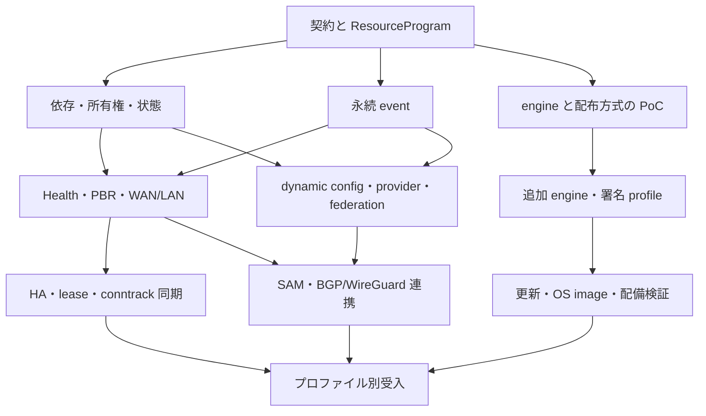

# 現行 routerd と同等の製品にするための実装計画

作成日: **2026-10-24（Asia/Tokyo）**
状態: **実装中。各部分checkpointの検証と、作業単位全体の完了判定を区別する。**

ユーザー指定の継続ゴールは、全残実装と必要な試験を完了し、対象実機で利用可能と判断できる状態まで進めること。
部分checkpointでゴールを完了にせず、実装・検証・未検証と証跡を更新する。
対象機種・NIC・性能条件の確認と並行して、独立して進められる実装・隔離VM検証を続ける。

最新product checkpointは `8887e75`。
BGPRouterの `phase` / `establishedPeers` / `backend` / `observedAt` をDerivedEvent/EventRuleへ接続した。
全peerの観測と同じ経路/BFD依存のnetwork ACKを要求し、未解決FIBならDegraded、適用待ちはunknownになる。
同じ経路のheartbeatはACKを再利用する。engine walk前のBOOTTIMEで元の最大5秒を固定し、
BGPのFIBもその期限で失効する。最初の通知からlive supervisorのinstance/generation/digestを照合する。
旧95b2f43 pair20.33秒FAIL、関連4 package Raceとclean全体check/Race/vet/static両arch build115.99秒PASS。
native6 gateは新BGP-derived22.74秒・既存BGP9.70秒・BFD-derived13.71秒・BFD/BGP22.74秒・
Health/Derived13.38秒・二WAN/PBR32.13秒PASS。QEMUのBGP-derived54.19秒・BGP31.53秒・BFD-derived41.56秒・BFD/BGP56.57秒もPASS。
Health/Derivedは初回67.14秒FAILを保存。target保存後のACK喪失でpendingに残る既存prefixを、未保存と誤判定していた。
実SQLiteで局所再現後、fixture544233eで保存失敗境界の既存履歴と新規未保存を分けて検証する。
修正後clean全体check/Race/vet/両arch build12.80秒PASS（cache含む）、4 ELFのSHAは元と完全一致。
同じ製品pairの修正native Health/Derived13.01秒・二WAN/PBR31.12秒PASS。
修正QEMU Health/Derived100.08秒・二WAN/PBR85.05秒もPASS。関連6 gateの個別受入であり、全計画・全suite・対象実機の完了ではない。
受理RIBの件数をFIB候補数で代用せず、richer status/GR/旧resource/profile、他providerと全残計画は残す。
work package全体の完了とparityは変更しない。[証跡と残作業](evidence/2026-10-25-bgp-derived.md) を参照。

先行product checkpoint `95b2f43`では、BFD `observedAt` の `equals` / `any_of` で、通知集約中のA→B→Aや別の一致値への移行が
古いhysteresisを完成させる問題をtest-firstで再現し、修正した。
workerで集約前の時刻変更を数え、比較用continuityとpresence-onlyのcontinuityを分ける。
650msの実hold、正のcounterと定期更新、期限切れ・再送・worker/control復旧を要求する。
旧d376489 ELF4.43秒FAIL、関連4 package Raceとclean全体check/Race/vet/static両arch build115.48秒PASS。
checked pairのnativeはBFD-derived13.46秒・Health/Derived13.06秒・BFD/BGP23.14秒・二WAN/PBR33.25秒PASS。
最終QEMUはBFD-derived44.16秒・Health/Derived95.07秒・BFD/BGP53.39秒・二WAN/PBR98.27秒PASS。
時刻反転の再現はsimulated clockで、host/guestのCLOCK_REALTIME操作やNTP fault／実機clock受入ではない。
BGPを含む他providerと全残計画を継続する。work package全体の完了とparityは変更しない。
[検証・残作業](evidence/2026-10-25-bfd-timestamp.md) を参照。

先行product checkpoint `d376489`（BFD初回 `e848fbe`）では、BFDの `phase` / `peerStates` / `peers` / `observedAt` を有限な現在状態としてDerivedEventへ渡し、durable EventRuleへ接続した。
Up/Initは元packet受信期限を超えず、通知再送や表示で期限を延長しない。通知集約中のflapはcounterでholdをリセットする。
実UDP peerを使い、期限切れ・同一再送・worker/control再起動・旧通知409・過去Upを復活させない経路を追加した。
初回QEMUの既存Health/Derivedは52.11秒FAILで保存。localの圧縮保存16件/batchは2,098,093byteを割り当て、
store内codec workspace再利用で467,666byteへ減った。期限/RAM/vCPUは変更していない。
codec修正だけのQEMUも51.51秒FAIL。localで読取中のbody検証が新規保存まで1秒timeoutさせることを再現し、
有限pageを取得してSQL接続を返した後にgzip/JSONを検証するよう修正した。
event store全体Race24.008秒と最終clean check/Race/vet/static両arch build104.86秒PASS。
最終nativeはBFD-derived11.70秒・BFD/BGP22.87秒・Health/Derived13.11秒・二WAN/PBR31.18秒・archive7.84秒PASS。
最終QEMUはHealth/Derived92.09秒・BFD-derived41.76秒・BFD/BGP56.19秒・二WAN/PBR89.46秒・archive38.73秒がPASS。
実8MiB tmpfsのmandatory容量警告/保存失敗/回復/control SIGKILLも7.50秒PASS。
これはCORE-04のprovider部分実装であり、BFD raw producer、他provider/構造化selector/Derived連鎖、
全残計画と対象実機/NIC/性能受入は未完了。parityとwork package全体の完了状態は変更しない。
[契約](resource-program.md#derivedevent) と [検証・残作業](evidence/2026-10-24-bfd-derived.md) を参照。

先行product `3bca14b`では、eventの元payloadを、同じWAL/FULL transaction内のgzip領域へ自動退避し、hot枠/pageを回収する。
元event row・ID・cursorを残すため、未読consumer・pending outbox・timerの参照と再送ACKを維持する。
読取時はgzip/CRC・長さ・SHA・event IDを検証し、破損や余分なstream、展開量超過を拒否する。
`events` はhot、`archived_events` は圧縮、`history` は全履歴を表示し、exportは両領域を含む。
圧縮領域100万件/256MiB、全履歴100万件/元byte1GiBの上限を持ち、IDを忘れない。
最終clean全体check/Race/vet/static両arch build106.40秒、checked ELFと同じnativeは
archive6.75秒・Derived11.76秒・二WAN Health/PBR30.12秒がPASS。修正後QEMU archive41.97秒・Derived110.31秒・二WAN Health/PBR90.25秒もPASS。
実8MiB quotaでも保存失敗/回復/control SIGKILL6.45秒PASS。
三boot/二SIGKILLは72.91秒PASS。二度目のcut前後ともraw全4件が圧縮領域にあり、
元内容/cursor4/5/6/7と完了job記録3件を保持した。
初回QEMU Derivedは53.11秒FAILを保存した。繰り返し読取の再展開割当を736,221→71,755byte/16件へ減らし、
4MiB/4,096件以下のcacheと、圧縮をDB書込transaction外へ移す修正を加えた。期限/RAM/vCPUは変えていない。
大きなeventで7 SQLite pageを解放し、新eventが2 pageをDB拡大なしで再利用した。
DB schemaは6で、未公開1/2/3/4/5はread-only拒否。外部archive退避・保持期限/世代終了・
総filesystem予算・規模/長時間と全計画/対象実機の受入は未完了。
[契約](event-storage.md) と [検証・残作業](evidence/2026-10-24-event-archive-tier.md) を参照。

先行 `0b4bb28` では、完了したconsumer/producer outboxを、小さなSHA-256重複抑止記録へ置き換えて枠を自動回収する。
元key・cursor/初回state versionを保存し、待機中job・state・event履歴は変更しない。
同一再送/ACKは成功し、内容変更・元cursor変更・cursor巻き戻し後の再実行を拒否する。
独立した100万件/256MiBのtombstone予算と容量表示を設け、満杯で元記録を忘れない。
保存失敗はread-only inspectionで消さず、次の回収成功でhealth/confirmを回復する。
最終clean `b197c17` の全体check/Race/vet/static両arch build22.47秒、
実daemonの自動回収/保存失敗/復旧/control SIGKILL4.70秒、Derived11.93秒・二WAN Health/PBR29.85秒がPASS。
大きなpayloadの24 SQLite pageを解放し、新jobが16 pageをDB拡大なしで再利用した。
QEMU archive/自動回収35.54秒・Derived121.51秒・二WAN Health/PBR96.05秒、実8MiB quota4.41秒がPASS。
三boot/二SIGKILLは75.27秒PASS。完了回収記録1→3→3件と、元履歴4件/cursor4/5/6/7を保持した。
DB schemaは5、未公開1/2/3/4はread-only拒否。
[契約](event-storage.md) と [検証・残作業](evidence/2026-10-24-job-compaction.md) を参照。
event履歴のarchive/回収、dedupの長期運用、他残計画と対象実機受入は未完了。

先行product `6006090` はevent journalの件数/byte/DB/WAL/filesystem容量を可視化し、warning/exhaustedと
freshなtrial confirm拒否を追加した。`show event-store`、private API、localの
`routerd events export/verify` で、固定tipまでの完全な履歴prefixを0600の新規ファイルへ公開・検証する。
既存ファイルと競合作成先を上書きせず、元ID/内容/cursorを保持し、producerを止めない。
clean全体check/Race/vet/static両arch build102.77秒、実daemonのarchive1.99秒・Derived11.92秒・
二WAN Health/PBR29.56秒、実8MiB quotaでのhealthy容量警告1.65秒がPASS。
QEMU archive26.13秒・Derived89.26秒・二WAN Health/PBR87.25秒もPASS。
同じ新productの三boot/二SIGKILL回帰は72.65秒PASS。元2件と追加1件の内容/cursor 4/5/6を保持した。
これは容量観測と履歴copyであり、archive後もsource/dedup/cursorを削除しない。領域回収は未実装。
[操作と保存契約](event-storage.md) と [検証・残作業](evidence/2026-10-24-event-capacity.md) を参照。

先行の検証checkpointでは、製品コードf5e9cc5を変更せず、専用fixture `9e14ce8` で三回の実kernel bootを追加した。
未配信queue保存後と、target保存/local ACK後の登録解除失敗中に、hostからQEMUをSIGKILLした。
同じ256 MiB ext4 diskで、最初の2件と次bootの追加2件が一度ずつ配信され、二度目のcut後も内容・cursor 4/5/6/7が一致した。
登録待ちが再発見され、障害解除後は健全に戻り、Health/Derived現在値は復活しない。旧通知と履歴POSTは409。
全体check/Race/vet/static両arch build17.24秒、三boot QEMU合計74.36秒PASS。
これはguest VMの二境界の強制終了試験であり、host/物理storage電源断・全cut点・全計画の受入ではない。
[電源断試験の証跡と残作業](evidence/2026-10-24-health-power.md) と
[専用fixture](../images/health-power-test/README.md) を参照。再現targetは `make qemu-health-power`。

宣言を残した条件inactiveのHealth queueを、workerの再有効化と排他的に回収する。
選択binding・fresh supervisor・queue lockを確認し、宣言済みの所有登録は空になっても保持する。
`stopped_pending_relays` は途中のpageと保存失敗を可視化し、現在instance/Derived入力を復活させない。
所有権の待機中はcontrol source lockを解放し、設定更新と競合したcallbackは次回へ回す。
全体check/Race/vet/static両arch build100.37秒、最終nativeは条件停止4.41秒・永久削除1.58秒・
Derived11.88秒・二WAN Health/PBR29.89秒がPASS。固定harnessの実配送は旧238bc58が10秒timeout FAIL、
最終f5e9cc5が2.72秒PASS。2回の停止/回収/再有効化とcontrol SIGKILL、元event内容の一致を確認した。
最終QEMUは条件停止48.37秒・Derived97.76秒・二WAN Health/PBR91.65秒がPASS。
関連3系統の再検証であり、全suiteの新aggregate合格とはしない。
途中で検出したTryLockの回収見送り、control排他中の通常送信deadline、test用DDL競合の失敗と修正も保存する。
[条件停止回収・検証・残作業](evidence/2026-10-24-health-stopped.md) を参照。全計画・実機受入は未完了。

先行product checkpoint `238bc58` では、Health queueの所有登録をworker起動前に永続化し、
永久削除後に登録済みqueueだけを実controlが回収する経路を追加した。
source削除・supervisorでのworker不在・排他store lockを要求し、target保存→local ACK→空queueの登録解除を行う。
missing/foreign状態を空で置換/採用せず、元の観測時刻/ID/内容を保ち、現在factを復元しない。
候補失敗後の元設定復旧でも残登録をhealthへ出し、回収/登録解除まではtrial確定を防ぐ。
clean全体check/Race/vet/static両arch build131.74秒、実daemon11.79秒、
fixture期限修正後の実daemon12.15秒と新旧比較の小さな実配送試験1.68秒がPASS。
QEMU拡張gate113.66秒PASS。初回の75秒子fixture期限とrootfs容量不足のFAILを保持し、
150秒child/170秒parentとtest-only 64MiB scratchへ修正した。製品の容量・durability・鮮度とVM RAMは維持した。
関連QEMUは二WAN Health/PBR97.30秒・管理/実SSH41.82秒・EventRule63.62秒・BFD/BGP59.82秒がPASS。
既存の設定/journal/SSH保持と2回起動署名fallbackも120.84秒PASS。新queueの強制電源断とは別に扱う。
[回収経路・失敗の証跡](evidence/2026-10-24-health-retirement.md) を参照。
当時の条件inactive回収は後続f5e9cc5で追加した。他protocol/status provider、live queueのQEMU電源断、retention/規模/実機受入は残る。

先行product checkpoint `205f02f` ではHealthCheckのprobeごとの元eventをworker側のprivateな
WAL/FULL queueへ保存し、source-fencedな実control受付からdurable journal/EventRuleへ接続した。
履歴の元時刻/内容/IDを保ち、現在factやkernel権限へ変換しない。
ACK消失、target保存後local SQLite ACK失敗、同時enqueue、64件/64KiB上限、partial target retryを検証した。
clean全体check/Race/vet/static両arch build110.66秒、実daemon9.61秒、
QEMU拡張gate67.82秒・二WAN Health/PBR88.85秒・管理/実SSH36.55秒がPASS。
同じproduct/integration sourceで既存EventRule62.06秒・BFD/BGP53.44秒のQEMUもPASS。
実DB拒否中の4件がhealth/controlのSIGKILL後も同じID/内容で一度だけ履歴へ公開された。
[証跡と未完了範囲](evidence/2026-10-24-health-protocol-events.md) を参照。
当時のservice永久削除後の回収は後続で追加した。他protocol producer、retention/容量運用と全計画の受入は継続する。

先行product checkpoint `1ba9020` ではHealthCheckの有限なtyped statusからDerivedEvent resource、
durable journal、EventRuleまでを実control workerへ接続した。元の観測時刻・producer/source/control
authority、sample間のpredicate continuity、producer state/outbox、`show derived RESOURCE_ID` を実装した。
source復旧時のscope再利用・inactive providerの旧Up・新authorityへの旧Up grace継承をFAILで固定し修正した。
全体check/Race/vet/static両arch build、実daemonの管理8.21秒・Derived7.25秒、
QEMU Derived37.17秒・管理/実SSH31.72秒がPASS。
関連QEMU EventRule56.57秒・二WAN Health/PBR70.80秒・BFD50.96秒も同じproduct/test sourceでPASS。
worker/control/logging再起動、旧通知409、同じReady health processのmax_age失効、実SQLite失敗の
503と回復を検証した。[証跡と未検証範囲](evidence/2026-10-24-live-derived.md) を参照。
評価はsampled current statusであり、全raw protocol遷移のlossless journalではない。
他status provider、Derived連鎖、作用/federation、retention/規模/実機受入等は残る。
作業単位・parityの完了判定は据え置く。

先行product checkpoint `6185ba8` ではEventRule resourceを実control workerへ接続した。
条件/lifecycleにfenceしたdurable consumer・timer・履歴publicationとbounded healthを追加し、
全体check/Race/vet/両arch build、実daemon29.09秒、新QEMU59.42秒がPASS。
実DBの保存失敗、不健全なcommit応答/health、解除後の欠落・重複なしの回復も検証した。
関連management・二WAN Health/PBR・BFDは先行259380dで再検証した。
期限一致の入力優先と未観測revision gapも追加testで検証した。
[証跡・検出した失敗・未完了範囲](evidence/2026-10-24-live-eventrule.md) を参照。
当時のDerivedEvent実行経路の残作業は上記のHealthCheck範囲を追加した。全providerや作用の完了ではない。

先行component checkpoint `cb2bc11` では履歴cursorなしのproducer state/outboxを
追加し、空journalのDerived初回出力、実SQLite失敗/FULL/SIGKILL、clean check/buildと
QEMUの既存control・二回起動保持がPASSした。
[producer保存の証跡と残作業](evidence/2026-10-24-producer-state.md) を参照。
live controllerへの接続は後続checkpointで追加した。新producerのQEMU電源断受入は残る。

先行 `8342440` ではDerivedEventの有限snapshot評価と
永続化可能なhysteresisを追加し、固定routerd比較、実SQLiteのtimer復元/失敗/retry、
期限切れ時のunknown、clean check/Race/vet/static両arch buildがPASSした。
当時の残作業のうち、input cursorなしproducer保存は後続で追加した。
当時はresource/daemon接続も未完了だった。後続でHealthCheck範囲を追加したが、作用/federation等は残る。
[証跡と未検証範囲](evidence/2026-10-24-derived-evaluator.md) を参照。作業単位全体や実機利用可能性の合格とはしない。

## 最初の実装 checkpoint

CORE-01 / CORE-02 と CORE-03 の static graph 部分に着手した。
新しい入力は `schema_version: 2` の ResourceProgram だけとし、未公開 schema 1 の reader は追加していない。

- source の ID・owner・provenance・依存 graph を保存し、既存 native engine への plan を純粋関数で生成する。
- source 全体を candidate / pending / authoritative journal / confirmed rollback で一貫して扱う。
- Interface/address/route の更新・削除・worker 復旧を source から実行し、graph の不正を副作用より前に拒否する。
- SSH editor を resource ID に対応させ、`routerd config plan FILE` で実行 graph と ownership を確認できるようにした。
- 元 routerd の条件16件・依存6件と複数依存・所有権6件を、固定 source に対する実行 fixture にした。

仕様・制約は [resource-program.md](resource-program.md)、比較根拠は [feature-contracts.md](feature-contracts.md) に記録した。
三値論理と有限 protocol fact の基本型・epoch/期限チェック、SSH candidate の owner cascade を実装した。`when` / `ready_when` の runtime 投影、supervisor / 既存 protocol snapshot の有限 fact 変換、依存 subtree の停止・再開を追加した。詳細と検証範囲は [runtime conditions evidence](evidence/2026-10-24-runtime-conditions.md) を参照。一般status reference、全 protocol の readiness、durable event は CORE-03 / CORE-04 の残作業とする。`for` / `max_age` は後述のcheckpointで追加した。
startup store/revision の boot 選択、projection generation の永続復元、多 binary runtime manifest も残っている。
CORE-01 / CORE-02 / CORE-03 の全受入条件を完了扱いにはせず、既存 `parity.json` の判定を上げない。

Health worker（ICMP/TCP/DNS/HTTP）と最小 Health→PBR 投影を追加した。
PVE VMではraw ICMPを含む実socket、二WANの実supervisor/control/network/health worker、
実TCP/UDP・PCAP、worker再起動、旧通知、有限fact expiry、confirmed rollbackがPASS。
必須local targetは `make check-health-pbr`。同じ最小構成は外部NICなしQEMUでもPASS。
resourceごとの条件・保留理由を `show resources` / snapshot固定のbounded APIへ公開した。
generation再利用、最小kernelのNetlink lookup、nsfs mountinfo、VRRP停止の不具合も修正した。
コードcheckpointは `7046fd5`。
[PVE検証証跡](evidence/2026-10-24-pve-health-pbr.md) に実装済み・検証済み・未検証を区別して記録する。
これは完全なEgressRoutePolicyやNET-01/NET-02全体の合格ではない。
targetSource、full priority/mark/hash/hysteresis、durable event等の残作業は継続する。
続行手順は [PVE Codex handoff](pve-codex-handoff.md) を参照。

## 1. 基準と到達点

CORE-03のfact leafに `max_age` を追加した。producerの観測時刻を保持し、投影やtransport再送で
鮮度を延長しない。2分のproducer期限が残ったHealthy sampleを利用側の2.5秒制限で失効させ、
実daemon・独立2 WANのTCP/UDP/PCAPとQEMUで切替・復旧を確認した。
コードcheckpointは `e46ce22`。[鮮度制限の証跡](evidence/2026-10-24-condition-max-age.md) を参照。
このcheckpointではmax_ageのみを実装し、その後のcheckpointで安定時間を追加した。

さらに `for` の安定時間と `when_hold` / `ready_when_hold` を実装した。
投影の間に終わる障害も通知受理時に検出し、同値更新では保持、未知・期限・authority変更では数え直す。
コードcheckpointは `cb550a9`。全体check・static buildと、実daemon二WANの復旧待ちTCP/UDP・QEMUでPASS。
[安定時間の証跡](evidence/2026-10-24-condition-hold.md) を参照。一般status reference等のCORE-03残作業は継続する。

`9a07f1a` ではsupervisor起動ごとのIDで、全体再起動後の低いgenerationへ旧通知が混入するのを防ぐ。
実daemonとQEMUの二WAN TCP/UDP、署名trialのPID 1自動確認、ext4の2回起動・fallbackを検証した。
Go自動toolchain選択を妨げる試験builderも修正し、実amd64/arm64署名・CLI作成・runtime受理を確認した。
[最新の証跡・未完了](evidence/2026-10-24-supervisor-authority.md) を参照。
durable event、worker単位のauthority/権限分離、多binary runtime等を完了扱いにしない。

固定commitのaggregateでBFD admin ACK timeoutによるBGP worker再起動を検出した。
`959ba98` ではACKの観測時刻と消費時刻を分け、500ms制限を保持したまま受信済みACKを先に処理する。
consumer停止の再現・negative control・Race DetectorとQEMU単独で検証し、aggregateを再実行中。
[BFD ACKの証跡](evidence/2026-10-24-bfd-admin-ack.md) を参照。

`c2f3612` ではCORE-04のdurable journal/cursor/consumer outbox保存部を追加した。
実SQLite FULL・保存失敗の再配信・SIGKILL/WAL復元・private path保護を検証した。
daemon、producer state、EventRule/DerivedEvent、federationには未接続である。
BFD ACK観測時刻の修正だけではaggregate timeoutが残ったため、boot IDのprocess cacheと
admin watchdogの2秒への分離、admin呼出し前のproof失効を追加した。
control freshnessは500msを保持する。全体check/static buildとQEMU BFD単独はPASS。
[保存部・BFDの証跡](evidence/2026-10-24-events-clock.md) を参照。
全20 QEMU系統の固定commit aggregateは実行中。全作業単位の判定は据え置く。

同じclean `c2f3612` のMake一括実行がexit 0で完走し、**全20 QEMU系統がPASS**した。
二WAN Health/PBR、BFD/BGP、署名PID 1自動確認、ext4二回起動・設定/SSH保持・fallbackを含む。
[一括試験の証跡](evidence/2026-10-24-qemu-aggregate.md) に全manifestと範囲を保存した。
これは既存gateの合格であり、全作業単位や後続の設定outbox接続の合格を意味しない。

`7bdf27f` で設定lifecycleのproducer outboxを設定本体と同時保存し、control workerから
WAL/FULL journalへ接続した。64件のbackpressureとconfirmed rollback予約枠、
strict bounded履歴API、healthのdelivery errorを実装した。
全体check/static build、実SSH・control SIGKILL、二WAN TCP/UDP/PCAP、
関連QEMU management/Health-PBR/BFDがPASS。
[設定イベント接続の証跡](evidence/2026-10-24-config-events.md) を参照。
protocol event、EventRule/DerivedEvent、consumer作用、federation、retention等は残る。

`39f52e0` で `show observations` のbounded cursor読み取りと補完を追加した。
全体check/static buildと、control再起動後に実SSHから永続APIと同じ履歴を読むQEMUがPASS。
[CLI証跡](evidence/2026-10-24-observations-cli.md) を参照。全計画の判定は据え置く。

`12f9be6` ではstateful consumerの状態/cursor/job transactionとtimer version CAS、
cursorのみのrollback拒否、EventRule全8演算のpure componentを追加した。
固定routerdとの直接比較、実SQLite FULL/保存失敗/SIGKILL復元、全体check/static buildがPASS。
二回起動で検出したoutbox ACKとraw file hashの競合は、実diskで原因を証明してfixtureを修正した。
元のhash比較を保持し、設定event ID/cursorの二kernel起動保持も追加してPASS。
[詳細・scope](evidence/2026-10-24-event-transitions.md) を参照。
EventRule resource/daemon接続、DerivedEvent、consumer作用等は残る。

**routerd と routerd2 は別製品である。** routerd は稼働中の機能参照元、routerd2 は未リリースの開発対象。
現在の routerd2 の二バイナリー構成・設定書式・内部API・保存形式には利用者がいないため、後方互換性を要求しない。
routerd2 の設定書式も新設計に合わせて変更できる。引き継ぐ routerd の機能範囲は維持する。
以下の旧 source / schema / API の一覧は routerd 側の棚卸しであり、routerd2 の既存利用者との互換要件ではない。

現行 routerd の Linux 上の機能・設定・運用契約を、PID 1 の `routerd` と役割別 worker に再構成する。
homert02/03 は WAN/LAN/HA の受け入れプロファイルとして使い、BGP/RR、SAM、クラウド間接続、
federation、管理・観測も製品の範囲に含める。

| 対象 | 固定した基準 |
| --- | --- |
| 移植元 routerd | [1329ef54f296507eda79bbbc3b853783dd27251e](https://github.com/imksoo/routerd/tree/1329ef54f296507eda79bbbc3b853783dd27251e) |
| routerd2 実装チェックポイント | [8dfbf615b01e9da57a06196b4069b9d8713f9ab5](https://github.com/imksoo/routerd2/tree/8dfbf615b01e9da57a06196b4069b9d8713f9ab5) |
| 実装チェックポイントの CI | [run 40060123092 / success](https://github.com/imksoo/routerd2/actions/runs/40060123092) |
| 既存の互換性台帳 | [parity.md](parity.md) / [parity.json](parity.json) |
| 作業単位・依存・全項目の対応表 | [implementation-plan.json](implementation-plan.json) |

計画開始時点で、チェックポイントの local HEAD と GitHub main は一致し、作業ツリーに未コミット差分はなかった。
この計画の commit は、上記の実装チェックポイントとは別である。CI の成功は現在の実装範囲の証拠であり、
旧 resource 全体の互換性や未作成の OS イメージの検証結果ではない。

既存の PID 1、supervisor、native network writer、DHCP/RA/DS-Lite、DNS、VRRP、BGP/BFD、
WireGuard、内蔵 SSH、設定 journal、署名付き userland 更新を引き続き利用する。
残作業の中心は、各 protocol engine を旧 resource の依存・状態・生成・所有権へ接続することである。
現在の実装範囲は [README](../README.md) と [architecture.md](architecture.md) を参照する。

### 「同等」を閉じる判定

各 field / default / validation / lifecycle / status / event / 失敗動作を、次のいずれかに分類する。

| 判定 | 意味 |
| --- | --- |
| `equivalent` | 固定した旧契約と同じ観測可能な動作を、比較ケースと実行証拠で確認した |
| `explicit_replacement` | 新しい製品方針による変更。入力単位の説明・移行方法・受入条件を明記した |
| `unsupported` | 代替を含めて提供しない。対応済み件数には入れない |
| `not_yet_implemented` | 計画はあるが、実装または受入が終わっていない |

`explicit_replacement` を strict semantic parity に算入しない。
任意の apt/dnf/pkg 操作や journald sink を capability / native logging に置き換える場合、
製品としての移行完了と旧動作の完全一致は別の結果として報告する。
明示変更が残る場合は「完全に同一の動作」とは表示しない。
既存 `parity.json` の `semantic_parity` は、この計画の作成では変更しない。

## 2. 中心となる設計

### ResourceProgram を既存 runtime の上に置く

計画開始時点の `config.Document` は、ネットワークの desired state と service 設定を保持していた。
旧 resource の条件・生成元・依存関係を、静的な YAML 変換だけで表現し続ける方式には限界がある。
[計画開始時の設定モデル](https://github.com/imksoo/routerd2/blob/8dfbf615b01e9da57a06196b4069b9d8713f9ab5/internal/config/config.go)
を内部の engine intent に分離し、元の宣言を保持する `ResourceProgram` と coordinator を段階的に追加する。
ResourceProgram の初期実装は上記 checkpoint を参照。

- **operator revision**: 人が commit した source program の版。
- **projection generation**: 同じ source から、DHCP・health・VRRP 等の観測に応じて作った実行計画の版。
- **worker generation / producer epoch**: 実際に動かす子プロセスと、その通知の有効範囲。

source、dynamic parts、compiled plan、確認付き commit の rollback を、一つの正本と transaction で管理する。
source YAML と生成済み runtime 設定を独立した二つの正本にしない。
未公開 routerd2 の native schema v1、journal record、boot schema は新形式へ直接置換する。
旧形式の reader / adapter / bridge は作らず、開発 fixture を新形式に更新する。
復旧・confirmed commit の性質は新 journal で検証する。
動的状態が変わるたびに operator の設定 revision を書き換えることも避ける。

`when` は true / false / indeterminate を扱い、未確定の観測を成功として使用しない。
owner、provenance、依存、期限、観測済み世代から reconcile し、既存の `runtimeplan` に
型付き intent を渡す。network worker は Netlink / nftables / kernel API によって適用し、
適用結果を再観測する。カーネル転送路は維持する。

旧 validator の一部は file/env の secret を読むため、純粋な設定検証と secret の解決を分離する。
planner は入力・観測 snapshot・時刻を明示的に受け取り、ホスト状態を隠れて参照しない。

### event・protocol fact・log は保持契約を分ける

| データ | 必要な性質 |
| --- | --- |
| durable event / outbox / cursor | 再起動後の再送、at-least-once、作用側の idempotency、追跡できる結果 |
| protocol fact / ownership lease | producer、boot、設定世代、鮮度と失効。古い Up の復活を防止 |
| log / telemetry | bounded queue、drop の可視化、遅い consumer の分離。必要に応じた永続化 |

旧 event consumer は作用成功後に cursor を保存し、新規 consumer は journal tip から開始する。
cursor 保存失敗で再配送されるため、「exactly once の bus」を前提にしない。
federation の `ExpiresAt == zero` は失効しない event の契約として扱い、
kernel を変更する権限の有限 lease と混同しない。
参照: [eventconsumer](https://github.com/imksoo/routerd/blob/1329ef54f296507eda79bbbc3b853783dd27251e/pkg/eventconsumer/consumer.go) /
[federation event](https://github.com/imksoo/routerd/blob/1329ef54f296507eda79bbbc3b853783dd27251e/pkg/federation/event.go)。

### PID 1 とモジュールの責務

小さな boot 層が boot config を読み、選択した展開済み runtime の `routerd` へ PID 1 を引き継ぐ方式を推奨する。
選択 runtime の `routerd` は supervision、reaping、shutdown/reboot を小さく保持する。
resource coordinator、network、protocol、管理、logging、cloud adapter は個別 worker とし、必要に応じて別 binary に分割する。
boot 側は network resource の意味を解釈せず、startup-config の参照を runtime へ渡す。
詳細は [ADR 0001](adr/0001-boot-runtime-startup-config.md) に記載する。
追加 engine の採用によって、systemd / journald / sshd を製品の必須条件へ戻さない。

現在のプロセス分離には equal-UID の信頼モデルがある。
UID/GID/capability の分離は、UDS の role 認可・peer credential・state 所有権と同じ変更で実装する。
network writer、時計調整、release 操作、reboot を別の権限にする。
コンテナから host の時計・watchdog・reboot を操作しない。
参照: [logging の現在の信頼モデル](https://github.com/imksoo/routerd2/blob/8dfbf615b01e9da57a06196b4069b9d8713f9ab5/internal/logging/README.md)。

## 3. 優先順位と並行作業

番号は受入マイルストーンであり、全作業を直列に並べる指示ではない。
正確な依存は JSON の `depends_on` と `depends_on_gates` で管理する。
前者は作業全体、後者は名前を付けた component gate のみを必要とする。
`related_work_packages` は横断する契約の参照であり、実行順の edge ではない。
早期 PoC、read-only API の骨格、provider simulator、運用画面の準備は、
必要な契約が決まった範囲で並行着手できる。

| 段階 | 主な作業 | 出口条件 |
| --- | --- | --- |
| M0 実装チェックポイント | 既存実装の保存 | routerd2 8dfbf615、local/remote一致・clean。既存実装CI全成功。今回の計画作成前に確認。 |
| M1 resource 実行基盤と早期risk gate | CORE-01, CORE-02, CORE-03, CORE-04, CORE-06 | source program→依存評価→既存worker→状態→reconcileが一本通る。journal rollbackとengine/profile ADRの選択基準を持つ。 |
| M2 単一ノードの WAN/LAN・経路切替 | SYS-01, SYS-02, NET-01, NET-02, NET-03, NET-04, NET-05, NET-06, OPS-01 | Health→PBR/FIB→実packet、DS-Lite+第二経路/PPPoE、MSS、PD/LAN/DNS、基本resource APIを受入する。 |
| M3 二台 HA と routing resource | NET-07, NET-08, HA-01, HA-02, HA-03 | VRRP readiness、DHCP/PD継続、既存TCP/UDP NAT session維持、BGP/BFD/WG resource契約を別々に合格させて統合する。 |
| M4 SAM・federation・cloud mobility | CORE-05, CLOUD-01, CLOUD-02, CLOUD-03, CLOUD-04 | RR/leaf複数nodeとproviderごとの実captureで、所有権移動、/32、NATなし通信、revoke/drain/復旧を確認する。 |
| M5 全運用surface と追加engine | SYS-03, OPS-02, OPS-03, EXT-01, EXT-02 | 旧API/CLI/Web/観測、選定engineの必要機能、権限分離をprofile別に受入する。 |
| M6 更新・OSイメージ・配備先 | DIST-01, DIST-02, DIST-03, DIST-04 | SSHからの安全な更新、state付きfallback、kernel/rootfs A/B、物理機/arm64/cloud/K8sを個別にqualificationする。 |
| M7 互換性台帳と製品受入の確定 | QUAL-01 | 未対応・明示変更を隠さず、承認した契約集合の全ケースと性能・移行・戻し手順を証跡付きで閉じる。 |

### 最初の実動作

**HealthCheck → EgressRoutePolicy → native FIB / nftables → 実パケットの経路切替**を最初の縦方向の実装にする。

1. 既存 Interface / address / route を resource coordinator から操作する。
2. 二つの経路を分離して probe し、片方を遮断するとその経路の health だけが失敗することを確認する。
3. priority / PBR の切替と回復を、source / mark / table と packet capture で確認する。
4. worker / control の再起動と確認付き rollback でも、経路と所有者が整合することを確認する。

これで WAN 切替に直結する機能を完成させながら、HA と SAM に共通する依存・状態・所有権を検証できる。
NET-02 が必要とする NET-03 / NET-05 の primitive は、この最小実装に必要な範囲から提供する。
各 work package 全体の完了を待って最小経路切替まで止める必要はない。

この図は契約の流れの概略であり、全 edge を表すものではない。
API / CLI / Web / 観測の実装は各 feature と並行し、最後に表面だけを接続する作業にしない。
NTP は cloud/TLS に必要な基盤として前半に置く。
PPPoE・IKE・Tailscale・nDPI の選定も CORE-06 で早期に着手する。

### 最初の五つの変更単位

以下は着手順の案であり、既に作成済みの PR や実装ではない。

| 順 | 担当 | 具体的な変更 |
| --- | --- | --- |
| 1 | CORE-01 | field/default/status/event fixturesと旧実行環境のmanifest。新native機能を作る前に互換判定を再現する。 |
| 2 | CORE-02 | ResourceProgramと新schema/journal transaction、confirmed rollback、startup-config選択を実装する。未公開native v1 adapterや旧record読取互換は作らず、既存fixtureを新形式に更新する。 |
| 3 | CORE-03 | 三値条件・依存・ownerの最小coordinator。既存Interface/address/routeでstart/update/remove/recoveryを通す。 CORE-04のprotocol fact/freshnessと再起動時失効の最小契約を並行して定義し、次のHealth workerへ渡す。 |
| 4 | NET-01 | Health workerとscoped Netlink route lookup。二つの独立pathのprobeを実packetで識別する。 |
| 5 | NET-02 | NET-03/05の必要なprimitiveを接続し、priority/PBRの障害→fallback→復旧を実daemonで通す。 |

CORE-04 の protocol fact / freshness 契約は Health worker の前に最小限を提供する。
durable federation 全体の完成を先行条件にはしない。
CORE-06 の engine PoC も最初の五つと並行する。
各変更に移行用 fixture と必要な実動作 gate を対応させる。
日付だけの見積りは置かず、最初の経路切替と engine PoC の結果から残量を再評価する。

### 依存を過剰に広げない境界

SYS-03 は runtime 権限 gate と appliance watchdog gate に分ける。
SSH 更新と Kubernetes は権限 gate を必要とし、実機 watchdog の検証完了は待たない。
DIST-02 も image / boot / state の共通契約と物理機別 qualification を分ける。
cloud image は前者と対象 provider の boot/update 方式を必要とし、別の mini-PC / arm64 機の受入は待たない。

CLOUD-03 は enrollment / revoke と生成 resource の component 契約を閉じる。
実 BGP/WireGuard との統合は CLOUD-04 が受け持ち、CLOUD-03 と CLOUD-04 の相互完了待ちを作らない。

## 4. 単一配布イメージと展開済み runtime

**配布イメージは一つ、runtime environment はそれを filesystem へ展開した複数バイナリーの束**とする。
二つの ELF という制約を設けず、native module も `routerd-modules/...` のような役割別 binary に分割できる。
manifest digest ごとの不変な directory を保持し、更新・選択・復旧は互換性を確認した runtime 全体で行う。
module、binary、process、instance は一対一に固定しない。小さな関連 module の multicall も選択肢に残す。

起動は **boot config → load runtime → load startup-config** とする。
image の検証・展開を行う stager、小さな boot selector、選択 runtime の supervisor/config coordinator を分ける。
boot config は runtime と startup-config の参照・fallback・起動 policy を持ち、resource 設定の解釈は runtime が行う。
通常 boot で archive を毎回展開せず、stage と次回対象を決める prepare も別操作にする。

startup-config は選択した config store/revision の永続設定として扱う。
新しい authoritative journal を正本とし、startup-config の明示的な選択変更をその transaction にする。
空storeへの初回seed、running/candidate、confirmed rollbackを新仕様として定義する。prototypeのrecord形式は維持しない。
boot の試行回数・結果は boot config の意図と別の状態として管理する。

この方針は利用者の指定として採用済みである。配置例、manifest、state、未リリース実装の置換方針は
[ADR 0001](adr/0001-boot-runtime-startup-config.md) を参照する。runtime 実装は今後の作業である。
必要な外部 engine も同じ signed runtime の構成物として、版・依存・権限を固定する。

「optional」は搭載する profile を選べるという意味である。
IPsec / Tailscale / native DPI を設定したのに engine がない状態を正常適用とはしない。
設定が要求する capability を事前検査し、全機能プロファイルで必要な旧契約を受け入れる。

| 機能 | 先行して評価する方式 | 選定で実証すること |
| --- | --- | --- |
| PPPoE | native PPP/PPPoE と固定 pppd 系 engine の比較 | 認証・session・IPv4/IPv6・再接続、shell hook の除去、address/route/DNS の所有権 |
| NTP | foreground chronyd と型付き status/control adapter | 継続した時刻調整、client/server、DHCP 系 source、drift/state、未同期時の方針 |
| IPsec/IKE | charon + private VICI | aggregate connection、rekey/DPD/NAT-T、secret、kernel SA/policy/route/VIP の責務 |
| Tailscale | embedded backend と固定 daemon + typed local API の比較 | identity、subnet/exit-node、route/DNS、relay、公開 SSH field、revoke |
| nDPI | 隔離した CGO worker と固定 library / dissector 集合 | 実 backend の load、実分類、容量・障害分離、選択 component の配布条件 |

chronyd は foreground 運用が可能であり、一回の時刻取得は継続した clock discipline と別の契約である。
VICI は charon の設定・制御・監視に使えるが、プロトコル自身に認証・暗号化の保護はないため、
private UDS と認可境界を必要とする。charon の kernel interface は SA / policy に加え route / VIP も操作する。
そのまま組み込んで「network worker だけが全 kernel object を変更する」とは表現できない。
broker 化、または範囲・所有権・衝突回避を定めた限定委譲を PoC の合格条件にする。
出典: [chronyd manual](https://chrony-project.org/doc/4.8/chronyd.html) /
[VICI](https://docs.strongswan.org/docs/latest/plugins/vici.html) /
[charon](https://docs.strongswan.org/docs/latest/daemons/charon.html)。

tsnet の組込み listener が動くことだけでは、旧 TailscaleNode の subnet router / exit-node / DNS /
Tailscale SSH の全契約を証明しない。routerd 自身の管理 SSH と Tailscale SSH を別に扱う。
出典: [tsnet API](https://tailscale.com/docs/reference/tsnet-server-api) /
[旧 Tailscale 実装](https://github.com/imksoo/routerd/tree/1329ef54f296507eda79bbbc3b853783dd27251e/pkg/tailscale)。

### 署名する範囲

現在の未リリース実装は `manifest.json`、`manifest.sig`、`routerd`、`routerd-modules` の四ファイル構成である。これは新形式へ置換する対象であり、互換維持の対象ではない。
追加 engine を APK で置くだけでは、その集合の互換性や atomic な切替は保証されない。
参照: [releases.md](releases.md)。

新しい可変 component 数の形式では、次を runtime manifest の対象とする。

- executable、依存する .so、plugin、必要 data、固定 entry point と architecture。
- kernel feature / module、IPC と設定・state schema の互換範囲。
- 各 artifact の digest、source version、build flags、capability、配布資料。
- userland の一組を選ぶ更新と、旧版でも安全に解釈できる state migration 方針。

config snapshot、identity/鍵、rotation/revocation、durable event/cursor、有限 lease/fact の戻し方を分ける。
旧 snapshot の復元で、失効済みの credential や古い所有権を復活させない。
安全に変換できない state では downgrade を事前に拒否する。

bootstrap、runtime manifest、role→artifact catalogを新形式に合わせて同時に構築する。
未公開二binary形式の互換reader、selectorの先行更新、v1 bridgeは作らない。
実行中の runtime root と全 binary/library/plugin/data の解決を固定し、restart/prune 中の版混在を防ぐ。
新形式の初回リリースを基準として、その後のboot/runtime ABI・stateの更新互換性を定義する。
userland の切替と kernel / rootfs / bootloader A/B は別段階で検証する。
whole-OS 更新では kernel / modules / rootfs / boot selector metadata も署名と書込前検証の対象にする。

### license の判断

旧インストーラは外部 engine の package 名を選ぶが、正確な版や build option を固定していない。
移植元の source SHA だけで全依存の license / 実行動作が固定したとは扱わない。
[旧 install.sh](https://github.com/imksoo/routerd/blob/1329ef54f296507eda79bbbc3b853783dd27251e/packaging/install.sh)
を参考に、選択する source・依存・plugin ごとに版と条件を記録する。

特に nDPI は 2026-08-23 に component 別の license 変更が告知されている。
現行 library 全体を無条件に一つの LGPL 表記で扱わず、採用版・dissector・利用モードの条件を確認する。
process 分離だけで license の結論を出さない。SBOM/notices と、採用条件で必要な対応 source・変更・build 資料を
release と対応づけて生成し、取得可能性まで確認する。kernel、engine、library/plugin、firmware は個別に棚卸しする。
出典: [ntop の告知](https://www.ntop.org/announcing-ndpi-dual-license-change/) /
[component terms](https://github.com/ntop/nDPI/blob/dev/README.license.md)。

## 5. 先に明文化する設計判断

D-02、D-08、D-09 の方向は利用者の指定として採用済みである。具体的な配置・ABI・起動実装は ADR と PoC で確定する。
それ以外は最初の実装・PoC で確定させる提案である。
OS 固有の旧契約を変える場合は入力単位の migration policy に結びつける。

| ID | 判断 | 状態 | 内容 |
| --- | --- | --- | --- |
| D-01 | OS固有契約と任意executable | proposed | Packageの任意apt/dnf/pkg、journald sink、任意Plugin/provider executable、OS shell依存機能は、署名付きcapabilityとrouterdの管理面へ明示的に置換する案。未対応を拒否するだけでは旧契約全体のparityにならない。各inputごとに移行policy・理由・代替・受入を記録する。 |
| D-02 | 単一配布イメージと展開済み多binary runtime | accepted_direction | 配布イメージは対象architecture/profileごとに一つとし、filesystemへ展開した複数binary/library/plugin/dataの束をruntime environmentにする。native moduleも独立binaryへ分割でき、二つのELFに固定しない。manifest digestでruntime全体を選択・固定・復旧し、個別componentの互換未確認な混在を許さない。 |
| D-03 | kernel書換権限 | proposed | network writerへのbrokerを優先する。engineが直接XFRM等を管理する必要がある場合は、object namespace/owner/reconcile/foreign-state保護を限定した委譲ADRを先に合格させる。一般route/firewallの二重writerを黙認しない。 |
| D-04 | 旧動作互換とnativeの改善 | proposed | BFD bootstrap/reset、health鮮度、IPv6 known-good rule、sticky、DNS finite ownership等は、legacy互換modeと明示replacementを分ける。現在のnative defaultsへ直接写して同等と数えない。 |
| D-05 | HAと移行方式 | proposed | RouterdClusterはfile/flock/TTLの旧契約を基準にする。新旧node混在によるrolling migrationか、検証済みsnapshotを伴うmaintenance切替かを決め、選択した方式を二台で受入する。 |
| D-06 | 基準機能と追加配備先 | proposed | baselineのIPv4 /32 SAMとAWS/Azure/Oracle Cloud executorをまず復元する。GCPの具体的adapter、Golden Images、K8s運用は個別にqualificationする。EVPN、独自CNI、FreeBSD portは今回のbaseline完了条件に追加しない。 |
| D-07 | engine版・license・配布資料 | proposed | OS package名だけでなく正確なsource/build flags/dependencies/enabled componentsを固定する。nDPIの現在のcomponent別条件を確認し、process分離をlicense上の結論として扱わない。 |
| D-08 | boot config → runtime → startup-config | accepted_direction | イメージの検証・展開、次回runtime選択、起動を分ける。小さなboot層はruntimeとstartup-configの参照を選び、選択runtimeが設定schemaを検証・適用する。設定journalとYAMLを独立した正本にせず、boot attemptの可変状態も設定意図と分離する。最初の実装方式はverified runtimeへのexecによるPID 1引継ぎを推奨する。 |
| D-09 | 未リリース routerd2 の形式互換は不要 | accepted_direction | routerdは稼働中の機能参照元、routerd2は未リリースの別製品。routerd2の二binary形式、manifest、boot schema、設定書式、journal、内部APIは破壊的に置換でき、互換reader・v1 bridge・prototype state移行は作らない。routerdから引き継ぐ機能の範囲は減らさず、routerd2の製品版間更新/復旧保証は初回リリースの新形式を基準に始める。 |

## 6. 互換性上の重要な差

機能名だけのチェックリストでは見落とすため、以下を独立した受入ケースとして保持する。

| 項目 | 基準実装の動作と実装計画への影響 |
| --- | --- |
| Health / Egress | advisory selection と priority/mark/hash の実適用を分ける。Failing でも閾値未到達なら healthy、鮮度は `max(2分, 3×interval+timeout)`。候補の probe が別 WAN へ迂回して成功しないことを検証する |
| route evidence | `ip -j route get` を typed Netlink query へ置換する。証跡取得の失敗を、成功した probe の失敗に変更しない |
| weighted-ecmp | 旧 advisory selector は reserved / not implemented を Pending として返す。既存の完了機能とは数えない |
| IPv6 / DS-Lite | IPv6 host-only rule を IPv4 DS-Lite から分離する。RA 未取得時の known-good 保持と native 有限寿命の差を明示する |
| IA_NA / RA | DHCPv6Address は IA_NA client を要する。旧 networkd 等が担った RA trigger、managed/required/observe-only、MTU/hop-limit、useDNS の効果を確定し、PD/information と UDP 546 / DUID / IAID の所有権を整理する |
| BFD | interface 省略の multihop は baseline に含まれる。旧 fast/省略=300 ms×3、normal=500 ms×3、slow=1,000 ms×5 と明示 override を維持する |
| BFD と BGP | 旧実装は BFD の初回 Up 前でも BGP を構成し、既知の Up→Down で hard reset する。現在の strict startup gating と同一ではない。互換 mode または明示変更を設ける |
| VRRP | graceful activation timeout は状態報告を変えるだけで、ReadyWhen 未成立の VIP を強制公開しない。選出と公開 readiness を分ける |
| RouterdCluster | 旧方式は LeasePath の file/flock/TTL。ネットワーク quorum / consensus が既存機能であるとは扱わない |
| NAT sync | event-stream と conntrackd を区別する。既存 TCP 継続には tuple だけでなく TCP state / timeout / NAT mapping 等を要する |
| DHCP / DNS | active chain と standalone renderer の差、global sticky 最大値・固定 12h 再生、動的 DNS の優先順位・owner・withdraw を fixture にする |
| BGP の容量 | 現在の selected paths 4,096 件という bound を暗黙の製品上限にしない。whole-generation publication、chunking、backpressure、超過時状態と容量試験を設ける |
| SAM | IPv4 unicast /32 mobility、FOU/WireGuard、capture、所有権、NAT なし通信が baseline。延期されている EVPN を移植必須へ追加しない |
| cloud provider | 具体的な AWS/Azure/Oracle Cloud executor と GCP の enum を区別する。GCP adapter は別の実装・qualification とする |
| native DPI | fallback の全 unknown は実 nDPI backend ではない。loaded 状態と既知の分類を証明する |
| HA 移行 | native 同士の sync と旧 SSH/conntrackd 方式との wire compatibility は別要求。混在 rolling か maintenance 切替かを決めたうえで検証する |

根拠となる主な旧 source:

- [pkg/egressroute/selection.go](https://github.com/imksoo/routerd/blob/1329ef54f296507eda79bbbc3b853783dd27251e/pkg/egressroute/selection.go) / [pkg/healthcheck/route_lookup_linux.go](https://github.com/imksoo/routerd/blob/1329ef54f296507eda79bbbc3b853783dd27251e/pkg/healthcheck/route_lookup_linux.go) / [pkg/controller/chain/policyroute.go](https://github.com/imksoo/routerd/blob/1329ef54f296507eda79bbbc3b853783dd27251e/pkg/controller/chain/policyroute.go).

- [pkg/render/netplan.go](https://github.com/imksoo/routerd/blob/1329ef54f296507eda79bbbc3b853783dd27251e/pkg/render/netplan.go) / [pkg/apply/engine.go](https://github.com/imksoo/routerd/blob/1329ef54f296507eda79bbbc3b853783dd27251e/pkg/apply/engine.go) / [pkg/hostdeps/hostdeps.go](https://github.com/imksoo/routerd/blob/1329ef54f296507eda79bbbc3b853783dd27251e/pkg/hostdeps/hostdeps.go).

- [pkg/controller/bfd](https://github.com/imksoo/routerd/tree/1329ef54f296507eda79bbbc3b853783dd27251e/pkg/controller/bfd) / [pkg/controller/vrrp](https://github.com/imksoo/routerd/tree/1329ef54f296507eda79bbbc3b853783dd27251e/pkg/controller/vrrp) / [pkg/ha](https://github.com/imksoo/routerd/tree/1329ef54f296507eda79bbbc3b853783dd27251e/pkg/ha).

- [pkg/controller/chain/nat44sessionsync.go](https://github.com/imksoo/routerd/blob/1329ef54f296507eda79bbbc3b853783dd27251e/pkg/controller/chain/nat44sessionsync.go) / [pkg/controller/chain/dhcp_profile_leases.go](https://github.com/imksoo/routerd/blob/1329ef54f296507eda79bbbc3b853783dd27251e/pkg/controller/chain/dhcp_profile_leases.go).

- [pkg/controller/mobility/pool_plan.go](https://github.com/imksoo/routerd/blob/1329ef54f296507eda79bbbc3b853783dd27251e/pkg/controller/mobility/pool_plan.go) / [pkg/controller/mobility/reconcile_effects.go](https://github.com/imksoo/routerd/blob/1329ef54f296507eda79bbbc3b853783dd27251e/pkg/controller/mobility/reconcile_effects.go) / [pkg/sam/sam.go](https://github.com/imksoo/routerd/blob/1329ef54f296507eda79bbbc3b853783dd27251e/pkg/sam/sam.go) / [pkg/hybrid/hybrid.go](https://github.com/imksoo/routerd/blob/1329ef54f296507eda79bbbc3b853783dd27251e/pkg/hybrid/hybrid.go).

- [docs/adr/0012-bgp-address-mobility.md](https://github.com/imksoo/routerd/blob/1329ef54f296507eda79bbbc3b853783dd27251e/docs/adr/0012-bgp-address-mobility.md) / [pkg/providercontract](https://github.com/imksoo/routerd/tree/1329ef54f296507eda79bbbc3b853783dd27251e/pkg/providercontract) / [cmd/routerd-ndpi-agent](https://github.com/imksoo/routerd/tree/1329ef54f296507eda79bbbc3b853783dd27251e/cmd/routerd-ndpi-agent).

SAM は `PoolRuntimeSnapshot → ReconcilePool → PoolPlan` と effect 適用の境界、
`PlanLocalCaptureIntents`、owner refs を持つ HybridRoute lowering を再利用する。
旧 Runner や shell command 文字列の互換実行層を作るのではなく、決定ロジックと副作用を分離して
native writer / provider adapter に接続する。

## 7. 作業一覧と依存・受入条件

34 作業単位を以下に定義する。すべて `planned` である。
予定 package は設計上の配置案であり、既に存在する実装とは限らない。
`depends_on` は作業全体の受入に必要な契約を表し、`depends_on_gates` は部分成果物への依存を表す。
早期 PoC や最小実装を直ちに禁止するものではない。
各項目の主担当は track と module で割り当て、未定の個人名や実施済み日付は記載しない。

### M1 — resource 実行基盤と早期risk gate

#### CORE-01 — 基準環境と field 単位の互換契約

範囲: 共通基盤 / track: resource / risk: medium。
前提: なし。

**成果物**

- 既存の87 public kind／94 decoder kindの台帳を、default・validation・lifecycle・status・event・失敗時動作のcaseへ展開する。
- 旧コードのactive controllerと実際のOSエンジンを参照環境で固定する。旧install.shはengine版を固定していないため、source SHAだけを動作基準としない。
- 判定を equivalent／explicit_replacement／unsupported／not_yet_implemented に分け、意味変更のdecision IDと試験証跡を持つ。

**受入条件**

- 同じ入力・観測時系列に対する旧実装と新plannerの比較が再現できる。
- 既知のrenderer/controller差と削除済み18 kindの拒否をfixture化する。任意の未知入力を成功扱いで省略しない。
- API／CLI／controllerの全台帳に担当と受入caseがあり、追加upstream差分を固定基準と分けて扱える。

再利用・比較元: [pkg/api](https://github.com/imksoo/routerd/tree/1329ef54f296507eda79bbbc3b853783dd27251e/pkg/api), [pkg/config](https://github.com/imksoo/routerd/tree/1329ef54f296507eda79bbbc3b853783dd27251e/pkg/config), [pkg/controller/chain](https://github.com/imksoo/routerd/tree/1329ef54f296507eda79bbbc3b853783dd27251e/pkg/controller/chain), [packaging/install.sh](https://github.com/imksoo/routerd/blob/1329ef54f296507eda79bbbc3b853783dd27251e/packaging/install.sh)。

実装先の案: `docs/parity.json`, `internal/legacyconfig`, `internal/compatibility (新設予定)`。

#### CORE-02 — ResourceProgram と単一の設定 transaction

範囲: 共通基盤 / track: resource / risk: high。
前提: CORE-01。 設計判断: D-08, D-09。

**成果物**

- 元resource、identity、owner、provenanceを保持するResourceProgramと実行planを導入する。未公開のnative schema v1やDocument表現に互換制約を置かず、新しい入力・保存形式へ置換する。
- operator revision、derived projection generation、worker generationを区別し、sourceと実行planを一つの正本・transactionで管理する。
- 新しいjournalのtransaction、失敗時復旧、confirmed commitのrollbackにsource graphとworker構成を含める。secret解決をpure validationから分離する。prototype永続recordの読取互換は不要。
- boot entryが選ぶstartup-config store/revisionとrunning/candidateを区別する。startupの選択・保存を一つのauthoritative journalのtransactionとして定義し、初回seedは空storeだけに取り込む新仕様とする。

**受入条件**

- 新ResourceProgram/schema/journalで設定の適用・永続化・再起動を確認する。機能を検証する既存fixtureは新形式へ更新し、未公開native v1のbyte互換を要求しない。
- crash／重複request／同時更新／確認期限切れでsourceと実行planが別世代にならない。
- 初回リリース以降の対応済み製品版へ戻す場合に必要なconfig snapshotとschema互換方針を定義する。planner単体はhost file/env/networkを読まない。
- bootで選択したstartup revisionを正しく採用し、通常bootでseedが保存済み設定を上書きしない。runtime/configの実際の組合せをhealth witnessへ渡す。

再利用・比較元: [pkg/api](https://github.com/imksoo/routerd/tree/1329ef54f296507eda79bbbc3b853783dd27251e/pkg/api), [pkg/resource](https://github.com/imksoo/routerd/tree/1329ef54f296507eda79bbbc3b853783dd27251e/pkg/resource), [pkg/config/cluster_secret_validate.go](https://github.com/imksoo/routerd/blob/1329ef54f296507eda79bbbc3b853783dd27251e/pkg/config/cluster_secret_validate.go)。

実装先の案: `internal/resourceprogram (新設予定)`, `internal/config`, `internal/control`, `internal/runtimeplan`。

#### CORE-03 — 依存・条件・resource lifecycle の coordinator

範囲: 共通基盤 / track: resource / risk: high。
前提: CORE-02。

**成果物**

- when／dependsOn／ready_when／status reference、for/maxAge、true/false/indeterminate、循環検出を実装する。
- resourceごとのstart/update/stop/delete、owner GC、対象を絞ったreconcile、再起動時の再評価を扱う。
- 既存runtimeplanへ型付きintentを渡す。未解決resourceを静的Documentへ無理に変換せず、待機理由を状態に残す。

**受入条件**

- 不明なVRRP roleでBACKUPがDHCP/PD sessionを開始しない。条件除外後の参照整理も旧契約と一致する。
- dependency loss／source cutover／再起動／遅延した旧通知でforeign stateを消さず、新しい所有者を取り消さない。
- 中断された適用を再観測して復旧し、kernel未反映をReadyとして返さない。rollback失敗はdegradedで残す。

再利用・比較元: [pkg/resourcequery/when.go](https://github.com/imksoo/routerd/blob/1329ef54f296507eda79bbbc3b853783dd27251e/pkg/resourcequery/when.go), [pkg/api/provides.go](https://github.com/imksoo/routerd/blob/1329ef54f296507eda79bbbc3b853783dd27251e/pkg/api/provides.go), [pkg/lifecycle](https://github.com/imksoo/routerd/tree/1329ef54f296507eda79bbbc3b853783dd27251e/pkg/lifecycle), [pkg/resource](https://github.com/imksoo/routerd/tree/1329ef54f296507eda79bbbc3b853783dd27251e/pkg/resource)。

実装先の案: `internal/resourceprogram (新設予定)`, `internal/runtimeplan`, `internal/supervisor`。

#### CORE-04 — durable event と有限 protocol fact の契約

範囲: 共通基盤 / track: resource / risk: high。
前提: CORE-02。

**成果物**

- EventRule／DerivedEvent、durable journal、consumer cursor、outbox、再送・dedup・期限を移植する。
- durable event、freshnessを持つprotocol fact、欠落を許容するlogを別のchannelと保持契約にする。
- boot ID／単調時計／config digest／generation／producer epochを共有するが、古いUp状態を再起動後に復活させない。

**受入条件**

- 旧consumerのat-least-onceと「新規consumerはjournal tipから開始」を保つ。作用成功後のcursor保存失敗でも作用側で重複を抑止できる。
- 重複／順序逆転／peer再起動／disk full／cursor rollbackを検証する。
- federationのExpiresAt=zeroと、side effect権限の有限なleaseを混同しない。ログworker停止でdurable eventを失わない。

再利用・比較元: [pkg/eventconsumer](https://github.com/imksoo/routerd/tree/1329ef54f296507eda79bbbc3b853783dd27251e/pkg/eventconsumer), [pkg/eventrule](https://github.com/imksoo/routerd/tree/1329ef54f296507eda79bbbc3b853783dd27251e/pkg/eventrule), [pkg/derived](https://github.com/imksoo/routerd/tree/1329ef54f296507eda79bbbc3b853783dd27251e/pkg/derived), [pkg/bus](https://github.com/imksoo/routerd/tree/1329ef54f296507eda79bbbc3b853783dd27251e/pkg/bus), [pkg/federation/event.go](https://github.com/imksoo/routerd/blob/1329ef54f296507eda79bbbc3b853783dd27251e/pkg/federation/event.go)。

実装先の案: `internal/events (新設予定)`, `internal/serviceconfig`, `internal/runtimeplan`。

#### CORE-06 — 展開済み runtime・module catalog・boot ABI・engine 選定

範囲: 共通基盤 / track: platform / risk: high。
前提: CORE-01。 設計判断: D-02, D-03, D-07, D-08, D-09。

完了範囲: 共通manifest/authority/IPC、boot/runtime ABI、startup参照とverified role catalogの契約・最小実証をここで閉じる。全moduleのbinary分割や全boot媒体の更新は待たず、実runtime展開/起動はDIST-01/02、各engineはSYS-02/NET-04/EXT-01/EXT-02/OPS-03で個別に受入する。

**成果物**

- 単一配布イメージから展開する可変個数のnative/engine artifact集合、role→component、固定entry point、boot/runtime ABI、IPC/state schemaと権限をADRで定義する。binary数は固定せず、versioned runtime rootの全構成物をmanifest digestで選択する。
- PPPoE／NTP／IKE／Tailscale／nDPIの選定PoCを各担当と開始する。版・build flags・plugin・依存.so/data・licenseを固定する。
- 可変component数の新manifest/展開形式とverified runtime catalogへ一本化する。未公開の二ELF・四ファイル形式は置換し、互換readerや移行bridgeを作らない。APK追加だけでupdate整合性を成立させない。
- manifestに必要kernel feature/module/ABIの対応範囲を記載する。exact source/build/component inventory、SBOM/noticesと採用条件で必要なsource/build資料をreleaseへ対応づけ、取得可能性を検証する。
- boot config、image stager、startup-config参照、boot stateを別契約にする。runtime選択と設定revisionを同じ起動transactionで識別し、filesystemへ展開したrootを固定してworkerを起動する。

**受入条件**

- 新形式で三つ以上の独立native executableを持つruntime catalogの検証・起動契約を試験する。旧二binary形式の受入を要求せず、全機能のbinary分割完了もこの共通gateの前提にしない。
- profile validatorが欠落library/plugin、architecture/IPC/schema/kernel feature不一致、改竄をapply前に拒否することをfixtureで確認する。実engine artifactごとの受入は各engine担当作業で行う。
- engineのkernel書換範囲を申告する契約と、broker化または限定委譲の判定基準を確定する。実engineごとの決定・検証は個別作業の前提とし、未解決engineをcapabilityとして広告しない。
- roleごとのrestartで他runtimeへ解決先が変わらない。dynamic profileはloader/library/plugin/dataもbundleに固定し、host依存の解決を拒否する。実bootでの選択・fallback受入はDIST-01/02へ接続する。

再利用・比較元: [packaging/install.sh](https://github.com/imksoo/routerd/blob/1329ef54f296507eda79bbbc3b853783dd27251e/packaging/install.sh), [pkg/hostdeps](https://github.com/imksoo/routerd/tree/1329ef54f296507eda79bbbc3b853783dd27251e/pkg/hostdeps), [pkg/manageddaemon](https://github.com/imksoo/routerd/tree/1329ef54f296507eda79bbbc3b853783dd27251e/pkg/manageddaemon)。

実装先の案: `internal/release`, `internal/supervisor`, `internal/runtimeconfig`, `packaging/alpine`, `docs/adr`, `internal/releaseboot`, `cmd/routerd-boot (新設予定)`。

### M2 — 単一ノードの WAN/LAN・経路切替

#### SYS-01 — system resource と capability 要求

範囲: 旧 routerd 互換 / track: platform / risk: medium。
前提: CORE-03, CORE-06。 設計判断: D-01。

**成果物**

- Sysctl／SysctlProfileのexact/atLeast/optional、Hostname、Inventoryをnative effectとtyped observationで実装する。
- general sysctlとforwarding/RAなど専用moduleの要求を衝突検出し、設定journalから再起動時に再適用する。
- Packageの既知依存をversioned capabilityへ対応させ、任意apt/dnf/pkg要求との差を明示する。内部service-unit/kernel-module jobsもsupervisor/bootstrapへ移す。

**受入条件**

- 設定・更新・削除・rebootで各resourceのstatusと値が旧契約に一致する。
- 管理外sysctl/link/packageを黙示採用しない。必要capability不在はmutation前に診断する。
- container/hostモードでappliance専用mount/module loadを行わない。

再利用・比較元: [pkg/sysctlprofile](https://github.com/imksoo/routerd/tree/1329ef54f296507eda79bbbc3b853783dd27251e/pkg/sysctlprofile), [pkg/controller/chain/sysctl.go](https://github.com/imksoo/routerd/blob/1329ef54f296507eda79bbbc3b853783dd27251e/pkg/controller/chain/sysctl.go), [pkg/controller/chain/package.go](https://github.com/imksoo/routerd/blob/1329ef54f296507eda79bbbc3b853783dd27251e/pkg/controller/chain/package.go), [pkg/inventory](https://github.com/imksoo/routerd/tree/1329ef54f296507eda79bbbc3b853783dd27251e/pkg/inventory)。

実装先の案: `internal/system (新設予定)`, `internal/network`, `internal/boot`, `internal/kmod`, `internal/legacyconfig`。

#### SYS-02 — NTP client/server と時刻品質

範囲: 旧 routerd 互換 / track: platform / risk: high。
前提: CORE-03, CORE-06。 設計判断: D-02, D-07。

**成果物**

- 継続したclock disciplineを提供するengineを選定・監視し、static/auto/DHCP/DHCPv6 sourceとserverのlisten/allow/source referenceを扱う。
- 起動時未同期、source切替、slew/step、drift保存、server access、状態照会をtyped APIへ接続する。
- 内部deadlineをboot/monotonic時計で保ち、TLS等の時刻依存処理には未同期方針を持つ。containerにはhost時計の調整権限を与えない。

**受入条件**

- 独立NTP peerとのclient/server、source変更、network断、clock step、rebootを確認する。
- 時刻の進み／巻戻りでlease・BFD・confirmed commitの所有権が不当に延長されない。
- 固定serverへの一回のSNTP取得だけで合格にしない。採用engineの稼働・discipline・公開statusを確認する。

再利用・比較元: [pkg/controller/chain/ntp.go](https://github.com/imksoo/routerd/blob/1329ef54f296507eda79bbbc3b853783dd27251e/pkg/controller/chain/ntp.go), [pkg/render/timesyncd.go](https://github.com/imksoo/routerd/blob/1329ef54f296507eda79bbbc3b853783dd27251e/pkg/render/timesyncd.go), [pkg/api/specs.go](https://github.com/imksoo/routerd/blob/1329ef54f296507eda79bbbc3b853783dd27251e/pkg/api/specs.go)。

実装先の案: `internal/protocol/ntp (新設予定)`, `internal/serviceconfig`, `internal/runtimeplan`, `packaging/alpine`。

#### NET-01 — HealthCheck の native worker と経路証跡

範囲: 旧 routerd 互換 / track: network / risk: high。
前提: CORE-03, CORE-04。

**成果物**

- ICMP/TCP/DNS/HTTP probe、targetSource、source/interface/mark、threshold/history/statusを再利用する。
- ip -j route getをnetwork workerのscoped Netlink lookupへ置換する。経路証跡取得は旧のbest-effort契約を保つ。
- 別WANへ迂回して成功する誤判定を防ぎ、取得元・設定世代・freshnessをstatusへ含める。

**受入条件**

- 独立peerとpacket captureでprobeの送信interface/source/markが対象候補に対応する。
- Healthy/Failing/Unhealthyのthreshold境界、回復、停止、古いresultの再送を比較する。
- 経路証跡だけの失敗をprobe失敗へ変えず、停止したproducerを現行のHealthyとして使い続けない。

再利用・比較元: [pkg/healthcheck](https://github.com/imksoo/routerd/tree/1329ef54f296507eda79bbbc3b853783dd27251e/pkg/healthcheck), [cmd/routerd-healthcheck](https://github.com/imksoo/routerd/tree/1329ef54f296507eda79bbbc3b853783dd27251e/cmd/routerd-healthcheck)。

実装先の案: `internal/protocol/health (新設予定)`, `internal/serviceconfig`, `internal/runtimeplan`, `internal/network`。

#### NET-02 — EgressRoutePolicy・PBR・経路選択

範囲: 旧 routerd 互換 / track: network / risk: high。
前提: CORE-03, NET-01, NET-03, NET-05。 設計判断: D-04。

**成果物**

- advisory selectionとpriority/mark/hashの実適用を別planにし、候補のpriority/weight、条件、health、hysteresis、gateway/deviceを保持する。
- nft mark/connmark、rule/table、hash selection、probe用経路、hostTraffic、IPv6 source ruleをowner付きintentへ落とす。
- IPv6 source未取得時のknown-good rule保持とnative有限寿命の差を明示し、IPv4 DS-Liteの正常経路を巻き戻さない。

**受入条件**

- 実TCP/UDPがtraffic classごとのWANへ流れ、障害→fallback→回復で選択・status・実経路が一致する。
- Failing閾値とmax(2分,3×interval+timeout)の旧鮮度判定をfixture化する。
- advisoryはFIBを書かず、reserved weighted-ecmpを既存の実装済み機能として扱わない。foreign rule/tableを保持する。

再利用・比較元: [pkg/egressroute/selection.go](https://github.com/imksoo/routerd/blob/1329ef54f296507eda79bbbc3b853783dd27251e/pkg/egressroute/selection.go), [pkg/controller/chain/policyroute.go](https://github.com/imksoo/routerd/blob/1329ef54f296507eda79bbbc3b853783dd27251e/pkg/controller/chain/policyroute.go), [pkg/api/cluster_routes.go](https://github.com/imksoo/routerd/blob/1329ef54f296507eda79bbbc3b853783dd27251e/pkg/api/cluster_routes.go)。

実装先の案: `internal/policy/egress (新設予定)`, `internal/network`, `internal/runtimeplan`, `internal/legacyconfig`。

#### NET-03 — Firewall・ingress・MTU/MSS・fragment policy

範囲: 旧 routerd 互換 / track: network / risk: high。
前提: CORE-03, CORE-04。

**成果物**

- dynamic/timed IP sets、mark/connmark、ordered ACL、flow pinholes、health/drain、limits/logging、DNAT/SNATをtyped nft intentへ追加する。
- TCP MSS clamp、bridge-family clamp、IPv4 force-fragment、MTUの世代・所有権・quarantineを移植する。
- 旧service holeの実効範囲、host traffic、L2/L3、全resourceのownerと観測を保持する。

**受入条件**

- 旧active rendererとの判定比較と配布kernel上の実packet試験を両方実施する。
- SYN/SYN-ACK、小さいMSS、UDP/QUIC、DF/PTB/fragment、DS-Lite/PPP/WG path変更を確認する。
- TTL/owner削除、既存conntrack、途中失敗、foreign table保護を確認する。nft batch以外を一括atomicと呼ばない。

再利用・比較元: [pkg/render/nftables.go](https://github.com/imksoo/routerd/blob/1329ef54f296507eda79bbbc3b853783dd27251e/pkg/render/nftables.go), [pkg/controller/firewall](https://github.com/imksoo/routerd/tree/1329ef54f296507eda79bbbc3b853783dd27251e/pkg/controller/firewall), [pkg/controller/nat44](https://github.com/imksoo/routerd/tree/1329ef54f296507eda79bbbc3b853783dd27251e/pkg/controller/nat44), [pkg/controller/chain/ipaddressset.go](https://github.com/imksoo/routerd/blob/1329ef54f296507eda79bbbc3b853783dd27251e/pkg/controller/chain/ipaddressset.go), [pkg/controller/chain/mtu.go](https://github.com/imksoo/routerd/blob/1329ef54f296507eda79bbbc3b853783dd27251e/pkg/controller/chain/mtu.go), [pkg/controller/ingressservice](https://github.com/imksoo/routerd/tree/1329ef54f296507eda79bbbc3b853783dd27251e/pkg/controller/ingressservice), [pkg/ingressdrain](https://github.com/imksoo/routerd/tree/1329ef54f296507eda79bbbc3b853783dd27251e/pkg/ingressdrain)。

実装先の案: `internal/network`, `internal/policy/firewall (新設予定)`, `internal/runtimeplan`, `internal/legacyconfig`。

#### NET-04 — PPPoE の engine 選定と session 運用

範囲: 旧 routerd 互換 / track: network / risk: high。
前提: CORE-03, CORE-06, NET-03, NET-05。 設計判断: D-02, D-03, D-07。

**成果物**

- native PPP engineと固定版foreground pppd等の統合をPoCし、全fieldの実効動作・保守・license・サイズで選定する。
- discovery、PAP/CHAP、LCP、IPCP、必要なIPv6動作、AC/service名、MTU/MRU、echo、再接続をworker化する。
- shell hookを使わず、秘密をargvへ出さず、negotiated address/peer/DNS/routeをtyped ownerへ渡す。

**受入条件**

- 独立ACとのPADO/PADS/PADT、認証失敗、LCP途絶、重複応答、link flap、再起動で相互接続する。
- 旧childが生きている間に二重sessionを開始せず、stale address/routeを撤去する。
- PPPoEとDS-Liteを持つ二経路でPBR、MSS、回復probeを統合確認する。

再利用・比較元: [pkg/pppoeclient](https://github.com/imksoo/routerd/tree/1329ef54f296507eda79bbbc3b853783dd27251e/pkg/pppoeclient), [pkg/controller/pppoesession](https://github.com/imksoo/routerd/tree/1329ef54f296507eda79bbbc3b853783dd27251e/pkg/controller/pppoesession), [cmd/routerd-pppoe-client](https://github.com/imksoo/routerd/tree/1329ef54f296507eda79bbbc3b853783dd27251e/cmd/routerd-pppoe-client)。

実装先の案: `internal/protocol/pppoe (新設予定)`, `internal/network`, `internal/serviceconfig`, `internal/runtimeplan`。

#### NET-05 — link・address・WAN resource の完全化

範囲: 旧 routerd 互換 / track: network / risk: high。
前提: CORE-03, CORE-04。 設計判断: D-04。

**成果物**

- link/Bridge/VRF/VXLANの残りのoption/lifecycleとSelfAddressPolicyのcandidate/suffix/ordinal/fallbackをtyped selectionへ移す。
- DHCP4/PD/information/RA、DAD、preferred/valid、DS-Lite source/AFTR/multi-source、独立routeの依存を結ぶ。
- explicit adoption/exclusive等の意図と管理外状態の保護を両立する所有権移行を設計し、曖昧な黙示採用は拒否する。
- DHCPv6AddressのIA_NA clientを所有する。RAのmanaged/required/observe-only、RAによるDHCP起動、MTU/hop-limit、useDNSによるsystem resolver効果を旧host engine版ごとに確定し、native実装または明示replacementとする。

**受入条件**

- PD再番号付け、旧prefix deprecated、DAD失敗、source/router消失、AFTR/DNS失敗と回復を確認する。
- 1-based ordinal、prefix suffix、情報sourceとAFTRの選択を旧active codeと比較する。
- worker停止・control停止・kernel rebootを区別し、古いsourceで所有資源が復活しない。
- 独立DHCPv6 serverとのIA_NA取得/renew/rebind/expiry/restartを確認する。同一interfaceのPD/informationとUDP 546 socket・DUID/IAIDの所有権を共有でき、RA trigger/MTU/hop-limitとresolver効果も対応方針どおりに動く。

再利用・比較元: [pkg/api/provides.go](https://github.com/imksoo/routerd/blob/1329ef54f296507eda79bbbc3b853783dd27251e/pkg/api/provides.go), [pkg/lan](https://github.com/imksoo/routerd/tree/1329ef54f296507eda79bbbc3b853783dd27251e/pkg/lan), [pkg/controller/chain/phase2.go](https://github.com/imksoo/routerd/blob/1329ef54f296507eda79bbbc3b853783dd27251e/pkg/controller/chain/phase2.go), [pkg/controller/chain/bridge.go](https://github.com/imksoo/routerd/blob/1329ef54f296507eda79bbbc3b853783dd27251e/pkg/controller/chain/bridge.go), [pkg/controller/chain/vxlan_tunnel.go](https://github.com/imksoo/routerd/blob/1329ef54f296507eda79bbbc3b853783dd27251e/pkg/controller/chain/vxlan_tunnel.go), [pkg/vrf](https://github.com/imksoo/routerd/tree/1329ef54f296507eda79bbbc3b853783dd27251e/pkg/vrf), [pkg/vxlan](https://github.com/imksoo/routerd/tree/1329ef54f296507eda79bbbc3b853783dd27251e/pkg/vxlan), [pkg/render/netplan.go](https://github.com/imksoo/routerd/blob/1329ef54f296507eda79bbbc3b853783dd27251e/pkg/render/netplan.go), [pkg/apply/engine.go](https://github.com/imksoo/routerd/blob/1329ef54f296507eda79bbbc3b853783dd27251e/pkg/apply/engine.go), [pkg/hostdeps/hostdeps.go](https://github.com/imksoo/routerd/blob/1329ef54f296507eda79bbbc3b853783dd27251e/pkg/hostdeps/hostdeps.go)。

実装先の案: `internal/network`, `internal/runtimeplan`, `internal/protocol/raclient`, `internal/protocol/aftr`, `internal/legacyconfig`, `internal/protocol/dhcp6 (新設予定)`。

#### NET-06 — LAN・DHCPv6・relay・DNS の resource 完全化

範囲: 旧 routerd 互換 / track: network / risk: high。
前提: CORE-03, CORE-04, NET-05。 設計判断: D-04。

**成果物**

- DHCPv6 serverのstateful/stateless/both/RA-only、Rapid Commit、動的pool/optionsとDHCPv4 relayを実装する。
- v4 scope/profile/reservation/options、旧global sticky、fingerprint、lease importをowned journalへ接続する。
- DNS listener/zoneのdynamic addressFrom、VirtualAddress hostname、v4/v6 lease由来record、source優先順位、削除を既存resolverへ通知する。

**受入条件**

- 独立client/relayでDORA/renew、v6、decline/release、renumbering、restart/INIT-REBOOTを確認する。
- active chainとstandalone rendererの差、global sticky hold/replay、予約競合と複数serverをfixture化する。
- DNS TCP接続とlistenerを維持しつつ、静的record優先・source消失・revocation・再取得を検証する。

再利用・比較元: [pkg/controller/chain/chain.go](https://github.com/imksoo/routerd/blob/1329ef54f296507eda79bbbc3b853783dd27251e/pkg/controller/chain/chain.go), [pkg/controller/chain/dhcp_profile_leases.go](https://github.com/imksoo/routerd/blob/1329ef54f296507eda79bbbc3b853783dd27251e/pkg/controller/chain/dhcp_profile_leases.go), [pkg/controller/dnsresolver](https://github.com/imksoo/routerd/tree/1329ef54f296507eda79bbbc3b853783dd27251e/pkg/controller/dnsresolver), [pkg/dhcpeventqueue](https://github.com/imksoo/routerd/tree/1329ef54f296507eda79bbbc3b853783dd27251e/pkg/dhcpeventqueue), [pkg/dhcpfingerprint](https://github.com/imksoo/routerd/tree/1329ef54f296507eda79bbbc3b853783dd27251e/pkg/dhcpfingerprint), [pkg/raobserver](https://github.com/imksoo/routerd/tree/1329ef54f296507eda79bbbc3b853783dd27251e/pkg/raobserver)。

実装先の案: `internal/protocol/dhcpserver`, `internal/protocol/dhcp6server (新設予定)`, `internal/protocol/dhcprelay (新設予定)`, `internal/protocol/dns`, `internal/runtimeplan`, `internal/legacyconfig`。

#### OPS-01 — resource ControlAPI と基本 CLI

範囲: 旧 routerd 互換 / track: operations / risk: high。
前提: CORE-03, CORE-04。 設計判断: D-09。

**成果物**

- 旧22 HTTP operationsとresource validate/plan/apply/delete/get/describe、revision競合、認可を移植する。
- 新ResourceProgramを入力の共通入口とし、SSH/local/HTTPの共通typed handlerを用意する。未公開native v1用の別入口は維持しない。
- 各featureのstatus/probe/log/イベント入口をmoduleに接続し、大きな結果はboundedかつcomplete generationで取得する。

**受入条件**

- URLだけでなく成功/失敗response、認可、dry-run、副作用、secret非表示を比較する。
- 同時操作、旧revision、timeout、再送で誤った設定をcommitしない。
- 未実装moduleのendpointを成功の空responseで置き換えない。基本APIの完成と全featureの完成を分けて記録する。

再利用・比較元: [pkg/controlapi](https://github.com/imksoo/routerd/tree/1329ef54f296507eda79bbbc3b853783dd27251e/pkg/controlapi), [pkg/resourcequery](https://github.com/imksoo/routerd/tree/1329ef54f296507eda79bbbc3b853783dd27251e/pkg/resourcequery), [pkg/config/management.go](https://github.com/imksoo/routerd/blob/1329ef54f296507eda79bbbc3b853783dd27251e/pkg/config/management.go), [cmd/routerctl](https://github.com/imksoo/routerd/tree/1329ef54f296507eda79bbbc3b853783dd27251e/cmd/routerctl)。

実装先の案: `internal/control`, `internal/cli`, `internal/management`, `internal/resourceprogram (新設予定)`。

### M3 — 二台 HA と routing resource

#### NET-07 — BGP/BFD resource と大規模経路の契約

範囲: 旧 routerd 互換 / track: network / risk: high。
前提: CORE-03, CORE-04, NET-05。 設計判断: D-04。

**成果物**

- BGPRouter/BGPPeer/BGPDynamicPeerのpolicy/source/VRF/redistribution/eligibilityとBFD参照・profileを接続する。
- interface無しで元が生成するmultihop BFDを実装し、local address解決、legacy reset modeとnative strict modeを分ける。
- 全世代単位のRIB snapshot、分割転送/backpressure/上限超過の状態を定義し、現在の4096 selected pathsを無条件の互換上限にしない。

**受入条件**

- 独立BGP/BFD peerとのIPv4/v6、RR/dynamic peer、VRF/recursive/ECMP、single/multihopを確認する。
- BFD never-upでのBGP起動、既知Up→Downのhard reset、再起動とstrict gatingを別fixtureで試験する。
- 大量更新/切替中の部分RIBを完全snapshotと解釈せず、withdraw/owner期限切れとSAM /32 deliveryを確認する。

再利用・比較元: [pkg/bgp](https://github.com/imksoo/routerd/tree/1329ef54f296507eda79bbbc3b853783dd27251e/pkg/bgp), [pkg/bgpdaemon](https://github.com/imksoo/routerd/tree/1329ef54f296507eda79bbbc3b853783dd27251e/pkg/bgpdaemon), [pkg/controller/bgp](https://github.com/imksoo/routerd/tree/1329ef54f296507eda79bbbc3b853783dd27251e/pkg/controller/bgp), [pkg/controller/bfd](https://github.com/imksoo/routerd/tree/1329ef54f296507eda79bbbc3b853783dd27251e/pkg/controller/bfd)。

実装先の案: `internal/protocol/bgp`, `internal/protocol/bfd`, `internal/runtimeplan`, `internal/network`, `internal/legacyconfig`。

#### NET-08 — WireGuard の動的 peer・endpoint・identity

範囲: 旧 routerd 互換 / track: network / risk: high。
前提: CORE-03, CORE-04, NET-05, NET-06。

**成果物**

- hostname endpointの再解決とroamingの優先関係、peersFrom、enrollment由来identity/keyをtyped complete-peer-setへ変換する。
- key/PSK rotation、撤去、SAMからのpeer更新をsource generationでfenceする。
- 旧listener例外とstandalone fixed-listenerの未対応境界を正確なhook契約で解消する。

**受入条件**

- 再解決・roaming・key rotation・失効で旧peerが復活しない。
- multipart updateの中断、rollback、foreign link/peer保護を確認する。
- SAM連携はCLOUD-03/04の受入で追加確認し、それまで動的SAM featureを完了にしない。

再利用・比較元: [pkg/wireguard](https://github.com/imksoo/routerd/tree/1329ef54f296507eda79bbbc3b853783dd27251e/pkg/wireguard), [pkg/controller/chain/wireguard.go](https://github.com/imksoo/routerd/blob/1329ef54f296507eda79bbbc3b853783dd27251e/pkg/controller/chain/wireguard.go)。

実装先の案: `internal/network`, `internal/runtimeplan`, `internal/legacyconfig`, `internal/protocol/wireguard-control (新設予定)`。

#### HA-01 — VRRP・VirtualAddress・RouterdCluster

範囲: 旧 routerd 互換 / track: network / risk: high。
前提: CORE-03, NET-01, NET-05。 設計判断: D-04, D-05。

**成果物**

- track penalty/連続回数、preempt、unicast peers、旧version/authの実効動作、動的VIPとGARPを移植する。
- electionとVIP公開を分離し、ready_whenとgraceful activation、WAN/LAN VMAC、RA withdrawalを同じrole authorityで扱う。
- RouterdClusterのfile/flock/TTL協調を維持するか、異なるfencing方式への置換を明示する。

**受入条件**

- 二台と独立peerで選出、track、preempt、分断、worker/control crash、再起動を確認する。
- MASTERでもready_when未成立ならVIPを出さず、graceful timeoutで強制公開しない。
- WAN/LAN VMAC、GARP/NA/RA順序、foreign VIP保護、未確定roleでのsession開始禁止を検証する。

再利用・比較元: [pkg/controller/vrrp](https://github.com/imksoo/routerd/tree/1329ef54f296507eda79bbbc3b853783dd27251e/pkg/controller/vrrp), [pkg/ha](https://github.com/imksoo/routerd/tree/1329ef54f296507eda79bbbc3b853783dd27251e/pkg/ha), [pkg/api/specs.go](https://github.com/imksoo/routerd/blob/1329ef54f296507eda79bbbc3b853783dd27251e/pkg/api/specs.go)。

実装先の案: `internal/protocol/vrrp`, `internal/runtimeplan`, `internal/network`, `internal/cluster (新設予定)`, `internal/legacyconfig`。

#### HA-02 — DHCP/PD lease の認証付き同期

範囲: 旧 routerd 互換 / track: network / risk: high。
前提: CORE-04, NET-06, HA-01。 設計判断: D-05。

**成果物**

- v4/v6 server leaseとPD client identity/leaseのsnapshot+delta、cursor、owner epoch、再同期を実装する。
- rsync/SSH/shでのファイル移送からsemantic journal同期へ移す。旧nodeとの混在期間の要否と変換方式を先に決める。
- complete snapshot cutover、gap検出、expiry、永続化とACKの順序を保持する。

**受入条件**

- 二台切替時にleaseを再配布せず、DUID/IAID/PDと予約・stickyの意味を維持する。
- 重複/逆順/replay、peer再起動、同期link断、snapshot途中の切替で二重ownerを作らない。
- 混在移行を採用した場合は実際の旧/新ペアで検証し、未対応ならmaintenance切替として明記する。

再利用・比較元: [pkg/controller/chain/filesync.go](https://github.com/imksoo/routerd/blob/1329ef54f296507eda79bbbc3b853783dd27251e/pkg/controller/chain/filesync.go), [pkg/ha](https://github.com/imksoo/routerd/tree/1329ef54f296507eda79bbbc3b853783dd27251e/pkg/ha)。

実装先の案: `internal/ha/leasesync (新設予定)`, `internal/protocol/dhcpserver`, `internal/protocol/dhcp6pd`, `internal/runtimeplan`。

#### HA-03 — NAT conntrack の同期と既存通信継続

範囲: 旧 routerd 互換 / track: network / risk: high。
前提: CORE-04, NET-03, HA-01。 設計判断: D-05。

**成果物**

- ctnetlink dump/event/importを使い、NAT mapping、TCP状態、timeout、必要なprotocol metadataを同期する。
- 旧event-streamとconntrackd modeの能力差を保持し、tuple登録だけをfull state同期と呼ばない。
- lease同期とは別の状態機械・欠落検出・再同期・観測を持ち、同じ認証と世代fencing契約を再利用する。

**受入条件**

- 既にESTABLISHEDのTCPで連続データを流し、VRRP切替後も接続を維持する。UDP NAT mappingも確認する。
- 再起動、sync link断、event gap、逆順、古いpeer、混雑時に不正なmappingを復活させない。
- 新しいTCP接続が通るだけの試験は不合格とする。kernel/conntrack feature対応をprofile別に検証する。

再利用・比較元: [pkg/controller/chain/nat44sessionsync.go](https://github.com/imksoo/routerd/blob/1329ef54f296507eda79bbbc3b853783dd27251e/pkg/controller/chain/nat44sessionsync.go), [pkg/api/specs.go](https://github.com/imksoo/routerd/blob/1329ef54f296507eda79bbbc3b853783dd27251e/pkg/api/specs.go)。

実装先の案: `internal/ha/conntracksync (新設予定)`, `internal/network`, `internal/runtimeplan`。

### M4 — SAM・federation・cloud mobility

#### CORE-05 — dynamic config・provenance・plugin 呼出し

範囲: 旧 routerd 互換 / track: resource / risk: high。
前提: CORE-03, CORE-04, CORE-06。 設計判断: D-01。

**成果物**

- merge／mask／override／TTL／生成元／owner refsを維持し、DynamicConfigSourceとDynamicOverridePolicyを実装する。
- 旧pure mergerを抽出し、host依存validatorと外部executable runnerを切り離す。
- 既知pluginをtyped module呼出しに移し、任意executableは承認されたextension契約との対応を個別に記録する。

**受入条件**

- 部分reconcileで対象外pool/sourceの生成resourceをGCしない。
- override競合、sourceの期限切れ、削除、生成失敗、replayでprovenanceと最終意図が再現できる。
- 対応しない任意pluginを受理したふりをせず、必要capabilityと移行理由を変換前に表示する。

再利用・比較元: [pkg/dynamicconfig](https://github.com/imksoo/routerd/tree/1329ef54f296507eda79bbbc3b853783dd27251e/pkg/dynamicconfig), [pkg/plugin](https://github.com/imksoo/routerd/tree/1329ef54f296507eda79bbbc3b853783dd27251e/pkg/plugin), [pkg/lifecycle](https://github.com/imksoo/routerd/tree/1329ef54f296507eda79bbbc3b853783dd27251e/pkg/lifecycle)。

実装先の案: `internal/resourceprogram (新設予定)`, `internal/extensions (新設予定)`, `internal/legacyconfig`。

#### CLOUD-01 — provider inventory/action の native adapter

範囲: 旧 routerd 互換 / track: cloud / risk: high。
前提: CORE-03, CORE-04, CORE-06。 設計判断: D-01, D-06。

**成果物**

- 既存承認・検証・journal・idempotency・rollbackを再利用し、AWS/Azure/Oracle Cloudのexecutorをtyped HTTP/SDK adapterへ置換する。
- 不明な結果のtimeoutでは現在状態を再観測してからretryし、assignment generationと所有権を検証する。
- GCPはschema宣言と具体的executorの実績を区別し、追加provider qualificationとして実装・受入する。

**受入条件**

- providercontract simulatorでapply/verify/undo、遅延/timeout/重複/権限不足/誤ownerを確認する。
- 遅い旧apply/undoが新holderのsecondary IP/routeを奪わず、dry-runと承認待ちで外部変更しない。
- providerごとの使い捨て実環境で捕捉・転送・復旧・cleanupを確認するまでlive-qualifiedにしない。

再利用・比較元: [pkg/provideraction](https://github.com/imksoo/routerd/tree/1329ef54f296507eda79bbbc3b853783dd27251e/pkg/provideraction), [pkg/providerinventory](https://github.com/imksoo/routerd/tree/1329ef54f296507eda79bbbc3b853783dd27251e/pkg/providerinventory), [pkg/providercontract](https://github.com/imksoo/routerd/tree/1329ef54f296507eda79bbbc3b853783dd27251e/pkg/providercontract), [pkg/controller/provideraction](https://github.com/imksoo/routerd/tree/1329ef54f296507eda79bbbc3b853783dd27251e/pkg/controller/provideraction), [pkg/hybrid](https://github.com/imksoo/routerd/tree/1329ef54f296507eda79bbbc3b853783dd27251e/pkg/hybrid)。

実装先の案: `internal/provider (新設予定)`, `internal/resourceprogram (新設予定)`, `internal/control`。

#### CLOUD-02 — federation と subscription

範囲: 旧 routerd 互換 / track: cloud / risk: high。
前提: CORE-03, CORE-04。

**成果物**

- 認証付きpeer transport、event envelope、outbox/cursor、再送、subscription、SLOとguardを移植する。
- eventの公開寿命と実行権限のfreshnessを区別し、受信eventから任意コマンドを起動しない。
- revoke、partition、追い付き、状態表示、delivery summaryを管理APIへ出す。

**受入条件**

- 分断・重複・順序逆転・peer再起動・revoke・clock変化後も正しい作用とcursorになる。
- ExpiresAt=zeroを黙って短寿命eventへ変えず、無効なproducerが権限を保持しない。
- 新consumerの開始位置、重複作用、self-capture guardを旧fixtureと比較する。

再利用・比較元: [pkg/federation](https://github.com/imksoo/routerd/tree/1329ef54f296507eda79bbbc3b853783dd27251e/pkg/federation), [pkg/federationguard](https://github.com/imksoo/routerd/tree/1329ef54f296507eda79bbbc3b853783dd27251e/pkg/federationguard), [pkg/controller/eventfederation](https://github.com/imksoo/routerd/tree/1329ef54f296507eda79bbbc3b853783dd27251e/pkg/controller/eventfederation), [pkg/controller/eventsubscription](https://github.com/imksoo/routerd/tree/1329ef54f296507eda79bbbc3b853783dd27251e/pkg/controller/eventsubscription), [pkg/eventconsumer](https://github.com/imksoo/routerd/tree/1329ef54f296507eda79bbbc3b853783dd27251e/pkg/eventconsumer)。

実装先の案: `internal/federation (新設予定)`, `internal/events (新設予定)`, `internal/control`。

#### CLOUD-03 — SAM enrollment・topology・placement

範囲: 旧 routerd 互換 / track: cloud / risk: high。
前提: CORE-03, CORE-04, CORE-05, CLOUD-02。

**成果物**

- SAMNodeSet/PeerGroup/RRSet、enrollment policy/claim/client、認証identity、placementとtransport生成を移植する。
- claimの有効期限・revoke、発行元、generation、生成resourceのowner/provenanceを保持する。
- 申請/取消/topology/診断APIをtyped管理面へ接続する。

**受入条件**

- 重複claim、expired/revoked identity、旧epoch、分断復旧で無効なpeer/経路/権限を復活させない。
- RR/leaf変更時に生成元と対象poolだけをreconcileし、別poolをGCしない。
- claim/revoke、identity、生成resourceのowner/provenanceと取消をcomponent contractとして受入する。実WG/BGPの統合結果はCLOUD-04/QUAL-01で別途確認し、この作業の完了前提へ逆向きに追加しない。

再利用・比較元: [pkg/samenrollment](https://github.com/imksoo/routerd/tree/1329ef54f296507eda79bbbc3b853783dd27251e/pkg/samenrollment), [pkg/mobilityconfig](https://github.com/imksoo/routerd/tree/1329ef54f296507eda79bbbc3b853783dd27251e/pkg/mobilityconfig), [pkg/controller/chain/sam.go](https://github.com/imksoo/routerd/blob/1329ef54f296507eda79bbbc3b853783dd27251e/pkg/controller/chain/sam.go), [pkg/sam](https://github.com/imksoo/routerd/tree/1329ef54f296507eda79bbbc3b853783dd27251e/pkg/sam)。

実装先の案: `internal/sam (新設予定)`, `internal/resourceprogram (新設予定)`, `internal/control`。

#### CLOUD-04 — SAM mobility・hybrid と native capture

範囲: 旧 routerd 互換 / track: cloud / risk: high。
前提: CLOUD-01, CLOUD-02, CLOUD-03, NET-03, NET-05, NET-07, NET-08, NET-02。 設計判断: D-06。

**成果物**

- PoolRuntimeSnapshot→ReconcilePool→PoolPlan、PlanLocalCaptureIntents、HybridRoute loweringを抽出再利用する。
- ARP/GARP/Proxy ARP、provider secondary-IP/route-table capture、FOU/WG等のtransport、BGP /32 delivery、drain/handoffをnative effectへ接続する。
- desired/previous holder、lease、assignment generation、outbox、rollbackと説明可能な状態を一貫させる。

**受入条件**

- RR2＋leaf4相当の独立nodeで、NATなしの双方向通信、移動、広告/FIB/捕捉ownerの一致を確認する。
- OS local addressで対象IPを吸い込まず、古い観測、遅いprovider結果、BGP欠落、crashで二重captureを作らない。
- planned drainはtakeover観測より先にcaptureを外さず、peer revokeでtransport/route/権限を撤去する。providerごとの実証を別々に記録する。

再利用・比較元: [pkg/controller/mobility/pool_plan.go](https://github.com/imksoo/routerd/blob/1329ef54f296507eda79bbbc3b853783dd27251e/pkg/controller/mobility/pool_plan.go), [pkg/controller/mobility/reconcile_effects.go](https://github.com/imksoo/routerd/blob/1329ef54f296507eda79bbbc3b853783dd27251e/pkg/controller/mobility/reconcile_effects.go), [pkg/sam/sam.go](https://github.com/imksoo/routerd/blob/1329ef54f296507eda79bbbc3b853783dd27251e/pkg/sam/sam.go), [pkg/hybrid/hybrid.go](https://github.com/imksoo/routerd/blob/1329ef54f296507eda79bbbc3b853783dd27251e/pkg/hybrid/hybrid.go), [pkg/controller/chain/mobility_dataplane.go](https://github.com/imksoo/routerd/blob/1329ef54f296507eda79bbbc3b853783dd27251e/pkg/controller/chain/mobility_dataplane.go)。

実装先の案: `internal/sam (新設予定)`, `internal/provider (新設予定)`, `internal/network`, `internal/protocol/bgp`, `internal/runtimeplan`。

### M5 — 全運用surface と追加engine

#### SYS-03 — worker 権限分離と watchdog

範囲: 新しい製品・配備要件 / track: platform / risk: high。
前提: CORE-03, CORE-06。 設計判断: D-03。

**成果物**

- UID/GID/capability、writable directory、resource limitsとUDSのrole/peer credential認可を同時に実装する。
- network変更、clock調整、release操作、rebootを別権限にし、旧generationからのprivileged requestを拒否する。
- appliance専用の明示watchdogをboot attemptと接続する。containerではruntime/orchestratorの再起動契約を使う。
- bootstrap、runtime supervisor、stager、workerが持つ権限と書込先を分離する。binaryの分割だけを権限分離の完了と扱わない。

**受入条件**

- logging/DNS/telemetry workerからnetwork/release操作ができず、再起動後の古いcredentialも無効になる。
- disk full／遅いexporter／worker OOMがforwardingを停止させない。
- PID1 hang→watchdog reset→未確認trialのfallbackをVM/実機で確認し、containerからhost reset/clock変更ができない。

**部分成果物の境界**

- `runtime-authority`: role/peer credential、UID/GID/capabilityとstate ownershipを同時導入する。 network/clock/release/rebootの権限とgeneration fencingを分離する。 containerからhost clock/watchdog/rebootを操作できない。
- `appliance-watchdog`: 対象VM/実機でPID1 hangからwatchdog resetとtrial fallbackを確認する。

再利用・比較元: [pkg/lifecycle](https://github.com/imksoo/routerd/tree/1329ef54f296507eda79bbbc3b853783dd27251e/pkg/lifecycle), [pkg/manageddaemon](https://github.com/imksoo/routerd/tree/1329ef54f296507eda79bbbc3b853783dd27251e/pkg/manageddaemon)。

実装先の案: `internal/supervisor`, `internal/localapi`, `internal/control`, `internal/logging`, `internal/boot`, `internal/releaseboot`。

#### OPS-02 — WebConsole と運用 CLI の全 surface

範囲: 旧 routerd 互換 / track: operations / risk: medium。
前提: OPS-01, CORE-05, NET-01, NET-03, NET-06, NET-07, NET-08, HA-01, CLOUD-01, CLOUD-02, CLOUD-04, OPS-03, EXT-01, EXT-02, NET-02, SYS-01。

**成果物**

- 27 Web routesと全CLI dispatch/handler/advertised syntaxを対応表に従って実装する。
- resource/connection/DNS/flow/firewall/SAM/provider/ledger/probe/drain等の操作を共通APIへ載せ、静的Web assetsを同梱する。
- YAML編集の改善、コメント保持の要否、全画面editorは既存契約と追加UXを分けて扱う。

**受入条件**

- 画面表示だけでなくmodule操作、authorization、error/状態遷移、pagination/stream再開をE2E確認する。
- CLIのexit code、output mode、flag/default、ledger保全・バックアップ・復元をfixture化する。
- API/CLI/UIの表示と実kernel/module状態が同じrevision/ownerを指す。

再利用・比較元: [pkg/webconsole](https://github.com/imksoo/routerd/tree/1329ef54f296507eda79bbbc3b853783dd27251e/pkg/webconsole), [cmd/routerctl](https://github.com/imksoo/routerd/tree/1329ef54f296507eda79bbbc3b853783dd27251e/cmd/routerctl), [pkg/resourcequery](https://github.com/imksoo/routerd/tree/1329ef54f296507eda79bbbc3b853783dd27251e/pkg/resourcequery)。

実装先の案: `internal/control`, `internal/cli`, `internal/management`, `internal/web (新設予定)`。

#### OPS-03 — 観測・retention・export・native DPI

範囲: 旧 routerd 互換 / track: operations / risk: high。
前提: CORE-04, CORE-06, NET-03。 設計判断: D-01, D-02, D-07。

**成果物**

- LogSink/Telemetry/ObservabilityPipeline/LogRetention/TrafficFlowLog/FirewallEventLogをnative loggerの上へ移植する。
- NFLOG/flow ingest、分類、保持/query、retention、OTLP/syslog/webhook/Loki/Kafka等を独立した障害単位にする。
- nDPIは版・dissector集合・利用モード・配布条件を固定し、実backendとfallbackを明示する。journald sinkは個別の移行契約を持つ。
- OTLP logs/metrics/traces、TLS/headers、sampling、DNS/DHCP fingerprint等のretention/queryを旧field単位のcaseで追跡する。

**受入条件**

- 実nft/NFLOG packetが分類・保持・query・exportへ到達し、既知positive/negative分類が得られる。
- libndpiLoaded相当の実engine証跡を確認する。全unknownのfallback起動はnative DPI合格にしない。
- 遅いexporter/満杯disk/再起動/replay/retentionでforwardingを止めず、drop・durability契約・redactionを検証する。

再利用・比較元: [pkg/logstore](https://github.com/imksoo/routerd/tree/1329ef54f296507eda79bbbc3b853783dd27251e/pkg/logstore), [pkg/otel](https://github.com/imksoo/routerd/tree/1329ef54f296507eda79bbbc3b853783dd27251e/pkg/otel), [pkg/observabilitypipeline](https://github.com/imksoo/routerd/tree/1329ef54f296507eda79bbbc3b853783dd27251e/pkg/observabilitypipeline), [pkg/eventlog](https://github.com/imksoo/routerd/tree/1329ef54f296507eda79bbbc3b853783dd27251e/pkg/eventlog), [pkg/nflog](https://github.com/imksoo/routerd/tree/1329ef54f296507eda79bbbc3b853783dd27251e/pkg/nflog), [pkg/dpi](https://github.com/imksoo/routerd/tree/1329ef54f296507eda79bbbc3b853783dd27251e/pkg/dpi), [cmd/routerd-ndpi-agent](https://github.com/imksoo/routerd/tree/1329ef54f296507eda79bbbc3b853783dd27251e/cmd/routerd-ndpi-agent), [Makefile](https://github.com/imksoo/routerd/blob/1329ef54f296507eda79bbbc3b853783dd27251e/Makefile)。

実装先の案: `internal/logging`, `internal/observability (新設予定)`, `internal/control`, `packaging/alpine`。

#### EXT-01 — IPsec/IKE の owned engine 統合

範囲: 旧 routerd 互換 / track: engines / risk: high。
前提: CORE-03, CORE-06, SYS-02, NET-03, NET-05。 設計判断: D-02, D-03, D-07。

**成果物**

- charon＋private VICI等の候補を評価し、全connection aggregate、secret/certificate、SA/rekey/DPD/NAT-Tとstatusを実装する。
- broker化したkernel interfaceまたは限定したXFRM所有権委譲を決定する。engineとnetwork workerの二重writerを放置しない。
- engine/library/pluginをprofile単位で監視・更新し、swanctlやupdown shellへ依存しない。

**受入条件**

- 独立peerとの認証・rekey・DPD・NAT-T・再起動・変更/削除を実通信で確認する。
- 一connectionの変更で無関係のconnectionをunloadせず、foreign SA/policy/routeを保護する。
- VICI等の制御channelをprivate/role認可に限定し、古いgenerationや不正secretを拒否する。

再利用・比較元: [pkg/ipsec](https://github.com/imksoo/routerd/tree/1329ef54f296507eda79bbbc3b853783dd27251e/pkg/ipsec), [cmd/routerd/ipsec_apply.go](https://github.com/imksoo/routerd/blob/1329ef54f296507eda79bbbc3b853783dd27251e/cmd/routerd/ipsec_apply.go)。

実装先の案: `internal/protocol/ipsec (新設予定)`, `internal/network`, `internal/runtimeplan`, `packaging/alpine`。

#### EXT-02 — Tailscale routing product の統合

範囲: 旧 routerd 互換 / track: engines / risk: high。
前提: CORE-03, CORE-06, SYS-02, NET-03, NET-05, NET-06。 設計判断: D-01, D-02, D-03, D-07。

**成果物**

- embedded backendと固定daemon＋typed local interfaceを比較し、旧TailscaleNode各fieldの実効経路を対応させる。
- persistent identity、advertise/accept routes、exit-node広告、DNS、tags、shieldsUpとSSHを明示的に扱う。
- tailnet由来route/firewall/DNSとrouterdの所有権を統合する。tsnet listenerの成功だけでrouter機能の実装済み判定をしない。

**受入条件**

- 独立tailnet peerとのsubnet/exit-node、route更新、再認証、relay/直通、再起動後identityを確認する。
- acceptDNSやfirewall変更が他moduleと競合せず、revoke後に古い権限が復活しない。
- Tailscale SSHとrouterd管理SSHを同じものと扱わない。旧OS shell契約との相違は個別に診断・記録する。

再利用・比較元: [pkg/tailscale](https://github.com/imksoo/routerd/tree/1329ef54f296507eda79bbbc3b853783dd27251e/pkg/tailscale), [pkg/controller/chain/system.go](https://github.com/imksoo/routerd/blob/1329ef54f296507eda79bbbc3b853783dd27251e/pkg/controller/chain/system.go), [pkg/api/specs.go](https://github.com/imksoo/routerd/blob/1329ef54f296507eda79bbbc3b853783dd27251e/pkg/api/specs.go)。

実装先の案: `internal/protocol/tailscale (新設予定)`, `internal/network`, `internal/runtimeplan`, `internal/management`, `packaging/alpine`。

### M6 — 更新・OSイメージ・配備先

#### DIST-01 — イメージ展開・boot 選択・SSH 更新・state 移行

範囲: 新しい製品・配備要件 / track: platform / risk: high。
前提: CORE-02, CORE-06, OPS-01, CORE-04。 設計判断: D-02, D-08, D-09。

部分成果物の前提: SYS-03/runtime-authority。

**成果物**

- bounded uploadとstreaming hash、署名検証、未公開directoryへの展開・全artifact検証・同期・公開を実装する。stageとboot configのprepare、実rebootを別操作として内蔵SSH/APIへ接続する。
- core/engine/profileのstate schema範囲をpreflightし、fallback用state snapshotとtrust policyを別々に保護する。
- 現在の小さいcontrol envelopeへ巨大bundleを一括送信せず、中断・再送・cleanupをidempotentにする。
- 永続stateをconfig snapshot、identity/鍵、rotation/revocation、durable event/cursor、有限lease/factへ分類し、各migration/fallback/再観測方針を定義する。権限失効やlease期限を旧snapshotへ巻き戻さない。
- 小さなboot selectorから選択runtime supervisorへverified handle/catalogを引き継ぐ。boot config→runtime→startup-configの実bootをfixtureで確認し、boot/runtime/configurationの実際の組合せを記録する。
- runtime rootをin-place更新せず、running/next/trial/fallback/migration参照をpruneから保護する。boot configの意図とattempt/confirmation状態を別にし、generation付きtransactionで整合させる。

**受入条件**

- 実SSH upload→新directoryへ展開/検証→runtimeとstartup-config参照のprepare→明示reboot→組合せのhealth confirmationを通す。stage/prepareが稼働中runtimeを変更しない。
- 不正署名、upload中断、disk full、並行operator、trial失敗でactive release/stateを破壊しない。
- config schemaが旧版互換でも、鍵rotation/失効、provider所有権移動、lease失効の後のfallbackで古いcredential/owner/Upが復活しない。安全に変換できないstateはdowngradeをpreflightで拒否し、bundleが自身のtrust policyを書き換えない。
- path traversal/重複entry/link escape/展開容量超過を拒否する。worker restart、runtime切替、pruneが競合しても稼働中binary/library/dataを混在・削除しない。
- 選択runtimeのmanifest/entrypoint ABIがboot層の対応範囲内であることをprepare前に確認する。初回リリース以降の対応版間更新とbootstrap更新はDIST-02と統合して受入する。prototype形式からの移行試験は不要。

再利用・比較元: routerd2 の既存 boot / release / control 基盤。旧 source の機能復元とは別の製品要件。

実装先の案: `internal/release`, `internal/releaseboot`, `internal/releasecli`, `internal/control`, `internal/cli`, `internal/management`, `internal/runtimeconfig`, `internal/supervisor`, `cmd/routerd-boot (新設予定)`。

#### DIST-02 — kernel/rootfs A/B・installer・実機

範囲: 新しい製品・配備要件 / track: platform / risk: high。
前提: DIST-01, SYS-01, SYS-03。 設計判断: D-08, D-09。

**成果物**

- kernel/modules/rootfs/bootloader/state互換性を一組として扱い、明示したdisk layoutとinstallerを作る。
- disk初期化はinstallerで行い、通常bootに自動検出・formatを持ち込まない。
- amd64 mini-PCとarm64のboot方法、driver/firmware、watchdogとfallbackを個別に検証する。
- whole-OS profileのkernel/modules/rootfsとboot selector metadataを署名対象にし、書込・slot選択前の検証と認可されたtrust key rotation/revocationを実装する。
- kernel、engine、依存library/plugin、firmwareのexact source/build/component inventoryとSBOM/noticesをreleaseに対応づける。採用条件で必要な対応source・変更・build資料を生成し、取得可能性を検証する。
- bootstrapとruntimeを新manifest/boot ABIに合わせて同時に構築する。初回リリースからboot側自身の更新・復旧方式を定義し、未公開selectorの先行更新やv1 shim bridgeは作らない。

**受入条件**

- 電源断、wrong kernel/modules、読めないstate、PID1 hangで既知正常な組へ戻る。
- 対象のUEFI/U-Boot等のboot方式とpersistent stateの二回以上の起動を、実機driverを含めて確認する。
- cross compileだけでarm64 applianceを合格にせず、read-only rootfsと必要な書込領域が分離されている。
- 未検証artifactをactive/trial slotへ選ばず、欠けたkernel feature/module/ABIと改竄を準備段階で拒否する。
- 新形式のknown-good runtimeと更新候補を使い、初回リリース以降に支えるbootstrap/runtime組合せとfallbackを実bootで検証する。非対応ABIを選択前に拒否し、boot層更新失敗でも正常な入口を保持する。

**部分成果物の境界**

- `image-boot-contract`: kernel/modules/rootfs/profile/state互換性とimage assemblyを対象boot方式で定義する。 artifactとboot selector metadataを署名検証してからstage/slotを選択する。 共通のpersistent state/初回identityと対象providerのboot/update契約を受入する。 新形式のbootstrap/runtime ABIとruntime/config参照のhandoffを受入し、初回リリース以降の対応版間更新・fallbackを定義する。未公開形式の移行は含めない。
- `hardware-qualification`: 対象のUEFI/U-Boot等のboot方式、driver/firmware、電源断、watchdog、persistent stateを物理機別に受入する。

再利用・比較元: routerd2 の既存 boot / release / control 基盤。旧 source の機能復元とは別の製品要件。

実装先の案: `images`, `packaging/alpine`, `internal/boot`, `internal/releaseboot`, `internal/storage`, `installer (新設予定)`。

#### DIST-03 — 各クラウドの OS image と provisioning

範囲: 新しい製品・配備要件 / track: platform / risk: high。
前提: SYS-02, NET-05。 設計判断: D-06, D-08。

部分成果物の前提: DIST-02/image-boot-contract。

**成果物**

- AWS/Azure/GCP/Oracle Cloud別のimage build/import recipe、metadata、初回identity/key、multi-NIC/IPv6/MTUと永続stateを実装する。
- Alpine等のbase imageをbuildに使い、最終boot lifecycleと必要なprovider機能を明示する。
- OCI container formatとOracle Cloudのmachine imageを別artifactとして扱う。
- cloud imageへboot層とfilesystemに展開したruntimeを用意し、装置固有startup-config/identityをruntime root外で初期化する。provider別にboot configと実runtime/configの選択を検証する。

**受入条件**

- providerごとの使い捨てVMで起動、routing、reboot、host key/state持続、修復とcleanupを確認する。
- 共有したhost key/secretをGolden Imageへ焼き込まず、metadata異常・複数NIC・再登録を検証する。
- buildやAPI mockの成功だけでlive cloud-qualifiedにしない。
- 実VMの最終bootでrouterdがPID 1、管理は内蔵SSH、engineは署名profileから起動する。init/cloud-init/service managerに残したruntime依存がないことを確認する。

再利用・比較元: routerd2 の既存 boot / release / control 基盤。旧 source の機能復元とは別の製品要件。

実装先の案: `images/cloud (新設予定)`, `internal/provisioning (新設予定)`, `packaging/alpine`。

#### DIST-04 — Kubernetes router workload と管理連携

範囲: 新しい製品・配備要件 / track: platform / risk: high。
前提: OPS-01, NET-05, NET-07, NET-08。 設計判断: D-06, D-08。

部分成果物の前提: SYS-03/runtime-authority。

**成果物**

- Pod/host network namespaceを明示し、既存CNIとの共存、capabilities/sysctl、永続state、readiness/drainを持つ配布manifestを作る。
- 必要なcontroller/operatorをtyped revision/ownership APIに接続する。イメージ更新はorchestratorに任せる。
- 独自CNI pluginは追加製品として切り分け、ルータPodを動かすための必須作業へ追加しない。
- 同じmanifestのruntime集合をOCI image内に展開して配る。Pod内にappliance用installer/boot selectorを必須として重ねず、image選択はorchestrator、startup-config/stateは明示volumeとする。

**受入条件**

- reschedule/node failureで旧ownerが広告や権限を維持せず、経路撤去と管理到達性を確認する。
- Pod netns profileはhost networkを変更しない。hostNetwork profileは明示委譲されたobjectのみ管理し、既存CNIの資源を採用/削除しない。両profileともhost clock/watchdog/rebootを操作しない。
- controller Readyだけでなく実traffic、永続identity、update/rollbackと切替中の状態を検証する。

再利用・比較元: routerd2 の既存 boot / release / control 基盤。旧 source の機能復元とは別の製品要件。

実装先の案: `deploy/kubernetes (新設予定)`, `internal/control`, `internal/runtimeconfig`, `Dockerfile`。

### M7 — 互換性台帳と製品受入の確定

#### QUAL-01 — 全体互換・移行・性能の製品受入

範囲: 共通基盤 / track: qualification / risk: high。
前提: CORE-01, CORE-02, CORE-03, CORE-04, CORE-05, CORE-06, SYS-01, SYS-02, NET-01, NET-02, NET-03, NET-04, NET-05, NET-06, NET-07, NET-08, HA-01, HA-02, HA-03, CLOUD-01, CLOUD-02, CLOUD-03, CLOUD-04, OPS-01, OPS-02, OPS-03, EXT-01, EXT-02。 設計判断: D-09。

新しい配備先の受入では、別途 SYS-03, DIST-01, DIST-02, DIST-03, DIST-04 の該当項目を必要とする。これらを旧機能互換の完了条件へ一律に追加しない。

**成果物**

- 全resource/surfaceのcaseをequivalent／承認済みreplacement／unsupported／未完了へ確定し、未完了を残してfull parityを名乗らない。
- homert単体/二台、RR/leafとcloud SAM、optional engine、appliance/cloud/K8sを別profileで受入する。
- 同条件の旧routerd比較、packet loss/convergence、throughput/pps/latency、CPU、RSS/PSS、起動時間、route/peer/conntrack容量を測る。

**受入条件**

- field/default/lifecycle/status/event、実protocol、実daemon/recovery、migration/rollbackの全証跡が揃う。
- 既存の機能・通信・障害回復テストを新構成へ更新し、新gateはrequired testとPASS markerを要求する。環境不足をskip成功にせず、旧prototype形式の維持も要求しない。
- 旧/新node混在や本番切替は、選んだ方式の独立受入と戻し手順がある。実機/クラウド未検証profileをqualifiedと表示しない。
- runtime binary数に依存せず、manifestが宣言したsupervisor/required workersとstartup-configの組合せを受入する。未公開二ELF形式との互換試験は不要で、既存の機能試験は新構成へ適応する。

再利用・比較元: [docs/adr](https://github.com/imksoo/routerd/tree/1329ef54f296507eda79bbbc3b853783dd27251e/docs/adr), [pkg/api](https://github.com/imksoo/routerd/tree/1329ef54f296507eda79bbbc3b853783dd27251e/pkg/api)。

実装先の案: `docs/parity.json`, `docs/parity.md`, `internal/integration`, `scripts`, `images`。

## 8. 棚卸し項目の割当と網羅性

以下の数字は **旧 source の入口・契約の数**であり、「未実装の protocol がこの数ある」という意味ではない。
既存の native engine と静的移行器は活用しつつ、各 resource 全体の契約を完成させる。
全項目の個別割当・元 source・行番号は JSON に保存する。

| 対象 | 件数 |
| --- | ---: |
| 作業単位 | 34 |
| module group | 26 |
| decoder が扱う resource kind | 94 |
| 公開設定 schema の kind | 87 |
| framework controller | 49 |
| 補助 start hook | 6 |
| 旧 command binary | 18 |
| Control API operation | 22 |
| Web route | 27 |
| CLI dispatch | 91 |
| CLI handler | 78 |
| CLI advertised syntax | 123 |

91 dispatch / 78 handler / 123 syntax は別々の静的 inventory であり、足して独立 command 数にはしない。
CLI の advertised syntax は出力や分岐の漏れを探す補助であり、文法全体を自動的に証明するものではない。
API / CLI の割当は対応 feature の実装受入も必要とする。
旧 binary 18 個をそのまま 18 個の実行ファイルとして再配布する指示でもない。

削除済みの 18 kind は、移植元でも廃止された入力として拒否を保つ。
内部的に必要な service-unit / kernel-module 等の仕事は、supervisor / bootstrap の owned job として実装する。

| module group | 主担当 | 関連作業 |
| --- | --- | --- |
| config.dynamic | CORE-05 | CORE-02, CORE-03, CORE-04, CORE-06 |
| system | SYS-01 | CORE-03, CORE-06 |
| observability | OPS-03 | CORE-04, SYS-03 |
| management | OPS-02 | OPS-01, DIST-01 |
| ha | HA-01 | HA-02, HA-03, NET-05 |
| network.links | NET-05 | CORE-03, NET-03 |
| network.addresses | NET-05 | CORE-03 |
| network.routes | NET-02 | NET-01, NET-03, NET-05, NET-07 |
| health | NET-01 | CORE-03, CORE-04 |
| wan.dhcp4 | NET-05 | CORE-03 |
| wan.dhcp6 | NET-05 | CORE-03, NET-06, HA-02 |
| wan.pppoe | NET-04 | CORE-06, NET-02, NET-03 |
| wan.dslite | NET-05 | NET-01, NET-02, NET-03 |
| lan.dhcp_ra | NET-06 | NET-05, HA-02 |
| dns | NET-06 | CORE-03, CORE-04 |
| routing.bgp | NET-07 | CLOUD-04 |
| routing.bfd | NET-07 | CORE-03 |
| vpn.wireguard | NET-08 | CLOUD-03, CLOUD-04 |
| vpn.ipsec | EXT-01 | CORE-06, NET-03 |
| vpn.tailscale | EXT-02 | CORE-06, NET-03, NET-06 |
| hybrid | CLOUD-04 | CLOUD-01, CORE-05 |
| mobility | CLOUD-04 | CLOUD-01, CLOUD-02, CLOUD-03, NET-07, NET-08 |
| federation | CLOUD-02 | CORE-04 |
| events | CORE-04 | CORE-03 |
| firewall | NET-03 | NET-02, HA-03, OPS-03 |
| time | SYS-02 | CORE-03, CORE-06 |

たとえば HA group の主担当は HA-01 だが、DHCP / PD lease sync は HA-02、
NAT44SessionSync は HA-03 に個別割当している。CloudProviderProfile / ProviderActionPolicy は CLOUD-01、
SAM の enrollment/topology は CLOUD-03、DHCPv6Address client は NET-05 であり、
group の名前だけで作業を閉じない。
JSON の `inventory_sha256` と pinned baseline を使用し、元台帳が変わったら差分を再割当する。

## 9. 受け入れ環境と完了証拠

既存 CI の単体・race・vet・build・APK/OCI・QEMU・kernel packet gate は、新構成へ更新して機能を検証する。
未公開二binary形式や旧journalのbyte互換はgateにしない。
新機能は、旧宣言の parse 成功、文字列 renderer の一致、worker Ready のいずれかだけでは完了にしない。
各機能のリスクに対応する次の証拠を揃える。

1. 旧 public field/default/validation/status/event の contract fixture。
2. 同じ入力・観測系列に対する pure planner の比較と、意図的差の記録。
3. 独立 peer / wire encoder との相互接続と、kernel 上の実パケット。
4. 実際の選択 runtime supervisor と manifest が宣言する workers の起動・変更・再起動・期限切れ・rollback。
5. crash、重複、旧 generation、観測遅延、途中失敗時の所有権と再観測。
6. 対象 profile の build / state migration / 更新・戻し手順。

環境のない試験を skip して「合格」と扱わない。required suite と明示的な成功 marker を設け、
実施環境・source/artifact digest・結果・既知の制約を evidence に記録する。
この計画の docs-only commit 自体では protocol や cloud を追加実装・実行したと主張しない。

| 受入 profile | 主な条件 |
| --- | --- |
| baseline-contracts | 全public resourceと非resource surfaceの契約をcaseごとに閉じる。equivalentとexplicit replacementを別集計し、後者をstrict semantic parityへ算入しない。 |
| homert-single | DS-Lite/PPPoE、二経路probe/PBR、MTU/MSS、PD/RA、DHCP/DNSが実daemonと独立peerで動き、障害後に復旧する。 |
| homert-ha | 二台切替でVIP readiness、WAN/LAN identity、DHCP/PDと既存TCP/UDP NAT sessionを継続する。選択したmigration方式も受入する。 |
| sam-rr-leaf | 独立した2 RR＋4 leafのlabを初期目標とし、/32、NATなし双方向通信、所有権移動、capture/revoke/drain、障害復旧を検証する。node数は容量上限ではない。 |
| engine-full | 選択した外部engineの全必要機能、artifact closure、実backend、state/upgradeとlicense資料をprofile単位で確認する。 native moduleも任意個数のbinaryへ分割でき、runtime全体のmanifestと依存解決を検証する。 |
| appliance-hardware | 対象amd64/arm64 hardware別にboot/update、電源断、persistent state、driver/firmwareを検証する。 SYS-03のruntime-authorityとappliance-watchdog、および対象のhardware-qualificationを要求する。 boot config→展開済みruntime→startup-config、初回リリース以降のbootstrap更新/復旧を含める。 |
| cloud-images | AWS/Azure/GCP/Oracle Cloudごとに実VMのboot/reboot/routing/state/cleanupを受入する。provider操作のparityとは別判定。 DIST-02のimage-boot-contractを必要とし、別機種のhardware-qualificationは待たない。 |
| kubernetes-router | 既存CNIと共存したrouter workloadでtraffic、reschedule/drain、identity/state、namespaceと更新を受入する。独自CNIは含めない。 SYS-03のruntime-authorityを必要とし、appliance-watchdogは待たない。 |

`baseline-contracts` は旧機能の契約閉鎖であり、新しい Golden Image や Kubernetes 配備先の
qualification を待たずに別判定できる。逆に cloud image が boot しても SAM/provider 操作の合格にはならない。
各 profile の必要作業と継承関係は JSON の `acceptance_profiles` に記録する。

### 性能・容量

Alpine 採用だけで Ubuntu と同一性能と断定しない。
同じ NIC、CPU、kernel 設定、offload、IRQ、MTU、conntrack 条件、traffic を揃え、
旧 routerd と新 profile の throughput / pps / p50・p99 latency / packet loss / convergence /
CPU / RSS・PSS / boot time を比較する。
NAT、DS-Lite、PPPoE、WireGuard、IPsec、DPI の有効・無効も分ける。

経路数・peer 数・conntrack 数・DHCP lease 数・DNS cache / QPS の容量目標を事前に宣言する。
最小 lab の node 数や現在の内部 bound を製品の最終上限としない。
大きな RIB は「部分 snapshot を完全な世代として扱わない」ことを先に守り、伝送 chunk と backpressure を実装する。
容量超過時の応答・drop・degraded 状態まで受入する。

### 更新と HA を組み合わせる

旧版と新版の混在を支える場合は、sync protocol / state schema / owner generation が互換であることを
実際のペアで確認する。maintenance 切替を選ぶ場合は、事前 snapshot、切替手順、検証と戻しを用意する。
どちらも、既存 TCP session の継続と新規接続成功を別の検査にする。
PID 1 の userland 選択、kernel/rootfs A/B、cloud image replacement、Kubernetes rollout は
それぞれの更新主体と受入条件を持つ。

## 10. 実装を進めるための入力

source fixture、isolated lab、engine PoC、provider simulator の実装は現時点の材料で進められる。
実環境の次の gate に入る時点で、以下を必要とする。

| 使用する段階 | 必要な入力 |
| --- | --- |
| CORE-01 / QUAL-01 | サニタイズしたhomert02/03の最新設定、使用中の外部engine版、期待するWAN/PBR/HA動作。未入手でもsource fixtureとisolated labの実装は進める。 |
| CORE-06 | 各engineの正確な版・plugin・配布条件。用途に必要な機能集合をPoCの合否にする。 |
| HA-02 / HA-03 | 新旧node混在を必要とするか、maintenance切替を許すか。選んだ方式のfixtureと戻し手順を用意する。 |
| CLOUD-01 / DIST-03 | 使い捨てcloud環境、許可範囲、費用/cleanup条件。実credentialをrepositoryやimageへ保存しない。 |
| DIST-02 / QUAL-01 | 対象mini-PC/arm64、NIC/firmware、route/peer/pps/latency等の受入目標。 |

将来の cloud 操作や本番切替のための情報が未入手でも、共通基盤の実装着手は止めない。
有料環境の操作、本番 WAN/HA の切替、disk 初期化は、その具体的な対象と手順を扱う段階で実施条件を確認する。

## 11. 文書と台帳の更新方法

- 新しい旧 source を取り込むときは baseline SHA を変更する前に inventory 差分を確認し、作業と case を追加する。
- 作業の着手・完了は JSON の status と evidence に反映し、対応する本書の範囲・依存も更新する。
- source の項目があることと実行済み証拠を混同しない。関連 module が未完成なら API/UI だけを full parity としない。
- `semantic_parity` を true にする変更には、その resource 全体の合格 case と証拠を対応させる。
- 明示変更、未対応、未検証 profile を release notes と migration report に残す。
- 新設予定 path の変更は通常の実装判断で行い、作業 ID と受入条件を安定した追跡単位にする。

## 12. 外部の一次資料

確認日: 2026-10-24。実装時には、採用する正確な版に対応する資料・source・license を固定する。

- [strongSwan VICI](https://docs.strongswan.org/docs/latest/plugins/vici.html)。

- [strongSwan charon](https://docs.strongswan.org/docs/latest/daemons/charon.html)。

- [chronyd manual](https://chrony-project.org/doc/4.8/chronyd.html)。

- [chrony introduction/license](https://chrony-project.org/)。

- [Tailscale tsnet API](https://tailscale.com/docs/reference/tsnet-server-api)。

- [Tailscale license](https://github.com/tailscale/tailscale/blob/main/LICENSE)。

- [nDPI license change](https://www.ntop.org/announcing-ndpi-dual-license-change/)。

- [nDPI component terms](https://github.com/ntop/nDPI/blob/dev/README.license.md)。

移植元 source の参照はすべて pinned SHA を使用する。
外部 engine の方式は選定候補であり、掲載した upstream の機能説明を routerd2 への統合完了証拠として扱わない。
