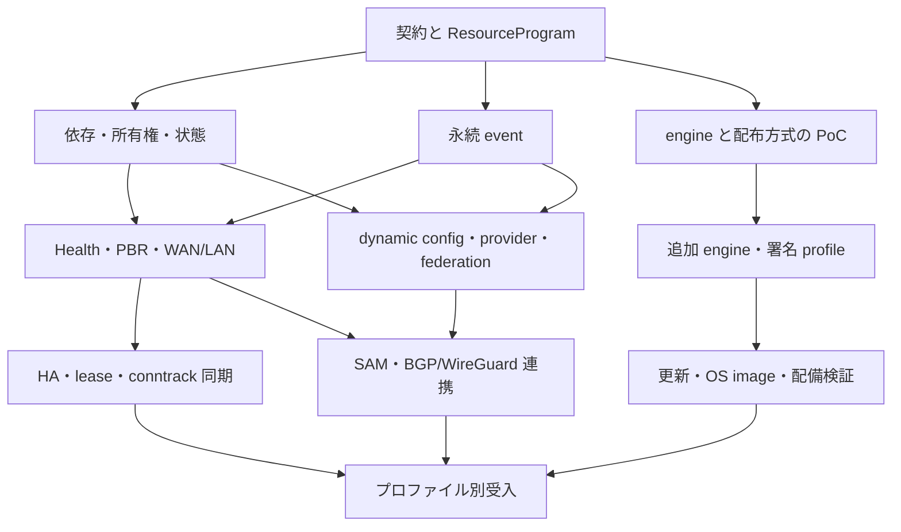

2026-10-30 JST local-redirect-native78: 宛先集合を製品内DNSで解決し、単一network writerへローカルDNS転送を接続。準備完了後の両IP/TCPUDP・集合変更・再起動・撤去は実通信で通過。初期端末を起動前からつなぐ単体受入とHA timeoutは残る。旧YAMLの取込件数を機能の未実装数にせず、現在の製品設定で全homertの通信・運用を成立させる。[結果と限界](pve-codex-handoff.md)。

2026-10-30 JST blackhole-native77: homertで使うIPv4破棄経路を旧routerdと照合し、単一network writerへ取り込んだ。実二端末のTCP/UDP破棄・対象外通信・再起動保持・具体経路・撤去復帰・管理外経路保持は終了0。関連Race/vet/両architecture build/署名六ELFは終了0。全設定取込は89件で拒否。HA timeoutと全homert/全34項目は未完了。

2026-10-30 JST dns-input-native76候補: DNS入力を状態報告待ちから分離した。18秒PDの実Alpineで署名更新準備・正常確定と、候補の設定取り込み後のHealth異常から旧版/旧設定への自動復旧・自動DNS/両IP通信が終了0。復旧253.49秒。sourceCIDRsは実daemonのTCP/UDP許可・拒否まで通過。全homert取込は91件で拒否。全make checkは終了0。併行中の二台再参加はVRRP適用要求timeoutで失敗し未解決。別診断版では130分/724巡と自然PD更新一回・全daemon再起動後の復帰が終了0。全34項目・期限達成は未完了。[現在の結果と残作業](pve-codex-handoff.md)。

# 現行 routerd と同等の製品にするための実装計画

作成日: 2026-10-24。更新日: 2026-10-30。開発中。全体ゴールは継続中。

ユーザー指定の完了期限: **2026-10-29 16:56:38 UTC**（2026-10-28 16:56:38 UTCから24時間）。
全34項目と実環境での利用可能性が完了条件。部分成功へ縮小せず、期限時点でも未成立は未成立と報告する。
旧routerdの実装を取り込み、独自のLAN配布エンジンを置換する。動く単体構成、二台運用、残る製品機能と
配備・更新・復旧を順に通し、実通信を妨げる不足を優先する。全面的な新規実装や試験基盤の拡張を先行させない。

過去のcheckpoint列挙を削除した。過去の試験・API・保存形式の維持を実装制約にしない。
[AGENTS.md](../AGENTS.md) に従い、機能と実通信を満たす簡潔な構造へ作り直す。
現在の変更・実行結果・残作業は [引き継ぎ](pve-codex-handoff.md) を参照する。
機能範囲と作業単位は以下とJSONの台帳で管理し、既存試験の成功を全体完了に数えない。
実端末からの単体通信を先に確認する全体の [試験計画](test-plan.md) を参照する。
各試験前に同計画のゴール実行手順と対象項目を必ず読み直し、失敗時も同じ手順で観測・切り分け・修正する。

旧routerdの作者による作り直しであり、実装全体を取り込んでよい。各機能を新規に書くことは要件ではない。
動作実績のある関数・package・外部engineと修正を先に再利用し、routerd2の所有権・寿命・設定との接続に
必要な変更を加える。旧実装の呼出経路と実設定を照合してから変更し、既存のrouterd2実装があることも
再利用を避ける理由にしない。必要な第三者のlicense・noticeは保持する。

現在はnative-56で旧routerdのDHCPv4描画・保持履歴と固定dnsmasqを取り込み、独自割当器と台帳を削除した。
`handoff-stop`では停止時の不要なpeer通信待ちを除き、同期断中の再起動でVRRP適用を止める実障害を修正した。
署名二台・ISC/AFTR・二WANで双方向切替、同じTCP/UDP、保持、元PD期限の失効と上流復旧を完走した。
TCP再接続なし、UDP損失0、最長応答待ち6.82秒。1秒広告の一構成で、全homert受入ではない。
実署名PID 1二台と独立端末で切替・更新・保持・停止中通知の保存・再取得、実HGWで自動取得とDNS利用、
IPv4/IPv6、PD交換と全体再起動後の通信が成立した。詳細と未受入は [引き継ぎ](pve-codex-handoff.md)。
同じnative-56で独立Headscale/公式Tailscaleとの署名PID 1試験と、実HGWの自動WAN/PD・LAN/DNS/DS-Liteに
Tailscaleを合わせた75秒通信・PD交換・全体再起動も通った。対向underlay固定・LAN発IPv6 NAT追加を
現行homertとの差分として記録する。19:44 UTC開始の7800秒試験は21:31:52 UTCのLAN DNS SERVFAILで失敗した。約577回の通信が通ったが、自然PD更新前に終了し、原因は未確定。
DNS/DoH/条件付き転送、stateless DHCPv6、RAとVRRPは既存Go workerを使う。dnsmasqはDNS無効のDHCPv4 engineであり、systemdを介さずworkerが所有する。外部依存削減の当初目標を達成したとは扱わず、VRRP等を一律外部化する方針にも変えていない。homert全体二台、Tailscaleの残機能、k8s/pve、Cloud SAM、
配備更新復旧と対象実機を含む全34項目のゴールは未完了。旧版の130分試験は自然PD更新を観測したが、
最終通常PD交換後の名前解決失敗で終了1。最新版の長時間安定性やONU直結の受入には数えない。

2026-10-27 `dhcp-request-clock` / native-31: 独立dnsmasqと実5.2秒遅延でDHCPv4の期限延長を
再現し、元のREQUEST時刻へ修正した。通常取得/再起動再取得/自然更新と、QEMUの実UTC補正・
元期限失効・worker/control交換後のTCP/UDPも通った。生ログ・capture・試験binaryは削除する。
直前の`ha-dhcp` / native-31ではDHCPv4貸出の相互TLS認証付きcheckpoint同期を追加した。
実PID1二台と独立端末で切替・更新・同期断復旧を確認し、PD同期とpartner-down継続は残る。
直前の`peer-receive` / native-30では、旧routerd/依存engineと比較し、IPv4リンクローカルの
conntrack同期/B4対向、正当なIPv6表記、残存ciaddr、独立RA/IA/AAAA情報の受理を修正した。
RAのDNS満杯処理は最短期限の除去へ閉じ、経路更新を維持する。既存の実worker・独立peer・
実packetで切替/既存TCP/UDP、PD/RA、DNSとBFD→BGP→FIBを確認した。全経路の監査や
HA-02/HA-03全体の完了ではなく、homertの残機能と相互接続を進めながら修正を継続する。

2026-10-29 履歴処理: 空のwrite transactionを除き、整理・圧縮・容量取得を既存tickで一工程ずつ実行する。
各処理の2秒期限と警報保持は維持した。512MiB/2 CPUの計測付き実APK/PID 1で設定保存・再起動後の
IPv4/IPv6 TCP/UDP・DNS・NTP・管理と、65.2秒/9巡の履歴進行・Health履歴破棄0を確認し終了0。
途中の設定healthy=false、設定変更中の履歴timeout、以前のworker起動10秒超過・DNS SERVFAILは未解消。
一時計測を削除し、原因を隠す期限延長はしない。成立範囲と次の観測は[引き継ぎ](pve-codex-handoff.md)に残す。

2026-10-29 native-60: 旧routerdのNTP client/server fragmentと選択規則を一つの時計所有者へ取り込んだ。
固定先・条件付き学習/代替先を独立群にし、元情報期限と条件期限をworkerがそれぞれ失効する。
実homertのNTP構造を公開値へ置換し、製品の取込・通常適用、独立peerとの期限・再取得・VRRP条件変化、
同じchronydとLAN時刻/IPv4/IPv6 TCP/UDP/captureを確認した。全homert受入とは分け、DHCPv4実学習と
監督情報の失効・起動遅延は未解消として[引き継ぎ](pve-codex-handoff.md)に残す。

## 実行順序

全34 work packageの範囲は維持し、次の順で実際の運用を完成させる。

1. **homert02/03**: 最新の実設定・条件で変わる稼働状態と旧routerdを読み、一台分の通信を完成させ、
   次に二台の切替・復旧を通す。WAN/LANのIPv4/IPv6、DS-Lite、実際の経路選択と代替回線、
   DHCP/PD/RA、学習DNSから上流の名前解決と端末配布、filter/NAT/MTU/MSS、BGP・管理経路を対象とする。
   HA-01の現行運用上の不足、HA-02のDHCP/PD同期、HA-03の接続状態同期、EXT-02のTailscaleを優先する。
   大項目の全機能を形式的な着手条件にしない。確認した実設定にないPPP方式追加は先行させない。
   通常更新・回線断/復帰・再起動・二台切替/復旧を実相手と端末で確認し、必要なaddress・PD・貸出・
   接続状態を引き継ぐ。既存TCP/UDPの継続と新規接続の復旧を分ける。配備・負荷・管理・更新復旧・
   戻し方を確認し、手動補修や残存設定へ依存しない。本番切替はこの順序指定では実行しない。
2. **k8s-rt / pve-rt**: homertの置換条件を満たした後、実設定・経路・接続先・冗長化・配備条件を
   調べて差分を実装する。順番は実際の依存関係で決める。名前からCNIや仮想化構成を推測しない。
3. **Cloud SAM**: `routerd-labs`の`docs/concepts/cloudedge-sam.md`、
   `docs/operations/cloud-sam-rearchitecture-goal.md`、`cloud-sam-representative-redundancy.md`、
   `cloud-sam-full-topology-minimal.md`（確認版`a0b1b3b`）と旧baselineとの差を読む。
   参加認証/取消と構成配布、RR/接続nodeのWireGuard/FOU・BGP、/32所有判断とローカル転送/計画移動、
   クラウド観測/操作・実通信/引継ぎ/復旧の順にCLOUD-01〜04を進める。入力を一度正規化し、
   所有判断を一度行い、型付き決定を適用する。状態表示や合成旧resourceへ戻さない。
   選択したIPv4 /32をオンプレミス・AWS・Azure・OCI間で移し、NATなしで送信元/宛先を保つ双方向通信を確認する。
   経路・所有者・実捕捉を一致させ、同優先度の奪い返し抑制、意図した優先度復帰、計画移動の順序、
   参加取消と分断/復旧を通す。突然のnode喪失時の新規復旧と既存TCP継続を分ける。
   新しい有料環境や本番操作の許可は推定しない。

直近はcontrol交換・永続再起動・影響するHealth→PBRを収束させ、homertの不足へ進む。
全機能の監査台帳や専用試験基盤を先に作らず、実際に必要な依存経路を小さく完成させる。

### homertの現状確認（2026-10-27、読み取り専用）

現行設定とControl APIを両nodeで確認した。homert02はmaster/activation Ready、homert03は
backup/Standby。いずれもpreempt=falseで、優先度は150/100。主系はPD取得中で、選択経路は
PDを使うDS-Liteの分散経路。待機系は代替経路を選んでいる。設定にPPPはない。
両系でTailscaleはRunning/online、conntrackdのserviceはactive。conntrackdはFTFW、外部cache有効、
起動時再同期、TCP window tracking無効、expectation同期有効という設定だった。
表示上Runningであることを、同期内容や既存TCP継続の確認とは扱わない。
主系のDHCPv4/PD同期はSyncedで15秒間隔。DHCPv6 serverはstatelessで、
PD由来DNSとdomain-searchを配り、待機系ではWhenFalseにより停止する。
この運用のためにstateful DHCPv6の全pool機能を先行条件へ追加しない。

次の実装は、既存VRRP admissionとwriterの責任範囲に沿ったHA-03の接続状態引継ぎと、
HA-02の貸出・PD identity/期限の引継ぎを対象とする。実績のあるconntrackdの実装・昇格経路と
native workerを比較し、外部cacheのkernel適用を終えてからVIP/転送を公開する。
同じTCP socketとUDP mappingで切替・復帰を確認し、新規接続の成功とは区別する。
DNS配布・管理経路を保った一台分の通信、二nodeのWAN/LAN identityとPD、実際の
standby時の停止条件も合わせて通す。routerd2による置換や本番切替はまだ行っていない。

## 1. 基準と到達点

**routerd と routerd2 は別製品である。** routerd は稼働中の機能参照元、routerd2 は未リリースの開発対象。
現在の routerd2 の二バイナリー構成・設定書式・内部API・保存形式には利用者がいないため、後方互換性を要求しない。
routerd2 の設定書式も新設計に合わせて変更できる。引き継ぐ routerd の機能範囲は維持する。
以下の旧 source / schema / API の一覧は routerd 側の棚卸しであり、routerd2 の既存利用者との互換要件ではない。

現行 routerd の Linux 上の機能・設定・運用契約を、PID 1 の `routerd` と役割別 worker に再構成する。
homert02/03 は WAN/LAN/HA の受け入れプロファイルとして使い、BGP/RR、SAM、クラウド間接続、
federation、管理・観測も製品の範囲に含める。

| 対象 | 固定した基準 |
| --- | --- |
| 移植元 routerd | [1329ef54f296507eda79bbbc3b853783dd27251e](https://github.com/imksoo/routerd/tree/1329ef54f296507eda79bbbc3b853783dd27251e) |
| routerd2 実装チェックポイント | [8dfbf615b01e9da57a06196b4069b9d8713f9ab5](https://github.com/imksoo/routerd2/tree/8dfbf615b01e9da57a06196b4069b9d8713f9ab5) |
| 実装チェックポイントの CI | [run 40060123092 / success](https://github.com/imksoo/routerd2/actions/runs/40060123092) |
| 既存の互換性台帳 | [parity.md](parity.md) / [parity.json](parity.json) |
| 作業単位・依存・全項目の対応表 | [implementation-plan.json](implementation-plan.json) |

計画開始時点で、チェックポイントの local HEAD と GitHub main は一致し、作業ツリーに未コミット差分はなかった。
この計画の commit は、上記の実装チェックポイントとは別である。CI の成功は現在の実装範囲の証拠であり、
旧 resource 全体の互換性や未作成の OS イメージの検証結果ではない。

既存の PID 1、supervisor、native network writer、DHCP/RA/DS-Lite、DNS、VRRP、BGP/BFD、
WireGuard、内蔵 SSH、設定 journal、署名付き userland 更新を引き続き利用する。
残作業の中心は、各 protocol engine を旧 resource の依存・状態・生成・所有権へ接続することである。
現在の実装範囲は [README](../README.md) と [architecture.md](architecture.md) を参照する。

### 「同等」を閉じる判定

各 field / default / validation / lifecycle / status / event / 失敗動作を、次のいずれかに分類する。

| 判定 | 意味 |
| --- | --- |
| `equivalent` | 固定した旧契約と同じ観測可能な動作を、比較ケースと実行証拠で確認した |
| `explicit_replacement` | 新しい製品方針による変更。入力単位の説明・移行方法・受入条件を明記した |
| `unsupported` | 代替を含めて提供しない。対応済み件数には入れない |
| `not_yet_implemented` | 計画はあるが、実装または受入が終わっていない |

`explicit_replacement` を strict semantic parity に算入しない。
任意の apt/dnf/pkg 操作や journald sink を capability / native logging に置き換える場合、
製品としての移行完了と旧動作の完全一致は別の結果として報告する。
明示変更が残る場合は「完全に同一の動作」とは表示しない。
既存 `parity.json` の `semantic_parity` は、この計画の作成では変更しない。

## 2. 中心となる設計

### ResourceProgram を既存 runtime の上に置く

計画開始時点の `config.Document` は、ネットワークの desired state と service 設定を保持していた。
旧 resource の条件・生成元・依存関係を、静的な YAML 変換だけで表現し続ける方式には限界がある。
[計画開始時の設定モデル](https://github.com/imksoo/routerd2/blob/8dfbf615b01e9da57a06196b4069b9d8713f9ab5/internal/config/config.go)
を内部の engine intent に分離し、元の宣言を保持する `ResourceProgram` と coordinator を段階的に追加する。
ResourceProgram の初期実装は上記 checkpoint を参照。

- **operator revision**: 人が commit した source program の版。
- **projection generation**: 同じ source から、DHCP・health・VRRP 等の観測に応じて作った実行計画の版。
- **worker generation / producer epoch**: 実際に動かす子プロセスと、その通知の有効範囲。

source、dynamic parts、compiled plan、確認付き commit の rollback を、一つの正本と transaction で管理する。
source YAML と生成済み runtime 設定を独立した二つの正本にしない。
未公開 routerd2 の native schema v1、journal record、boot schema は新形式へ直接置換する。
旧形式の reader / adapter / bridge は作らず、開発 fixture を新形式に更新する。
復旧・confirmed commit の性質は新 journal で検証する。
動的状態が変わるたびに operator の設定 revision を書き換えることも避ける。

`when` は true / false / indeterminate を扱い、未確定の観測を成功として使用しない。
owner、provenance、依存、期限、観測済み世代から reconcile し、既存の `runtimeplan` に
型付き intent を渡す。network worker は Netlink / nftables / kernel API によって適用し、
適用結果を再観測する。カーネル転送路は維持する。

旧 validator の一部は file/env の secret を読むため、純粋な設定検証と secret の解決を分離する。
planner は入力・観測 snapshot・時刻を明示的に受け取り、ホスト状態を隠れて参照しない。

### event・protocol fact・log は保持契約を分ける

| データ | 必要な性質 |
| --- | --- |
| durable event / outbox / cursor | 再起動後の再送、at-least-once、作用側の idempotency、追跡できる結果 |
| protocol fact / ownership lease | producer、boot、設定世代、鮮度と失効。古い Up の復活を防止 |
| log / telemetry | bounded queue、drop の可視化、遅い consumer の分離。必要に応じた永続化 |

旧 event consumer は作用成功後に cursor を保存し、新規 consumer は journal tip から開始する。
cursor 保存失敗で再配送されるため、「exactly once の bus」を前提にしない。
federation の `ExpiresAt == zero` は失効しない event の契約として扱い、
kernel を変更する権限の有限 lease と混同しない。
参照: [eventconsumer](https://github.com/imksoo/routerd/blob/1329ef54f296507eda79bbbc3b853783dd27251e/pkg/eventconsumer/consumer.go) /
[federation event](https://github.com/imksoo/routerd/blob/1329ef54f296507eda79bbbc3b853783dd27251e/pkg/federation/event.go)。

### PID 1 とモジュールの責務

小さな boot 層が boot config を読み、選択した展開済み runtime の `routerd` へ PID 1 を引き継ぐ方式を推奨する。
選択 runtime の `routerd` は supervision、reaping、shutdown/reboot を小さく保持する。
resource coordinator、network、protocol、管理、logging、cloud adapter は個別 worker とし、必要に応じて別 binary に分割する。
boot 側は network resource の意味を解釈せず、startup-config の参照を runtime へ渡す。
詳細は [ADR 0001](adr/0001-boot-runtime-startup-config.md) に記載する。
追加 engine の採用によって、systemd / journald / sshd を製品の必須条件へ戻さない。

現在のプロセス分離には equal-UID の信頼モデルがある。
UID/GID/capability の分離は、UDS の role 認可・peer credential・state 所有権と同じ変更で実装する。
network writer、時計調整、release 操作、reboot を別の権限にする。
コンテナから host の時計・watchdog・reboot を操作しない。
参照: [logging の現在の信頼モデル](https://github.com/imksoo/routerd2/blob/8dfbf615b01e9da57a06196b4069b9d8713f9ab5/internal/logging/README.md)。

## 3. 優先順位と並行作業

番号は受入マイルストーンであり、全作業を直列に並べる指示ではない。
正確な依存は JSON の `depends_on` と `depends_on_gates` で管理する。
前者は作業全体、後者は名前を付けた component gate のみを必要とする。
`related_work_packages` は横断する契約の参照であり、実行順の edge ではない。
早期 PoC、read-only API の骨格、provider simulator、運用画面の準備は、
必要な契約が決まった範囲で並行着手できる。

| 段階 | 主な作業 | 出口条件 |
| --- | --- | --- |
| M0 実装チェックポイント | 既存実装の保存 | routerd2 8dfbf615、local/remote一致・clean。既存実装CI全成功。今回の計画作成前に確認。 |
| M1 resource 実行基盤と早期risk gate | CORE-01, CORE-02, CORE-03, CORE-04, CORE-06 | source program→依存評価→既存worker→状態→reconcileが一本通る。journal rollbackとengine/profile ADRの選択基準を持つ。 |
| M2 単一ノードの WAN/LAN・経路切替 | SYS-01, SYS-02, NET-01, NET-02, NET-03, NET-04, NET-05, NET-06, OPS-01 | Health→PBR/FIB→実packet、DS-Lite+第二経路/PPPoE、MSS、PD/LAN/DNS、基本resource APIを受入する。 |
| M3 二台 HA と routing resource | NET-07, NET-08, HA-01, HA-02, HA-03 | VRRP readiness、DHCP/PD継続、既存TCP/UDP NAT session維持、BGP/BFD/WG resource契約を別々に合格させて統合する。 |
| M4 SAM・federation・cloud mobility | CORE-05, CLOUD-01, CLOUD-02, CLOUD-03, CLOUD-04 | RR/leaf複数nodeとproviderごとの実captureで、所有権移動、/32、NATなし通信、revoke/drain/復旧を確認する。 |
| M5 全運用surface と追加engine | SYS-03, OPS-02, OPS-03, EXT-01, EXT-02 | 旧API/CLI/Web/観測、選定engineの必要機能、権限分離をprofile別に受入する。 |
| M6 更新・OSイメージ・配備先 | DIST-01, DIST-02, DIST-03, DIST-04 | SSHからの安全な更新、state付きfallback、kernel/rootfs A/B、物理機/arm64/cloud/K8sを個別にqualificationする。 |
| M7 互換性台帳と製品受入の確定 | QUAL-01 | 未対応・明示変更を隠さず、承認した契約集合の全ケースと性能・移行・戻し手順を証跡付きで閉じる。 |

### 最初の実動作

**HealthCheck → EgressRoutePolicy → native FIB / nftables → 実パケットの経路切替**を最初の縦方向の実装にする。

1. 既存 Interface / address / route を resource coordinator から操作する。
2. 二つの経路を分離して probe し、片方を遮断するとその経路の health だけが失敗することを確認する。
3. priority / PBR の切替と回復を、source / mark / table と packet capture で確認する。
4. worker / control の再起動と確認付き rollback でも、経路と所有者が整合することを確認する。

これで WAN 切替に直結する機能を完成させながら、HA と SAM に共通する依存・状態・所有権を検証できる。
NET-02 が必要とする NET-03 / NET-05 の primitive は、この最小実装に必要な範囲から提供する。
各 work package 全体の完了を待って最小経路切替まで止める必要はない。

この図は契約の流れの概略であり、全 edge を表すものではない。
API / CLI / Web / 観測の実装は各 feature と並行し、最後に表面だけを接続する作業にしない。
NTP は cloud/TLS に必要な基盤として前半に置く。
PPPoE・IKE・Tailscale・nDPI の選定も CORE-06 で早期に着手する。

### 最初の五つの変更単位

以下は着手順の案であり、既に作成済みの PR や実装ではない。

| 順 | 担当 | 具体的な変更 |
| --- | --- | --- |
| 1 | CORE-01 | field/default/status/event fixturesと旧実行環境のmanifest。新native機能を作る前に互換判定を再現する。 |
| 2 | CORE-02 | ResourceProgramと新schema/journal transaction、confirmed rollback、startup-config選択を実装する。未公開native v1 adapterや旧record読取互換は作らず、既存fixtureを新形式に更新する。 |
| 3 | CORE-03 | 三値条件・依存・ownerの最小coordinator。既存Interface/address/routeでstart/update/remove/recoveryを通す。 CORE-04のprotocol fact/freshnessと再起動時失効の最小契約を並行して定義し、次のHealth workerへ渡す。 |
| 4 | NET-01 | Health workerとscoped Netlink route lookup。二つの独立pathのprobeを実packetで識別する。 |
| 5 | NET-02 | NET-03/05の必要なprimitiveを接続し、priority/PBRの障害→fallback→復旧を実daemonで通す。 |

CORE-04 の protocol fact / freshness 契約は Health worker の前に最小限を提供する。
durable federation 全体の完成を先行条件にはしない。
CORE-06 の engine PoC も最初の五つと並行する。
各変更に移行用 fixture と必要な実動作 gate を対応させる。
日付だけの見積りは置かず、最初の経路切替と engine PoC の結果から残量を再評価する。

### 依存を過剰に広げない境界

SYS-03 は runtime 権限 gate と appliance watchdog gate に分ける。
SSH 更新と Kubernetes は権限 gate を必要とし、実機 watchdog の検証完了は待たない。
DIST-02 も image / boot / state の共通契約と物理機別 qualification を分ける。
cloud image は前者と対象 provider の boot/update 方式を必要とし、別の mini-PC / arm64 機の受入は待たない。

CLOUD-03 は enrollment / revoke と生成 resource の component 契約を閉じる。
実 BGP/WireGuard との統合は CLOUD-04 が受け持ち、CLOUD-03 と CLOUD-04 の相互完了待ちを作らない。

## 4. 単一配布イメージと展開済み runtime

**配布イメージは一つ、runtime environment はそれを filesystem へ展開した複数バイナリーの束**とする。
二つの ELF という制約を設けず、native module も `routerd-modules/...` のような役割別 binary に分割できる。
manifest digest ごとの不変な directory を保持し、更新・選択・復旧は互換性を確認した runtime 全体で行う。
module、binary、process、instance は一対一に固定しない。小さな関連 module の multicall も選択肢に残す。

起動は **boot config → load runtime → load startup-config** とする。
image の検証・展開を行う stager、小さな boot selector、選択 runtime の supervisor/config coordinator を分ける。
boot config は runtime と startup-config の参照・fallback・起動 policy を持ち、resource 設定の解釈は runtime が行う。
通常 boot で archive を毎回展開せず、stage と次回対象を決める prepare も別操作にする。

startup-config は選択した config store/revision の永続設定として扱う。
新しい authoritative journal を正本とし、startup-config の明示的な選択変更をその transaction にする。
空storeへの初回seed、running/candidate、confirmed rollbackを新仕様として定義する。prototypeのrecord形式は維持しない。
boot の試行回数・結果は boot config の意図と別の状態として管理する。

この方針は利用者の指定として採用済みである。配置例、manifest、state、未リリース実装の置換方針は
[ADR 0001](adr/0001-boot-runtime-startup-config.md) を参照する。runtime 実装は今後の作業である。
必要な外部 engine も同じ signed runtime の構成物として、版・依存・権限を固定する。

「optional」は搭載する profile を選べるという意味である。
IPsec / Tailscale / native DPI を設定したのに engine がない状態を正常適用とはしない。
設定が要求する capability を事前検査し、全機能プロファイルで必要な旧契約を受け入れる。

| 機能 | 先行して評価する方式 | 選定で実証すること |
| --- | --- | --- |
| PPPoE | native PPP/PPPoE と固定 pppd 系 engine の比較 | 認証・session・IPv4/IPv6・再接続、shell hook の除去、address/route/DNS の所有権 |
| NTP | foreground chronyd と型付き status/control adapter | 継続した時刻調整、client/server、DHCP 系 source、drift/state、未同期時の方針 |
| IPsec/IKE | charon + private VICI | aggregate connection、rekey/DPD/NAT-T、secret、kernel SA/policy/route/VIP の責務 |
| Tailscale | embedded backend と固定 daemon + typed local API の比較 | identity、subnet/exit-node、route/DNS、relay、公開 SSH field、revoke |
| nDPI | 隔離した CGO worker と固定 library / dissector 集合 | 実 backend の load、実分類、容量・障害分離、選択 component の配布条件 |

chronyd は foreground 運用が可能であり、一回の時刻取得は継続した clock discipline と別の契約である。
VICI は charon の設定・制御・監視に使えるが、プロトコル自身に認証・暗号化の保護はないため、
private UDS と認可境界を必要とする。charon の kernel interface は SA / policy に加え route / VIP も操作する。
そのまま組み込んで「network worker だけが全 kernel object を変更する」とは表現できない。
broker 化、または範囲・所有権・衝突回避を定めた限定委譲を PoC の合格条件にする。
出典: [chronyd manual](https://chrony-project.org/doc/4.8/chronyd.html) /
[VICI](https://docs.strongswan.org/docs/latest/plugins/vici.html) /
[charon](https://docs.strongswan.org/docs/latest/daemons/charon.html)。

tsnet の組込み listener が動くことだけでは、旧 TailscaleNode の subnet router / exit-node / DNS /
Tailscale SSH の全契約を証明しない。routerd 自身の管理 SSH と Tailscale SSH を別に扱う。
出典: [tsnet API](https://tailscale.com/docs/reference/tsnet-server-api) /
[旧 Tailscale 実装](https://github.com/imksoo/routerd/tree/1329ef54f296507eda79bbbc3b853783dd27251e/pkg/tailscale)。

### 署名する範囲

現在の未リリース実装は `manifest.json`、`manifest.sig`、`routerd`、`routerd-modules` の四ファイル構成である。これは新形式へ置換する対象であり、互換維持の対象ではない。
追加 engine を APK で置くだけでは、その集合の互換性や atomic な切替は保証されない。
参照: [releases.md](releases.md)。

新しい可変 component 数の形式では、次を runtime manifest の対象とする。

- executable、依存する .so、plugin、必要 data、固定 entry point と architecture。
- kernel feature / module、IPC と設定・state schema の互換範囲。
- 各 artifact の digest、source version、build flags、capability、配布資料。
- userland の一組を選ぶ更新と、旧版でも安全に解釈できる state migration 方針。

config snapshot、identity/鍵、rotation/revocation、durable event/cursor、有限 lease/fact の戻し方を分ける。
旧 snapshot の復元で、失効済みの credential や古い所有権を復活させない。
安全に変換できない state では downgrade を事前に拒否する。

bootstrap、runtime manifest、role→artifact catalogを新形式に合わせて同時に構築する。
未公開二binary形式の互換reader、selectorの先行更新、v1 bridgeは作らない。
実行中の runtime root と全 binary/library/plugin/data の解決を固定し、restart/prune 中の版混在を防ぐ。
新形式の初回リリースを基準として、その後のboot/runtime ABI・stateの更新互換性を定義する。
userland の切替と kernel / rootfs / bootloader A/B は別段階で検証する。
whole-OS 更新では kernel / modules / rootfs / boot selector metadata も署名と書込前検証の対象にする。

### license の判断

旧インストーラは外部 engine の package 名を選ぶが、正確な版や build option を固定していない。
移植元の source SHA だけで全依存の license / 実行動作が固定したとは扱わない。
[旧 install.sh](https://github.com/imksoo/routerd/blob/1329ef54f296507eda79bbbc3b853783dd27251e/packaging/install.sh)
を参考に、選択する source・依存・plugin ごとに版と条件を記録する。

特に nDPI は 2026-08-23 に component 別の license 変更が告知されている。
現行 library 全体を無条件に一つの LGPL 表記で扱わず、採用版・dissector・利用モードの条件を確認する。
process 分離だけで license の結論を出さない。SBOM/notices と、採用条件で必要な対応 source・変更・build 資料を
release と対応づけて生成し、取得可能性まで確認する。kernel、engine、library/plugin、firmware は個別に棚卸しする。
出典: [ntop の告知](https://www.ntop.org/announcing-ndpi-dual-license-change/) /
[component terms](https://github.com/ntop/nDPI/blob/dev/README.license.md)。

## 5. 先に明文化する設計判断

D-02、D-08、D-09 の方向は利用者の指定として採用済みである。具体的な配置・ABI・起動実装は ADR と PoC で確定する。
それ以外は最初の実装・PoC で確定させる提案である。
OS 固有の旧契約を変える場合は入力単位の migration policy に結びつける。

| ID | 判断 | 状態 | 内容 |
| --- | --- | --- | --- |
| D-01 | OS固有契約と任意executable | proposed | Packageの任意apt/dnf/pkg、journald sink、任意Plugin/provider executable、OS shell依存機能は、署名付きcapabilityとrouterdの管理面へ明示的に置換する案。未対応を拒否するだけでは旧契約全体のparityにならない。各inputごとに移行policy・理由・代替・受入を記録する。 |
| D-02 | 単一配布イメージと展開済み多binary runtime | accepted_direction | 配布イメージは対象architecture/profileごとに一つとし、filesystemへ展開した複数binary/library/plugin/dataの束をruntime environmentにする。native moduleも独立binaryへ分割でき、二つのELFに固定しない。manifest digestでruntime全体を選択・固定・復旧し、個別componentの互換未確認な混在を許さない。 |
| D-03 | kernel書換権限 | proposed | network writerへのbrokerを優先する。engineが直接XFRM等を管理する必要がある場合は、object namespace/owner/reconcile/foreign-state保護を限定した委譲ADRを先に合格させる。一般route/firewallの二重writerを黙認しない。 |
| D-04 | 旧動作互換とnativeの改善 | proposed | BFD bootstrap/reset、health鮮度、IPv6 known-good rule、sticky、DNS finite ownership等は、legacy互換modeと明示replacementを分ける。現在のnative defaultsへ直接写して同等と数えない。 |
| D-05 | HAと移行方式 | proposed | RouterdClusterはfile/flock/TTLの旧契約を基準にする。新旧node混在によるrolling migrationか、検証済みsnapshotを伴うmaintenance切替かを決め、選択した方式を二台で受入する。 |
| D-06 | 基準機能と追加配備先 | proposed | baselineのIPv4 /32 SAMとAWS/Azure/Oracle Cloud executorをまず復元する。GCPの具体的adapter、Golden Images、K8s運用は個別にqualificationする。EVPN、独自CNI、FreeBSD portは今回のbaseline完了条件に追加しない。 |
| D-07 | engine版・license・配布資料 | proposed | OS package名だけでなく正確なsource/build flags/dependencies/enabled componentsを固定する。nDPIの現在のcomponent別条件を確認し、process分離をlicense上の結論として扱わない。 |
| D-08 | boot config → runtime → startup-config | accepted_direction | イメージの検証・展開、次回runtime選択、起動を分ける。小さなboot層はruntimeとstartup-configの参照を選び、選択runtimeが設定schemaを検証・適用する。設定journalとYAMLを独立した正本にせず、boot attemptの可変状態も設定意図と分離する。最初の実装方式はverified runtimeへのexecによるPID 1引継ぎを推奨する。 |
| D-09 | 未リリース routerd2 の形式互換は不要 | accepted_direction | routerdは稼働中の機能参照元、routerd2は未リリースの別製品。routerd2の二binary形式、manifest、boot schema、設定書式、journal、内部APIは破壊的に置換でき、互換reader・v1 bridge・prototype state移行は作らない。routerdから引き継ぐ機能の範囲は減らさず、routerd2の製品版間更新/復旧保証は初回リリースの新形式を基準に始める。 |

## 6. 互換性上の重要な差

機能名だけのチェックリストでは見落とすため、以下を独立した受入ケースとして保持する。

| 項目 | 基準実装の動作と実装計画への影響 |
| --- | --- |
| Health / Egress | advisory selection と priority/mark/hash の実適用を分ける。Failing でも閾値未到達なら healthy、鮮度は `max(2分, 3×interval+timeout)`。候補の probe が別 WAN へ迂回して成功しないことを検証する |
| route evidence | `ip -j route get` を typed Netlink query へ置換する。証跡取得の失敗を、成功した probe の失敗に変更しない |
| weighted-ecmp | 旧 advisory selector は reserved / not implemented を Pending として返す。既存の完了機能とは数えない |
| IPv6 / DS-Lite | IPv6 host-only rule を IPv4 DS-Lite から分離する。RA 未取得時の known-good 保持と native 有限寿命の差を明示する |
| IA_NA / RA | DHCPv6Address は IA_NA client を要する。旧 networkd 等が担った RA trigger、managed/required/observe-only、MTU/hop-limit、useDNS の効果を確定し、PD/information と UDP 546 / DUID / IAID の所有権を整理する |
| BFD | interface 省略の multihop は baseline に含まれる。旧 fast/省略=300 ms×3、normal=500 ms×3、slow=1,000 ms×5 と明示 override を維持する |
| BFD と BGP | 旧実装は BFD の初回 Up 前でも BGP を構成し、既知の Up→Down で hard reset する。現在の strict startup gating と同一ではない。互換 mode または明示変更を設ける |
| VRRP | graceful activation timeout は状態報告を変えるだけで、ReadyWhen 未成立の VIP を強制公開しない。選出と公開 readiness を分ける |
| RouterdCluster | 旧方式は LeasePath の file/flock/TTL。ネットワーク quorum / consensus が既存機能であるとは扱わない |
| NAT sync | event-stream と conntrackd を区別する。既存 TCP 継続には tuple だけでなく TCP state / timeout / NAT mapping 等を要する |
| DHCP / DNS | active chain と standalone renderer の差、global sticky 最大値・固定 12h 再生、動的 DNS の優先順位・owner・withdraw を fixture にする |
| BGP の容量 | 現在の selected paths 4,096 件という bound を暗黙の製品上限にしない。whole-generation publication、chunking、backpressure、超過時状態と容量試験を設ける |
| SAM | IPv4 unicast /32 mobility、FOU/WireGuard、capture、所有権、NAT なし通信が baseline。延期されている EVPN を移植必須へ追加しない |
| cloud provider | 具体的な AWS/Azure/Oracle Cloud executor と GCP の enum を区別する。GCP adapter は別の実装・qualification とする |
| native DPI | fallback の全 unknown は実 nDPI backend ではない。loaded 状態と既知の分類を証明する |
| HA 移行 | native 同士の sync と旧 SSH/conntrackd 方式との wire compatibility は別要求。混在 rolling か maintenance 切替かを決めたうえで検証する |

根拠となる主な旧 source:

- [pkg/egressroute/selection.go](https://github.com/imksoo/routerd/blob/1329ef54f296507eda79bbbc3b853783dd27251e/pkg/egressroute/selection.go) / [pkg/healthcheck/route_lookup_linux.go](https://github.com/imksoo/routerd/blob/1329ef54f296507eda79bbbc3b853783dd27251e/pkg/healthcheck/route_lookup_linux.go) / [pkg/controller/chain/policyroute.go](https://github.com/imksoo/routerd/blob/1329ef54f296507eda79bbbc3b853783dd27251e/pkg/controller/chain/policyroute.go).

- [pkg/render/netplan.go](https://github.com/imksoo/routerd/blob/1329ef54f296507eda79bbbc3b853783dd27251e/pkg/render/netplan.go) / [pkg/apply/engine.go](https://github.com/imksoo/routerd/blob/1329ef54f296507eda79bbbc3b853783dd27251e/pkg/apply/engine.go) / [pkg/hostdeps/hostdeps.go](https://github.com/imksoo/routerd/blob/1329ef54f296507eda79bbbc3b853783dd27251e/pkg/hostdeps/hostdeps.go).

- [pkg/controller/bfd](https://github.com/imksoo/routerd/tree/1329ef54f296507eda79bbbc3b853783dd27251e/pkg/controller/bfd) / [pkg/controller/vrrp](https://github.com/imksoo/routerd/tree/1329ef54f296507eda79bbbc3b853783dd27251e/pkg/controller/vrrp) / [pkg/ha](https://github.com/imksoo/routerd/tree/1329ef54f296507eda79bbbc3b853783dd27251e/pkg/ha).

- [pkg/controller/chain/nat44sessionsync.go](https://github.com/imksoo/routerd/blob/1329ef54f296507eda79bbbc3b853783dd27251e/pkg/controller/chain/nat44sessionsync.go) / [pkg/controller/chain/dhcp_profile_leases.go](https://github.com/imksoo/routerd/blob/1329ef54f296507eda79bbbc3b853783dd27251e/pkg/controller/chain/dhcp_profile_leases.go).

- [pkg/controller/mobility/pool_plan.go](https://github.com/imksoo/routerd/blob/1329ef54f296507eda79bbbc3b853783dd27251e/pkg/controller/mobility/pool_plan.go) / [pkg/controller/mobility/reconcile_effects.go](https://github.com/imksoo/routerd/blob/1329ef54f296507eda79bbbc3b853783dd27251e/pkg/controller/mobility/reconcile_effects.go) / [pkg/sam/sam.go](https://github.com/imksoo/routerd/blob/1329ef54f296507eda79bbbc3b853783dd27251e/pkg/sam/sam.go) / [pkg/hybrid/hybrid.go](https://github.com/imksoo/routerd/blob/1329ef54f296507eda79bbbc3b853783dd27251e/pkg/hybrid/hybrid.go).

- [docs/adr/0012-bgp-address-mobility.md](https://github.com/imksoo/routerd/blob/1329ef54f296507eda79bbbc3b853783dd27251e/docs/adr/0012-bgp-address-mobility.md) / [pkg/providercontract](https://github.com/imksoo/routerd/tree/1329ef54f296507eda79bbbc3b853783dd27251e/pkg/providercontract) / [cmd/routerd-ndpi-agent](https://github.com/imksoo/routerd/tree/1329ef54f296507eda79bbbc3b853783dd27251e/cmd/routerd-ndpi-agent).

SAM は `PoolRuntimeSnapshot → ReconcilePool → PoolPlan` と effect 適用の境界、
`PlanLocalCaptureIntents`、owner refs を持つ HybridRoute lowering を再利用する。
旧 Runner や shell command 文字列の互換実行層を作るのではなく、決定ロジックと副作用を分離して
native writer / provider adapter に接続する。

## 7. 作業一覧と依存・受入条件

34 作業単位を以下に定義する。すべて `planned` である。
予定 package は設計上の配置案であり、既に存在する実装とは限らない。
`depends_on` は作業全体の受入に必要な契約を表し、`depends_on_gates` は部分成果物への依存を表す。
早期 PoC や最小実装を直ちに禁止するものではない。
各項目の主担当は track と module で割り当て、未定の個人名や実施済み日付は記載しない。

### M1 — resource 実行基盤と早期risk gate

#### CORE-01 — 基準環境と field 単位の互換契約

範囲: 共通基盤 / track: resource / risk: medium。
前提: なし。

**成果物**

- 既存の87 public kind／94 decoder kindの台帳を、default・validation・lifecycle・status・event・失敗時動作のcaseへ展開する。
- 旧コードのactive controllerと実際のOSエンジンを参照環境で固定する。旧install.shはengine版を固定していないため、source SHAだけを動作基準としない。
- 判定を equivalent／explicit_replacement／unsupported／not_yet_implemented に分け、意味変更のdecision IDと試験証跡を持つ。

**受入条件**

- 同じ入力・観測時系列に対する旧実装と新plannerの比較が再現できる。
- 既知のrenderer/controller差と削除済み18 kindの拒否をfixture化する。任意の未知入力を成功扱いで省略しない。
- API／CLI／controllerの全台帳に担当と受入caseがあり、追加upstream差分を固定基準と分けて扱える。

再利用・比較元: [pkg/api](https://github.com/imksoo/routerd/tree/1329ef54f296507eda79bbbc3b853783dd27251e/pkg/api), [pkg/config](https://github.com/imksoo/routerd/tree/1329ef54f296507eda79bbbc3b853783dd27251e/pkg/config), [pkg/controller/chain](https://github.com/imksoo/routerd/tree/1329ef54f296507eda79bbbc3b853783dd27251e/pkg/controller/chain), [packaging/install.sh](https://github.com/imksoo/routerd/blob/1329ef54f296507eda79bbbc3b853783dd27251e/packaging/install.sh)。

実装先の案: `docs/parity.json`, `internal/legacyconfig`, `internal/compatibility (新設予定)`。

#### CORE-02 — ResourceProgram と単一の設定 transaction

範囲: 共通基盤 / track: resource / risk: high。
前提: CORE-01。 設計判断: D-08, D-09。

**成果物**

- 元resource、identity、owner、provenanceを保持するResourceProgramと実行planを導入する。未公開のnative schema v1やDocument表現に互換制約を置かず、新しい入力・保存形式へ置換する。
- operator revision、derived projection generation、worker generationを区別し、sourceと実行planを一つの正本・transactionで管理する。
- 新しいjournalのtransaction、失敗時復旧、confirmed commitのrollbackにsource graphとworker構成を含める。secret解決をpure validationから分離する。prototype永続recordの読取互換は不要。
- boot entryが選ぶstartup-config store/revisionとrunning/candidateを区別する。startupの選択・保存を一つのauthoritative journalのtransactionとして定義し、初回seedは空storeだけに取り込む新仕様とする。

**受入条件**

- 新ResourceProgram/schema/journalで設定の適用・永続化・再起動を確認する。機能を検証する既存fixtureは新形式へ更新し、未公開native v1のbyte互換を要求しない。
- crash／重複request／同時更新／確認期限切れでsourceと実行planが別世代にならない。
- 初回リリース以降の対応済み製品版へ戻す場合に必要なconfig snapshotとschema互換方針を定義する。planner単体はhost file/env/networkを読まない。
- bootで選択したstartup revisionを正しく採用し、通常bootでseedが保存済み設定を上書きしない。runtime/configの実際の組合せをhealth witnessへ渡す。

再利用・比較元: [pkg/api](https://github.com/imksoo/routerd/tree/1329ef54f296507eda79bbbc3b853783dd27251e/pkg/api), [pkg/resource](https://github.com/imksoo/routerd/tree/1329ef54f296507eda79bbbc3b853783dd27251e/pkg/resource), [pkg/config/cluster_secret_validate.go](https://github.com/imksoo/routerd/blob/1329ef54f296507eda79bbbc3b853783dd27251e/pkg/config/cluster_secret_validate.go)。

実装先の案: `internal/resourceprogram (新設予定)`, `internal/config`, `internal/control`, `internal/runtimeplan`。

#### CORE-03 — 依存・条件・resource lifecycle の coordinator

観測受理とBGP/VRRPの実適用待ちを分離し、config適用・定期更新・worker起動停止待ちの
kernel書込みをcoordinatorへ集約した。I/O中も観測を受け取り、古い結果で新しい通知を
完了扱いにしない。VRRP grantも廃止し、準備条件とVIP適用結果を同じ要求で扱う。
通常更新・起動停止待ち・設定切替も同じ処理へ揃え、installedの重複保持を廃止した。
BGP経路の元の期限は、ACK済みBFD受信期限と再帰next-hopのaddress・route・link期限との
短い方をnetwork workerへ渡し、controlと独立して撤去する。
期限更新だけではkernel経路を置換せず、routing tableの観測も操作ごとに共有する。
物理interface上の条件付きaddress／routeにも元の条件・依存期限を渡し、writer再起動後も
独立して失効させる。controlとwriterのlifetime投影を共有し、ReadyはACK済み期限を確認する。
失効時のprotocol通知JSON書換えを廃止し、元の観測を消費側で評価する。
BGP・DHCPv4の重複した受信期限を削除し、BGP状態表示も元のBOOTTIME期限を使う。
BFD→BGPもpacketとproducer観測の元期限へ揃え、HTTP受信leaseと失敗counterを削除した。
350msのcontrol停止で健全なBGPが切れる問題を実通信で再現し、同じTCP sessionと経路の維持を確認した。
元の期限が切れた後の復旧では、撤去ACKと新しい受信を引き続き要求する。
DHCP serverは設定切替後も元通知を保持し、期限切れのactive条件とDNS出力を除外する。
DHCP server観測も受理時に型付きで保持し、元BOOTTIME期限をDNSのA/PTR応答まで渡す。
control／DNSの受信側期限表と内部JSON複製を削除した。個別clientの割当・保存のUTC依存と、
他protocolの型付き保持は未完了。
worker設定・canonical bytes・digestを、生成予定のRAも含めてsourceごとに一度準備する。
通常投影は起動対象を選び、設定の再生成・JSON化・hashを行わない。BGP/VRRPの型付き設定と
RA固定templateも共有し、RAのprefix・期限・DNSはlive入力に分ける。
network intentのprotocol投影もJSON往復を除き、変更する集合だけを複製する。
期限切れ・学習情報撤去でもsourceと既存の投影を変更しない。writer内部のsnapshot複製は未整理。
現在の検証範囲と残作業は
[引き継ぎ](pve-codex-handoff.md) を参照する。CORE-03全体の完了とはしない。

範囲: 共通基盤 / track: resource / risk: high。
前提: CORE-02。

**成果物**

- when／dependsOn／ready_when／status reference、for/maxAge、true/false/indeterminate、循環検出を実装する。
- resourceごとのstart/update/stop/delete、owner GC、対象を絞ったreconcile、再起動時の再評価を扱う。
- 既存runtimeplanへ型付きintentを渡す。未解決resourceを静的Documentへ無理に変換せず、待機理由を状態に残す。

**受入条件**

- 不明なVRRP roleでBACKUPがDHCP/PD sessionを開始しない。条件除外後の参照整理も旧契約と一致する。
- dependency loss／source cutover／再起動／遅延した旧通知でforeign stateを消さず、新しい所有者を取り消さない。
- 中断された適用を再観測して復旧し、kernel未反映をReadyとして返さない。rollback失敗はdegradedで残す。

再利用・比較元: [pkg/resourcequery/when.go](https://github.com/imksoo/routerd/blob/1329ef54f296507eda79bbbc3b853783dd27251e/pkg/resourcequery/when.go), [pkg/api/provides.go](https://github.com/imksoo/routerd/blob/1329ef54f296507eda79bbbc3b853783dd27251e/pkg/api/provides.go), [pkg/lifecycle](https://github.com/imksoo/routerd/tree/1329ef54f296507eda79bbbc3b853783dd27251e/pkg/lifecycle), [pkg/resource](https://github.com/imksoo/routerd/tree/1329ef54f296507eda79bbbc3b853783dd27251e/pkg/resource)。

実装先の案: `internal/resourceprogram (新設予定)`, `internal/runtimeplan`, `internal/supervisor`。

#### CORE-04 — durable event と有限 protocol fact の契約

範囲: 共通基盤 / track: resource / risk: high。
前提: CORE-02。

**成果物**

- EventRule／DerivedEvent、durable journal、consumer cursor、outbox、再送・dedup・期限を移植する。
- durable event、freshnessを持つprotocol fact、欠落を許容するlogを別のchannelと保持契約にする。
- boot ID／単調時計／config digest／generation／producer epochを共有するが、古いUp状態を再起動後に復活させない。

**受入条件**

- 旧consumerのat-least-onceと「新規consumerはjournal tipから開始」を保つ。作用成功後のcursor保存失敗でも作用側で重複を抑止できる。
- 重複／順序逆転／peer再起動／disk full／cursor rollbackを検証する。
- federationのExpiresAt=zeroと、side effect権限の有限なleaseを混同しない。ログworker停止でdurable eventを失わない。

再利用・比較元: [pkg/eventconsumer](https://github.com/imksoo/routerd/tree/1329ef54f296507eda79bbbc3b853783dd27251e/pkg/eventconsumer), [pkg/eventrule](https://github.com/imksoo/routerd/tree/1329ef54f296507eda79bbbc3b853783dd27251e/pkg/eventrule), [pkg/derived](https://github.com/imksoo/routerd/tree/1329ef54f296507eda79bbbc3b853783dd27251e/pkg/derived), [pkg/bus](https://github.com/imksoo/routerd/tree/1329ef54f296507eda79bbbc3b853783dd27251e/pkg/bus), [pkg/federation/event.go](https://github.com/imksoo/routerd/blob/1329ef54f296507eda79bbbc3b853783dd27251e/pkg/federation/event.go)。

実装先の案: `internal/events (新設予定)`, `internal/serviceconfig`, `internal/runtimeplan`。

#### CORE-06 — 展開済み runtime・module catalog・boot ABI・engine 選定

範囲: 共通基盤 / track: platform / risk: high。
前提: CORE-01。 設計判断: D-02, D-03, D-07, D-08, D-09。

完了範囲: 共通manifest/authority/IPC、boot/runtime ABI、startup参照とverified role catalogの契約・最小実証をここで閉じる。全moduleのbinary分割や全boot媒体の更新は待たず、実runtime展開/起動はDIST-01/02、各engineはSYS-02/NET-04/EXT-01/EXT-02/OPS-03で個別に受入する。

**成果物**

- 単一配布イメージから展開する可変個数のnative/engine artifact集合、role→component、固定entry point、boot/runtime ABI、IPC/state schemaと権限をADRで定義する。binary数は固定せず、versioned runtime rootの全構成物をmanifest digestで選択する。
- PPPoE／NTP／IKE／Tailscale／nDPIの選定PoCを各担当と開始する。版・build flags・plugin・依存.so/data・licenseを固定する。
- 可変component数の新manifest/展開形式とverified runtime catalogへ一本化する。未公開の二ELF・四ファイル形式は置換し、互換readerや移行bridgeを作らない。APK追加だけでupdate整合性を成立させない。
- manifestに必要kernel feature/module/ABIの対応範囲を記載する。exact source/build/component inventory、SBOM/noticesと採用条件で必要なsource/build資料をreleaseへ対応づけ、取得可能性を検証する。
- boot config、image stager、startup-config参照、boot stateを別契約にする。runtime選択と設定revisionを同じ起動transactionで識別し、filesystemへ展開したrootを固定してworkerを起動する。

**受入条件**

- 新形式で三つ以上の独立native executableを持つruntime catalogの検証・起動契約を試験する。旧二binary形式の受入を要求せず、全機能のbinary分割完了もこの共通gateの前提にしない。
- profile validatorが欠落library/plugin、architecture/IPC/schema/kernel feature不一致、改竄をapply前に拒否することをfixtureで確認する。実engine artifactごとの受入は各engine担当作業で行う。
- engineのkernel書換範囲を申告する契約と、broker化または限定委譲の判定基準を確定する。実engineごとの決定・検証は個別作業の前提とし、未解決engineをcapabilityとして広告しない。
- roleごとのrestartで他runtimeへ解決先が変わらない。dynamic profileはloader/library/plugin/dataもbundleに固定し、host依存の解決を拒否する。実bootでの選択・fallback受入はDIST-01/02へ接続する。

再利用・比較元: [packaging/install.sh](https://github.com/imksoo/routerd/blob/1329ef54f296507eda79bbbc3b853783dd27251e/packaging/install.sh), [pkg/hostdeps](https://github.com/imksoo/routerd/tree/1329ef54f296507eda79bbbc3b853783dd27251e/pkg/hostdeps), [pkg/manageddaemon](https://github.com/imksoo/routerd/tree/1329ef54f296507eda79bbbc3b853783dd27251e/pkg/manageddaemon)。

実装先の案: `internal/release`, `internal/supervisor`, `internal/runtimeconfig`, `packaging/alpine`, `docs/adr`, `internal/releaseboot`, `cmd/routerd-boot (新設予定)`。

### M2 — 単一ノードの WAN/LAN・経路切替

#### SYS-01 — system resource と capability 要求

範囲: 旧 routerd 互換 / track: platform / risk: medium。
前提: CORE-03, CORE-06。 設計判断: D-01。

**成果物**

- Sysctl／SysctlProfileのexact/atLeast/optional、Hostname、Inventoryをnative effectとtyped observationで実装する。
- general sysctlとforwarding/RAなど専用moduleの要求を衝突検出し、設定journalから再起動時に再適用する。
- Packageの既知依存をversioned capabilityへ対応させ、任意apt/dnf/pkg要求との差を明示する。内部service-unit/kernel-module jobsもsupervisor/bootstrapへ移す。

**受入条件**

- 設定・更新・削除・rebootで各resourceのstatusと値が旧契約に一致する。
- 管理外sysctl/link/packageを黙示採用しない。必要capability不在はmutation前に診断する。
- container/hostモードでappliance専用mount/module loadを行わない。

再利用・比較元: [pkg/sysctlprofile](https://github.com/imksoo/routerd/tree/1329ef54f296507eda79bbbc3b853783dd27251e/pkg/sysctlprofile), [pkg/controller/chain/sysctl.go](https://github.com/imksoo/routerd/blob/1329ef54f296507eda79bbbc3b853783dd27251e/pkg/controller/chain/sysctl.go), [pkg/controller/chain/package.go](https://github.com/imksoo/routerd/blob/1329ef54f296507eda79bbbc3b853783dd27251e/pkg/controller/chain/package.go), [pkg/inventory](https://github.com/imksoo/routerd/tree/1329ef54f296507eda79bbbc3b853783dd27251e/pkg/inventory)。

実装先の案: `internal/system (新設予定)`, `internal/network`, `internal/boot`, `internal/kmod`, `internal/legacyconfig`。

#### SYS-02 — NTP client/server と時刻品質

範囲: 旧 routerd 互換 / track: platform / risk: high。
前提: CORE-03, CORE-06。 設計判断: D-02, D-07。

**成果物**

- 継続したclock disciplineを提供するengineを選定・監視し、static/auto/DHCP/DHCPv6 sourceとserverのlisten/allow/source referenceを扱う。
- 起動時未同期、source切替、slew/step、drift保存、server access、状態照会をtyped APIへ接続する。
- 内部deadlineをboot/monotonic時計で保ち、TLS等の時刻依存処理には未同期方針を持つ。containerにはhost時計の調整権限を与えない。

**受入条件**

- 独立NTP peerとのclient/server、source変更、network断、clock step、rebootを確認する。
- 時刻の進み／巻戻りでlease・BFD・confirmed commitの所有権が不当に延長されない。
- 固定serverへの一回のSNTP取得だけで合格にしない。採用engineの稼働・discipline・公開statusを確認する。

再利用・比較元: [pkg/controller/chain/ntp.go](https://github.com/imksoo/routerd/blob/1329ef54f296507eda79bbbc3b853783dd27251e/pkg/controller/chain/ntp.go), [pkg/render/timesyncd.go](https://github.com/imksoo/routerd/blob/1329ef54f296507eda79bbbc3b853783dd27251e/pkg/render/timesyncd.go), [pkg/api/specs.go](https://github.com/imksoo/routerd/blob/1329ef54f296507eda79bbbc3b853783dd27251e/pkg/api/specs.go)。

部分実装: `time-sources` / native-59。固定chronyd 4.8をPID 1配下のworkerが所有し、private command socketと型付きtrackingを使う。
旧`resolveServers`の学習先優先/固定代替先選択を接続し、情報元のBOOTTIME期限でsourceだけを再読込する。
`make check-ntp-dhcp6`は独立ISC/chronyd/keepalivedと実LANで終了0。学習IPv6先・元期限・代替IPv4先・再取得、
VRRP主系条件でのclient停止/復帰、control/supervisor停止中の元期限とLAN応答を同一chronyd PIDで確認した。
`ntp-quality-native59`の実APK/Alpine/PID 1では、仮想RTCの約1200秒補正、初回品質の64.72秒での収束、
独立LAN時刻取得、ext4のdrift読込・再起動後の再補正とLAN応答・IPv4/IPv6/DNS/管理復旧まで終了0。
固定5engineとsourceを配布へ接続した。DHCPv4学習、旧resourceの静的/条件付き同期先併存、IPv6 LAN access、
無限lease、未同期時のTLS方針、slew/network断と全homert受入は未完了。SYS-02を完了にはしない。

実装先: `internal/protocol/ntp`, `internal/serviceconfig`, `internal/runtimeplan`, `packaging/alpine`。

#### NET-01 — HealthCheck の native worker と経路証跡

範囲: 旧 routerd 互換 / track: network / risk: high。
前提: CORE-03, CORE-04。

**成果物**

- ICMP/TCP/DNS/HTTP probe、targetSource、source/interface/mark、threshold/history/statusを再利用する。
- ip -j route getをnetwork workerのscoped Netlink lookupへ置換する。経路証跡取得は旧のbest-effort契約を保つ。
- 別WANへ迂回して成功する誤判定を防ぎ、取得元・設定世代・freshnessをstatusへ含める。

**受入条件**

- 独立peerとpacket captureでprobeの送信interface/source/markが対象候補に対応する。
- Healthy/Failing/Unhealthyのthreshold境界、回復、停止、古いresultの再送を比較する。
- 経路証跡だけの失敗をprobe失敗へ変えず、停止したproducerを現行のHealthyとして使い続けない。

再利用・比較元: [pkg/healthcheck](https://github.com/imksoo/routerd/tree/1329ef54f296507eda79bbbc3b853783dd27251e/pkg/healthcheck), [cmd/routerd-healthcheck](https://github.com/imksoo/routerd/tree/1329ef54f296507eda79bbbc3b853783dd27251e/cmd/routerd-healthcheck)。

2026-10-28追加: `health-import` / native-43は旧固定targetのHealthCheckを既存native workerへ変換する。
旧engine・thresholdと省略時の30秒/3秒を保持し、未指定のinterfaceは明示移行policyで選ぶ。
製品CLIの変換結果を使う`make check-health-pbr RELEASE_ID=health-import`で、実daemon・二WAN・
独立端末・captureによるTCP/UDP切替/復旧、worker/control/network交換、古い通知・元期限撤去・
confirmed rollbackが通った。旧条件付き起動・動的target・EgressRoutePolicy importは残る。

実装先の案: `internal/protocol/health (新設予定)`, `internal/serviceconfig`, `internal/runtimeplan`, `internal/network`。

#### NET-02 — EgressRoutePolicy・PBR・経路選択

範囲: 旧 routerd 互換 / track: network / risk: high。
前提: CORE-03, NET-01, NET-03, NET-05。 設計判断: D-04。

**成果物**

- advisory selectionとpriority/mark/hashの実適用を別planにし、候補のpriority/weight、条件、health、hysteresis、gateway/deviceを保持する。
- nft mark/connmark、rule/table、hash selection、probe用経路、hostTraffic、IPv6 source ruleをowner付きintentへ落とす。
- IPv6 source未取得時のknown-good rule保持とnative有限寿命の差を明示し、IPv4 DS-Liteの正常経路を巻き戻さない。

**受入条件**

- 実TCP/UDPがtraffic classごとのWANへ流れ、障害→fallback→回復で選択・status・実経路が一致する。
- Failing閾値とmax(2分,3×interval+timeout)の旧鮮度判定をfixture化する。
- advisoryはFIBを書かず、reserved weighted-ecmpを既存の実装済み機能として扱わない。foreign rule/tableを保持する。

再利用・比較元: [pkg/egressroute/selection.go](https://github.com/imksoo/routerd/blob/1329ef54f296507eda79bbbc3b853783dd27251e/pkg/egressroute/selection.go), [pkg/controller/chain/policyroute.go](https://github.com/imksoo/routerd/blob/1329ef54f296507eda79bbbc3b853783dd27251e/pkg/controller/chain/policyroute.go), [pkg/api/cluster_routes.go](https://github.com/imksoo/routerd/blob/1329ef54f296507eda79bbbc3b853783dd27251e/pkg/api/cluster_routes.go)。

実装先の案: `internal/policy/egress (新設予定)`, `internal/network`, `internal/runtimeplan`, `internal/legacyconfig`。

2026-10-28 `egress-route` / native-46: 旧 advisory 選択と実 policyroute 適用を読み、
条件が真の最高 preference 候補を、同順位の kernel ECMP として一つの route owner へ投影する。
別 worker/選択状態を作らず、既存 next-hop weight・fact/hold・writer の元期限を使う。
PVE Linux6.8/amd64 の実 worker・独立二 WAN/LAN・capture で、重み1:2、新規 TCP/UDP の両経路、
障害除外・復旧、上位候補、confirmed rollback、control/Health 停止中の writer 交換と元期限撤去が成功した。
既存 Health→PBR 全経路、make check、両 architecture build/署名検査も成功した。
最新 native-46 は実 HGW の30秒・両 family HTTPS/DNS・DUID を保つ crash/Rebind・撤去を通した。
native-43 の7800秒は758回の通信と再起動前の自然 Renew/Reply 一組まで完走した。両実行版を区別する。
IPv6 動的選択、source-only hash、mark/connmark、旧 EgressRoutePolicy 全体、homert 統合と実 NIC は残る。

2026-10-28 `source-hash` / native-47・network journal12: namespace 全体の IPv4 ECMP を送信元だけで
振り分ける明示設定を、既存 writer/setting owner へ接続した。mask→policy の有効化と、
元 policy→元 mask の解除、journal 復旧は既存の書込み所有を使う。
実二 WAN・三宛先で TCP/UDP の送信元別経路固定、両系利用、障害/復旧、kernel 元値復元・
confirmed rollback 再適用と writer 交換・元期限撤去が成功した。capture4096 frameの上限は維持する。
make check/Race/vet、両 architecture build と最終六 ELF の署名検査も成功した。
policy ごとの mark/hash、IPv6 動的選択、homert 全体と対象 NIC は残る。

#### NET-03 — Firewall・ingress・MTU/MSS・fragment policy

2026-10-27追加: 稼働中の下位MTU変更でDS-Liteが1460のまま残り、大TCPだけが停止する問題を
独立AFTRで再現した。writerの適用順を所属設定→下位MTU→owned IPv4-in-IPv6 MTU→address/UP→firewallとし、
linkの所有権でtunnel MTUを管理し、下位1280/tunnel1240とrollback1460を適用する。
作成したtunnelにMTUの復元記録を重ねず、下位interfaceの設定は既存journalで復元する。
実daemonで同じtunnel index/AFTR workerを維持し、IPv4/IPv6の1MiB TCP双方向・IPv4 UDP1450、
IPv6 UDPのPacket Too Big/1280と続くUDP1200が通った。Alpine実kernelも下位1280/tunnel1240の
再適用・TCP/UDPを通した。compiler contractはnative-23、network journalは9。旧試作形式readerは追加しない。
route固有PMTUと他encapsulationへの導出・bridge/VRF・実NICなど全受入は未完了。

2026-10-27追加: 明示したforward pairとaccept ACLのpairからMSSを自動生成し、writerの
実link設定後のkernel MTUで両方向の上限を決める。DF解除は明示選択を維持し、閾値の省略時は
実egress MTUを使う。導出結果をintentやjournalへ書き戻さない。製品MTU1454に対して
独立ACがMRU1400を交渉し、設定にIPv4 MSS/DF閾値を記載せずにMSS1360とfragmentを確認した。
DSL1460とともに大TCP/UDP、障害切替・復旧を通した。Alpine実kernelの1454→1400変更後も
再適用が通った。compiler contractはnative-22。route PMTU、bridge、VRF/iifと実NICの受入は残る。

2026-10-27: native `firewall.ipv4_clear_df`で入力・FIB出力・閾値を明示し、DNAT後・
forward MTU判定前にDFだけを解除する。独立PPP/AFTRで1450-byte UDP payloadを往復し、
PPP1452+46／DS-Lite1460+38-byteのkernel fragmentと元のID/offsetをcaptureで確認した。
source policyのDSLよりmark41のPPPを優先するDF packet、AFTR再起動後のUDPも通った。
Alpine linux-virt 6.18.58-r0の実kernelでも1450-byte UDP/NATを確認し、
製品imageのmodule rootへ`nft_fib_inet`を追加した。
VRF/iif経路、動的導出、IPv6 PTB/QUICなど全体受入は残る。固定routerdはPathMTUPolicyを
廃止しており、必要なのは実在するinterface/tunnel宣言からの導出であって旧kind readerではない。

2026-10-26: 旧`writeTCPMSSClampTable`のSYN/SYN-ACK・小MSS維持をnativeの
`firewall.mss_clamp`へ移した。明示MTUと一方向のinterface pairを既存owned nft batchで管理する。
独立RP-PPPoE/Linux AFTRの先のMTU-1500端末と通信し、ICMP MTU通知の遮断時に修正前の
1MiB download停止を再現した。修正後は両WANの1MiB download/upload、IPv6 TCP、
MSS1200、障害切替・AFTR再起動後の大転送を確認した。captureのSYN/SYN-ACKはPPP1414、
DS-Lite1420、IPv61400で、1200は不変。bridge向け処理とinterface/tunnelからの自動MTU導出は未完了。

範囲: 旧 routerd 互換 / track: network / risk: high。
前提: CORE-03, CORE-04。

**成果物**

- dynamic/timed IP sets、mark/connmark、ordered ACL、flow pinholes、health/drain、limits/logging、DNAT/SNATをtyped nft intentへ追加する。
- TCP MSS clamp、bridge-family clamp、IPv4 force-fragment、MTUの世代・所有権・quarantineを移植する。
- 旧service holeの実効範囲、host traffic、L2/L3、全resourceのownerと観測を保持する。

**受入条件**

- 旧active rendererとの判定比較と配布kernel上の実packet試験を両方実施する。
- SYN/SYN-ACK、小さいMSS、UDP/QUIC、DF/PTB/fragment、DS-Lite/PPP/WG path変更を確認する。
- TTL/owner削除、既存conntrack、途中失敗、foreign table保護を確認する。nft batch以外を一括atomicと呼ばない。

再利用・比較元: [pkg/render/nftables.go](https://github.com/imksoo/routerd/blob/1329ef54f296507eda79bbbc3b853783dd27251e/pkg/render/nftables.go), [pkg/controller/firewall](https://github.com/imksoo/routerd/tree/1329ef54f296507eda79bbbc3b853783dd27251e/pkg/controller/firewall), [pkg/controller/nat44](https://github.com/imksoo/routerd/tree/1329ef54f296507eda79bbbc3b853783dd27251e/pkg/controller/nat44), [pkg/controller/chain/ipaddressset.go](https://github.com/imksoo/routerd/blob/1329ef54f296507eda79bbbc3b853783dd27251e/pkg/controller/chain/ipaddressset.go), [pkg/controller/chain/mtu.go](https://github.com/imksoo/routerd/blob/1329ef54f296507eda79bbbc3b853783dd27251e/pkg/controller/chain/mtu.go), [pkg/controller/ingressservice](https://github.com/imksoo/routerd/tree/1329ef54f296507eda79bbbc3b853783dd27251e/pkg/controller/ingressservice), [pkg/ingressdrain](https://github.com/imksoo/routerd/tree/1329ef54f296507eda79bbbc3b853783dd27251e/pkg/ingressdrain)。

実装先の案: `internal/network`, `internal/policy/firewall (新設予定)`, `internal/runtimeplan`, `internal/legacyconfig`。

#### NET-04 — PPPoE の engine 選定と session 運用

2026-10-27 native-26: PPP learned DNSを宣言したresolver sourceへ、元期限付きのtyped inputで反映した。
独立dnsmasqと実LANのUDP/TCP、peer到達性を保ったままの失効、新server取得、同じdig TCP接続の維持を確認した。
DNS workerの設定write/file reload/raw lease注入とsticky sidecarは廃止し、controlの設定transactionと
有限inputへ一本化した。条件付きrouteがPPP等のowned linkを利用するための依存・active条件を受け入れる。
実DHCP→DNSと旧routerd importも確認した。最新の受入範囲・負荷時に残る遅延・物理機の限界は
[引き継ぎ](pve-codex-handoff.md)を参照する。NET-04全体の完了ではない。

2026-10-27配布profile追加: ppp-image/native-25・worker ABI4・manifest v4。
固定pppd 2.5.3とloader/library/plugin/OpenSSL legacy providerをregular-file imageへ同梱し、
対応source・APKBUILD・patch・noticeを別artifactとして署名bindingへ含めた。
実接続で再現したprovider欠落はpublisherと署名済みbundle受信時に適用前拒否する。
supervisorはengine FDを固定し、helperは空のprivate chrootへ展開する。host engineへのfallbackはない。
amd64/arm64の実3ELF＋engine/sourceの署名・stage・initializeを確認した。arm64は実行していない。
PVEで署名PID1 catalogからのPAP/CHAP＋PDと二WAN実通信を確認した。
コンテナは起動/control/shutdownのみ確認し、PPP実通信は未受入。
Alpine linux-virtにPPPoE moduleがないため、applianceはlinux-ltsの必要module閉包へ変更した。
QEMU applianceはCHAP、PD→RA/SLAAC、両family TCP/UDPとRenew、PPP再起動後のPD再取得・通信復旧を確認した。
`make qemu-pppoe DHCP6_SERVER=/path/to/dhcpd`で実イメージから再実行する。
以下は直前版までの経緯であり、現行配布engineの未実装を意味しない。

2026-10-26 実装中。既存 routerd の `LinuxPeer` を土台にした設定生成と foreground pppd を使い、
supervisor/control/network/PPPoE worker を接続した。独立 RP-PPPoE 3.15 / pppd 2.4.9 で
PAP/CHAP、DNS、MTU 1454、LAN TCP/UDP、IPv6CP link-local、元の観測期限での撤去、
worker 強制終了・古い通知・認証拒否/修復・AC 停止/復旧を確認した。
`make check-pppoe` で実 daemon と packet capture を再実行する。
2026-10-27追加: Ethernet MACのないPPPで自動DUID生成が失敗することを実接続で確認し、
永続DUID-UUIDを追加した。IPv6CPの使用可能なlink-localも観測し、writerは元のPPP期限で
交渉済みfamilyの既定経路を作る。`default_route`・`table`・`metric`は両family共通である。
独立ISC DHCP 4.4.3-P1でPD /60→LAN /64のRA→Linux SLAAC端末のIPv6 TCP/UDP、
実Renew、DHCPv6 worker再起動時のDUID維持、サーバー無応答によるrouter/clientの失効と復旧を通した。
通常DADを使い、`make check-pppoe-pd DHCP6_SERVER=/path/to/dhcpd`で再実行する。
最終native-24版のPAP/CHAPで、PPP再接続・元期限での両family既定経路撤去・古いDHCPv6通知拒否も通した。
route intentをworker configから除き、5秒confirmed rollbackで両family経路とTCP/UDPを復旧しても
PPP ifindex・worker世代を維持する。実PPPoE frameのRenew、IPv6 TCP/UDP、MSS1394を確認した。
独立dhcpdは相手PPPの再作成時に新ifindexへ再bindする。製品側のPPP hookや手動修復は使わない。
engine の配布・署名・依存 library、DNS の resolver 適用、完全な旧 field、
完全なMTU/fragment policyと実 ISP は未完了。[ADR 0002](adr/0002-pppoe-engine.md) を参照。

範囲: 旧 routerd 互換 / track: network / risk: high。
前提: CORE-03, CORE-06, NET-03, NET-05。 設計判断: D-02, D-03, D-07。

**成果物**

- native PPP engineと固定版foreground pppd等の統合をPoCし、全fieldの実効動作・保守・license・サイズで選定する。
- discovery、PAP/CHAP、LCP、IPCP、必要なIPv6動作、AC/service名、MTU/MRU、echo、再接続をworker化する。
- shell hookを使わず、秘密をargvへ出さず、negotiated address/peer/DNS/routeをtyped ownerへ渡す。

**受入条件**

- 独立ACとのPADO/PADS/PADT、認証失敗、LCP途絶、重複応答、link flap、再起動で相互接続する。
- 旧childが生きている間に二重sessionを開始せず、stale address/routeを撤去する。
- PPPoEとDS-Liteを持つ二経路でPBR、MSS、回復probeを統合確認する。

再利用・比較元: [pkg/pppoeclient](https://github.com/imksoo/routerd/tree/1329ef54f296507eda79bbbc3b853783dd27251e/pkg/pppoeclient), [pkg/controller/pppoesession](https://github.com/imksoo/routerd/tree/1329ef54f296507eda79bbbc3b853783dd27251e/pkg/controller/pppoesession), [cmd/routerd-pppoe-client](https://github.com/imksoo/routerd/tree/1329ef54f296507eda79bbbc3b853783dd27251e/cmd/routerd-pppoe-client)。

実装先の案: `internal/protocol/pppoe (新設予定)`, `internal/network`, `internal/serviceconfig`, `internal/runtimeplan`。

2026-10-26追加: 独立RP-PPPoE ACとLinux AFTRの二つのWAN、別LAN client、実native
Health/PBRを結び、応答内容で選択経路を識別したTCP/UDPの切替・復旧を確認した。
Healthの元期限、古い通知、5秒confirmed rollback、AFTR worker再起動後の新Healthによる
復旧も確認した。AFTRのactive factと通知元の実登録確認を追加し、consumerによる動的linkの
二重所有を除いた。再実行は `make check-dual-wan`。両WANの大payload/MSSは後続のNET-03試験で確認した。完全なMTU/fragment policy、実ISPのPPP、配布engineは未完了。

#### NET-05 — link・address・WAN resource の完全化

2026-10-28 `pd-host` / native-44: 旧routerdのPD由来/128処理と実homert設定を比較し、
native delegationの設置maskを/64と/128から選べるようにした。旧指定を保持し、別DS-Lite suffixも
余計な接続/64 routeを作らない/128とする。製品CLI→実daemon・独立ISC/radvd/Linuxで、
同じ/64内の二WAN endpointのTCP/UDPとLAN向け経路、worker交換・失効復旧・DUID rollbackが通った。
実HGWの30秒試験もWAN /128を使ったDS-Lite IPv4 HTTPSとnative IPv6 HTTPS、DNS、PD再起動・撤去まで成功。
長時間自然Renewは別のnative-43試験が実行中であり、native-44の完走には数えない。

2026-10-28 `ha-pd-admission`と`ha-pd-prepared` / native-43をens18の実HGWに接続した。別MAC・隔離LANで
RA/PD、DS-Lite経由IPv4 HTTPSとIPv6 HTTPS、学習DNSのUDP/TCP、終了時のRA撤去と
Release/Replyが成功した。Replyは送信元49153。管理address/MAC/default routeは不変だった。
変更前`ha-pd-admission`の7800秒試験は自然更新前のDNS応答判定で失敗し、
応答本文を採取する差分を加えた。ee50461再試行では約42分の実通信と途中のPD worker SIGKILL・
同じDUID/PDでのRebind/49153 Reply・LAN通信復旧を確認し、自然更新前に意図して中断した。
Rebindによる新しい期限を自然Renewと誤表示するfixtureを修正し、現在は3affd07/`health-import`で
7800秒を再実行中。最後にworkerを交換し、その前の自然Renew/対応Replyをcaptureで判定する。
30秒の自動試験はworker交換・DUID/IAID保持・Rebind/Replyと全通信・終了処理まで成功した。
自然更新成功とはまだ扱わない。独立端末のpublic DNSへの
IPv4 UDP/TCPも応答し、AFTR内の実packetを確認した。DHCPv4貸出の隔離WANへの適用も確認したが、
そのserverはHGWのIPv4 identityとは別。ONU直結・物理NICは未検証。

2026-10-27追加: `pd-recovery/native-32`は旧routerdのDUID選択・lease保存/Restoreを比較し、
private checkpointへDUID/IAID/PDと元BOOTTIME期限を保存する。同じbootのworker交換では
有効PDを復旧してRebindする。明示DUIDを優先し、保存済みDUIDはMAC/PPP session交換でも保持する。
独立ISC/RP-PPPoEとLinux SLAAC clientで、peer停止中の復旧・元期限一致・実TCP/UDP・
Rebind capture・元期限失効・失効後再起動の非復活を確認した。正常停止の空保存はReleaseに先行する。
専用QEMUの実UTC±24h、元期限の自律撤去と新規取得も通った。二台間PD同期と最新実機受入は残る。

2026-10-26追加: 実PD-sourceで111分後に生じたDS-Lite UDP失敗から、RA routeの期限更新時の
削除・再追加による一時的なIPv6経路喪失を特定した。独立dnsmasq/Linux AFTRでも再現し、
kernel timerのin-place更新へ変更した。更新途中のphysical timerをjournalに記録し、ACK前後の
writer再起動で所有権を回復する。30,000 UDP・同一TCP、kernel自身の元期限失効と復旧を確認した。
後続のroute-refresh実上流130分試験はDHCPv4 default routeを通っており、DS-Lite受入は無効。
`NLM_F_REPLACE`でREQUESTを落としてkernel未更新のままjournalだけが進む原因を修正した。
実kernelで旧コードの所有権エラーと修正後の期限更新を確認した。新しい実daemonのRA試験は
kernelの実期限更新も検査する。DHCPv4 defaultを無効にした修正版はready、第1世代で
実AFTRのカプセル化往復とLAN IPv4/IPv6 TCP/UDPが通り、長時間試験を再開始した。
PPPの有限active factと依存Health、明示した`forwarding.ipv4_rp_filter`のall/default管理・
復元も実装し、実PPPoE peerでPBRとconfirmed rollbackを確認した。全体受入は未完了。

範囲: 旧 routerd 互換 / track: network / risk: high。
前提: CORE-03, CORE-04。 設計判断: D-04。

**成果物**

- link/Bridge/VRF/VXLANの残りのoption/lifecycleとSelfAddressPolicyのcandidate/suffix/ordinal/fallbackをtyped selectionへ移す。
- DHCP4/PD/information/RA、DAD、preferred/valid、DS-Lite source/AFTR/multi-source、独立routeの依存を結ぶ。
- explicit adoption/exclusive等の意図と管理外状態の保護を両立する所有権移行を設計し、曖昧な黙示採用は拒否する。
- DHCPv6AddressのIA_NA clientを所有する。RAのmanaged/required/observe-only、RAによるDHCP起動、MTU/hop-limit、useDNSによるsystem resolver効果を旧host engine版ごとに確定し、native実装または明示replacementとする。

owned `dummy` linkを既存writer・所有権journalへ追加した。VRFごとの独立sourceとして実daemonで
生成・master接続・address設定を確認した。宣言済みmaster chainのrouting domainをconfig検証と
BGPの再帰解決で共有し、VRF device自身とbridge配下のtableを正しく導出する。
独立DHCPv6 serverと実daemonでPDのrenew・再番号付け、同じRA workerの継続、LAN上の
新旧prefix広告、利用者TCP/UDP、期限切れ時のRA停止・管理address撤去、再取得を確認した。
再生成したRAも事前に準備した同じ設定digestを使う。`make check-pd-ra`で再実行できる。
IA_NA clientをnative実装へ置換した。`request_address`と`request_prefix`は同一worker・UDP 546・
DUID/IAID・stateful transactionを共有する。複数割当と個別preferred/valid、情報取得の別transaction、
network writerへの/128投影を持つ。PD専用の外部state machine・補正wrapper・旧journal readerは削除した。
独立dnsmasqとの実daemon試験で取得・DNS/search・DAD後のsource付きTCP/UDP・SIGKILL後の再取得・
実Renew/Reply・サーバ停止中のRenew/Rebind・期限切れ撤去・復旧を確認した。
`make check-dhcp6`で再実行できる。独立Linux hostとの重複では、有限addressのDAD失敗を
一覧pollが見逃す不具合を修正した。割当通知前にkernelへsubscribeし、既存loopで失敗通知を読む。
実DAD/Decline・失敗address撤去・同じworkerで別のdnsmasq割当へのTCP/UDP復旧を確認した。
DeclineのNoBinding応答で完了し、無関係なPD期限を変えないこともローカルで確認した。
旧routerdとの比較を踏まえ、通常停止・役割変更では上流へReleaseせず、DUIDと期限付きリースを
保持する。ローカルのアドレスとRAは撤去し、同一bootでの再起動時は元の期限を保って確認する。
実HGWでSIGKILLと通常停止後の同じDUID/IAID・prefix・LAN通信、独立dnsmasqでIA_NAの停止・
再起動、独立ISC/RP-PPPoEでPAP/CHAPの通信・復旧とRA撤去後のPPP切断を確認した。
明示Release操作、異なるbootでのリース復元、ONU直結と実機受入は未検証または未実装。
二台の独立WANを使う試験では、初回probe失敗の`Failing`を利用可能としてVIPを誤公開する問題が
見つかった。Healthが一度Healthyになる前は不許可とし、Healthy後の一時失敗は閾値まで維持する。
両WAN停止時にVIPを公開せず、相手復旧後にPDと転送が戻ることを実daemonで確認した。
以下に残る旧Release試験の記録は当時の実装に対する結果であり、現在の停止動作ではない。
先行capture判定の失敗原因は未確定であり、その実行は合格としない。
`fc76a4a`のPPP/PD同時削除の合格は、HTTP422を試験が無視していたため取り下げた。
停止済みPPPの古いactive観測が消えたlinkへのrouteを追加する原因を修正し、現在の登録workerと
一致する観測だけを投影する。既存依存グラフで子も先に停止し、HTTP200の同時削除・再取得と、
PPPだけのMTU/MRU変更（1454→1452）でRelease→PADT→同じDUIDの再取得・両family TCP/UDPを確認した。
独立dnsmasqのIA_NA無応答Releaseは、期限120秒に対して同じtransactionで4送信・Replyなし、
13..22秒の停止・管理アドレス撤去が通った。fixtureの終了待ちだけを35秒にし、protocol期限は変えていない。
`restart service.NAME`もcontrolの同じ依存停止経路へ統一し、supervisorの直接service再起動を廃止した。
最終`service-restart`の実daemonとAPK由来Linux6.18.58-0-lts applianceで、独立AC/ISC・別Linux LAN端末により
寿命0 RA→Release→同一transactionのReply→PADTと、両family TCP/UDP・DNSの復旧を確認した。
DUID・設定revision・無関係なDNS workerは維持する。202は要求受付であり、取得完了ではない。
ビルド負荷と並行した3秒API待ちtimeoutは合格に数えず、最終版を単独再実行して確認した。
`control-drain`ではsupervisorが旧controlを生かしたままDHCPv6、他のdynamic worker、controlの順に停止する。
`Status.Lifecycle`へ契約を統一し、worker ABI5へ更新した。native-28と保存形式は維持する。
独立RP-PPPoE/ISCと別Linux LAN端末を使い、実daemonとAPK由来Linux6.18.58-lts applianceで
control交換前の旧PD Release、network/management PID維持、新control・PPP・PDでの両family TCP/UDP/DNS、
旧producerの通知409を確認した。captureは寿命0 RA→Release→対応Reply→PADTとなった。
同じfactory実装の永続ext4付きrebootでも二回目起動の設定・DUID・SSHホスト鍵と転送復旧を確認した。
SIGKILLで旧controlを失った場合と無応答peerでのcontrol交換は別の未検証範囲である。
複数IA_NAとのDAD共存、required/observe-only・resolver効果・RA triggerのHA組合せ・全kernel-link再設定・
control強制終了時の復旧・実suspend・更新trial中のreboot・VRF・全link option/lifecycle・WAN選択は残り、NET-05全体は未完了。

既存uplinkへ専用MAC/DUIDのmacvlanを隔離接続し、実上流RA・DHCPv4・PD /60と
LAN kernel SLAAC端末のIPv4 NAT/委譲IPv6 HTTPS・UDP DNSを確認した。
実上流がUDP 49153から返すDHCPv6応答を捨てる独自制約、通常DAD待ちの欠落、
bridge MAC変更後の古いSLLA広告を修正した。保存状態なしの起動でも全関連workerは第1世代でReady。
実AFTR経由で定期RA更新によるlink再生成とTCP切断を再現・修正した。
問い合わせ世代をendpoint依存先の変更だけで進め、期限更新では再問い合わせしない。
投影では現在のsource/DNS期限を直ちに交差させる。DNS順序変更では現在のAFTRを維持する。
最終製品の同一TCP接続で100秒のHTTPS/UDP DNSが通り、110秒でtunnel indexも不変だった。
独立RA/DNS/Linux AFTRとの期限切れ撤去・再取得・worker交替も通った。
製品`ntt-aftr`では実回線T1=7200秒の自然なRenew/Reply（上流source 49153）とPD期限更新を確認した。
同じDS-Lite TCP接続とUDP DNSが100分継続し、更新後のLAN IPv4/IPv6 HTTPSも通った。
tunnel indexは不変、PD workerはgeneration 1だった。Rebind/失効の実回線受入、
ONU型番・直結配線・NIC資格判定、以降の修正を含む最新版の実回線受入は未完了。
2026-10-27の別`fragment-readiness/native-21`では、DHCPv4 defaultを無効にした実AFTR経路で
130回（約132分）の観測が終了コード0で完了した。HTTPS HEAD780回を同じTCP接続で続け、
UDP DNS3900回も通った。自然T1のRenew/送信元49153 Reply、captureの開始SYN sequence1種類、
30秒ごとの転送先`dslite0`、最終control ready・全protocol worker世代1を確認した。
これはnative-21での結果であり、最新版native-24や物理ONU/NICの受入へ拡大しない。
別native-27 cohortは約130分・756回の定期両family HTTPS/UDP・TCP DNSを終了コード0で完了した。
自然T1のRenew/送信元49153 ReplyとPD期限更新、全worker世代1を確認した。最新native-28の長時間受入、
同一TCP継続、ONU直結配線・物理NICのqualificationには数えない。
[既存routerdとの比較](routerd-reuse-review.md)を各モジュールで継続する。
受信IAIDはdecoderで選択し、不良・無関係IAや独立optionで有効な割当全体を捨てない。
リンクローカルDNS/SNTPを許可し、独立dnsmasqと通常DAD・scope付きDNS実問い合わせ・
IA_NA TCP/UDP・更新/失効/復旧を確認した。不良RDNSS/DNSSLもRA option単位で破棄する。
Rapid Commit Discoverへの通常OFFERとDORAを独立Scapy・captureで確認した。
部分Renew/Rebindは有効なIAを更新し、未回答IAのexchangeと元T2を保持する。
ISC Kea 2.4.1でNA/PD同時取得・WAN/LAN TCP/UDP・scope付きDNSを確認した。
Keaの実ReplyからPDだけを省略して、元T2/RebindとPD失効、NA通信継続を確認した。
完全なReplyを戻すとLANも復旧した。省略された旧prefixの元のpreferred/valid期限を保持する。
WANリンクローカルDNSは別LANへ広告せず、実LAN captureでも確認した。
DHCPv4は旧request encoderのsubnet mask要求漏れを独立dnsmasqで再現して修正した。
/32割当・明示gateway直結routeからdefault routeとTCP/UDPが通った。
サブネット外であるだけでは投影全体を拒否せず、架空のonlink routeも作らない。
任意DHCPv4 optionの不良で割当全体を捨てる制約を削除し、旧helperの規定値・完結要素処理を使う。
不良option ACKは局所確認、独立dnsmasqは通常の/32・TCP/UDP確認までと区別する。

DHCPv6の割当・情報・T1/T2・再送は元のBOOTTIMEへ変更し、controlの受信側grantを削除した。
RAのrouter/PIO/DNSとAFTRまで元の期限を渡し、AFTRの二重input・clock anchor・再base・JSON identityを削除した。
`make qemu-dhcp6-clock`で実UTC±24時間、凍結producerの元通知不変、LAN TCP/UDP、
control/supervisor停止中のwriterによるIA_NA/LAN address撤去、RAの期限制限・撤退、
期限切れ通知の再送で復活しないこと、fresh workerでの再取得を確認した。
control停止時にRAは早期撤退し得る。DS-Lite専用のkernel API・Desired・journalを削除し、
固定tunnelと動的AFTR出力を通常の`link.kind: ip6tnl`へ統一した。元のAFTR期限をlinkへ渡し、
writerがcontrolなしでDOWN・管理address/route撤去を担当する。実daemon＋独立DNS/Linux AFTRで
TCP/UDP、同じindexでのendpoint更新、writer SIGKILL/再起動、control/supervisor停止中の
元TTLによる失効とfresh DNSによる復旧を確認した。`make check-aftr`から再実行できる。
RA clientも元のboot期限を通知・journal・address/route・AFTRへ渡す形に変更し、
UTC変換・clock anchor・再base・保存用の対応表を削除した。固定identityは構築時に一度だけhashする。
network writerは元のroute authorityとkernelのCLOCK_MONOTONIC timerを区別して保存する。
長い期限のkernel grant更新をwriterへ移し、controlの毎日のUTC horizonを廃止した。
PVEの実RA sender/backendとのSLAAC/default-route TCP/UDPとcapture、全owner停止中のkernel失効、
専用QEMUの実UTC±24時間、RA/network worker再起動、通知不変・期限切れ再送・新RAでの復旧を確認した。
`make check-ra-client`と`make qemu-ra-clock`で再実行できる。
RA→RDNSS→AFTRの連結では、独立したRA/DNS/Linux AFTRと別namespaceのLAN端末を使い、
実daemonによるNAT・IPv4-in-IPv6 TCP/UDP、DNSとsource preferredの元期限での停止、
新prefixでの復旧、RA/network worker再起動を確認した。`make check-ra-aftr`で再実行できる。
firewallの名前照合に存在確認を要求して起動を阻害していた制約・補助collectorを削除した。
AFTR source選択の全件sortを一回の走査へ変え、同じRAのsource/DNSでdecodeを共有する。
required/observe-only・system resolver、RA triggerのHA組合せ、suspend/reboot・VRF・対象実機の受入はまだ残る。

2026-10-27追加: `ra-dhcp6/native-34`は、旧routerdのnetplan生成・networkd adoptionと
DUID/lease保存経路を比較し、同一interfaceの明示`ra_from`でM/Oを一つのDHCPv6 workerへ渡す。
Oで情報取得、Mで設定されたIA_NAを開始し、明示PDはフラグと独立して取得する。
後続のフラグ解除は貸出を撤回しない。同じboot/identityの開始履歴とDUID/IAIDをcheckpointへ保持する。
RAの`use_mtu`/`use_hop_limit`は単一writerへIPv6設定を投影し、元値を保存/復元する。
MTUはIPv6 stackだけを変更し、物理MTUとの小さい方を適用する。Linuxの物理MTU変更に伴う
IPv6 MTU resetも同じjournal intent/ACKへ含める。RA撤去はwriterの適用完了を待つ。
network journal11へ変更し、旧開発stateの互換readerは作らない。
PVE Linux6.8/amd64、独立radvd2.19/dnsmasq2.90、通常DADの実daemonで、
M0O0待機→O情報取得→Mアドレス取得→解除後維持、学習経路のIPv6 TCP/UDP・UDP/TCP DNSが通った。
同一worker内の遷移、worker交換時のDUID/IAID保持、自然Renew・Rebind・120秒失効/復旧とReleaseも確認した。
IPv6 MTU1400/hop42・実packet hop42、writer交換、物理MTU1300による制限とconfirmed rollback、
終了時の元1500/64復元が通った。先行終了試験の失敗は元値紛失ではなく、RA通知受付だけで
worker/controlが終了する競合だった。適用ACKへ接続して修正し、一時診断コード・生ログ・captureを削除した。

2026-10-27追加: `dhcp6-confirm/native-35`はIA_NA単独の同boot再起動でConfirmを使い、
元grant/期限・T1/T2・lease serverを保つ。Successまたは無応答10秒の終了まで使用可能とは投影しない。
NotOnLinkだけの終了では旧addressを撤去して新規取得する。PD要求時は同じ復旧経路のRebindを使う。
旧routerdのDUID/PD保存・networkd委譲と、RFC9915/ISC clientを比較した。
独立ISC/radvd・別Linuxの重複端末/SLAAC端末で、PD→RA MによるIA_NA追加、実DAD/Declineと
PD側TCP/UDPの共存、server停止・M解除後の元NA/PD期限復旧とRebind更新が通った。
独立dnsmasqのConfirm/Reply・元期限/T1/T2保持・TCP/UDP、無応答10秒後の元grant使用、
実prefix変更のNotOnLinkによる旧NA撤去・同DUIDの新規取得とTCP/UDP/DNS復旧も通った。
自然更新・120秒失効/復旧、Release、RA MTUのrollback/元値復元も維持した。
最終`make check`（Go/Python・Race Detector・vet）とamd64/arm64静的buildは通った。
全体Raceで見つかったVRRP/BGPの受付/適用待ち登録の競合も同時化して修正し、
独立BGPのFIB/所有期限・再帰依存期限、keepalivedの初回ACK遅延と追加WAN identity/TCP/UDPが通った。
最新実ONU/対象NICの受入へ拡大しない。

**受入条件**

- PD再番号付け、旧prefix deprecated、DAD失敗、source/router消失、AFTR/DNS失敗と回復を確認する。
- 1-based ordinal、prefix suffix、情報sourceとAFTRの選択を旧active codeと比較する。
- worker停止・control停止・kernel rebootを区別し、古いsourceで所有資源が復活しない。
- 独立DHCPv6 serverとのIA_NA取得/renew/rebind/expiry/restartを確認する。同一interfaceのPD/informationとUDP 546 socket・DUID/IAIDの所有権を共有でき、RA trigger/MTU/hop-limitとresolver効果も対応方針どおりに動く。

再利用・比較元: [pkg/api/provides.go](https://github.com/imksoo/routerd/blob/1329ef54f296507eda79bbbc3b853783dd27251e/pkg/api/provides.go), [pkg/lan](https://github.com/imksoo/routerd/tree/1329ef54f296507eda79bbbc3b853783dd27251e/pkg/lan), [pkg/controller/chain/phase2.go](https://github.com/imksoo/routerd/blob/1329ef54f296507eda79bbbc3b853783dd27251e/pkg/controller/chain/phase2.go), [pkg/controller/chain/bridge.go](https://github.com/imksoo/routerd/blob/1329ef54f296507eda79bbbc3b853783dd27251e/pkg/controller/chain/bridge.go), [pkg/controller/chain/vxlan_tunnel.go](https://github.com/imksoo/routerd/blob/1329ef54f296507eda79bbbc3b853783dd27251e/pkg/controller/chain/vxlan_tunnel.go), [pkg/vrf](https://github.com/imksoo/routerd/tree/1329ef54f296507eda79bbbc3b853783dd27251e/pkg/vrf), [pkg/vxlan](https://github.com/imksoo/routerd/tree/1329ef54f296507eda79bbbc3b853783dd27251e/pkg/vxlan), [pkg/render/netplan.go](https://github.com/imksoo/routerd/blob/1329ef54f296507eda79bbbc3b853783dd27251e/pkg/render/netplan.go), [pkg/apply/engine.go](https://github.com/imksoo/routerd/blob/1329ef54f296507eda79bbbc3b853783dd27251e/pkg/apply/engine.go), [pkg/hostdeps/hostdeps.go](https://github.com/imksoo/routerd/blob/1329ef54f296507eda79bbbc3b853783dd27251e/pkg/hostdeps/hostdeps.go)。

実装先の案: `internal/network`, `internal/runtimeplan`, `internal/protocol/raclient`, `internal/protocol/aftr`, `internal/legacyconfig`, `internal/protocol/dhcp6`, `internal/protocol/dhcp6config`。

PD/IA_NA由来のDS-Lite sourceを実装した。`source_delegation`でLAN割当を選び、
同じ/64のLAN `::1`とB4 `::100`を一つのPD worker/writerが管理する。旧localDelegatedAddressと
host suffixもmanaged bindingへ変換する。native address maskは/64で、旧専用/128とは明示的に異なる。
静的source/delegationはcompile時に解決し、sourceの実owner interfaceでDAD・所有権を確認する。
独立Kea/DNS/Linux AFTRでPDとIA_NA双方のTCP/UDP、更新中の同一TCP、元期限撤去・復旧を確認した。
実上流のPD `::100` sourceでも実AFTR往復とLAN IPv4/IPv6 HTTPS/UDPが通った。
`route-request-fix`の長時間試験は49分で通常の適用待ちを誤ってdegraded表示し、監視が停止した。
長時間受入は未完了。適用待ちはapplyingと表示し、未適用のconfirmedは引き続き拒否する。
新`fragment-readiness`をfresh stateで実上流へ起動し、DHCPv4 default無効・dslite0経路で
同一TCP/UDPを再試験中。全SelfAddressPolicy/HA/VRFは未完了。
[設定例](../examples/wan-dslite-pd.yaml)と[引き継ぎ](pve-codex-handoff.md)を参照する。

2026-10-28 `info-options` / native-45: 旧 Information/PD client の固定要求を比較し、homert の
明示 `request: [aftr-name, dns-servers, sntp-servers, domain-search]` を受け付ける。
既存一 client の実 ORO、独立 ISC/radvd/BusyBox/Linux の PD/RA・配布・通信・失効復旧と
DUID rollback、make check・両 architecture build/署名検査が成功した。
Information/server の条件付き import と homert 全体・対象 NIC は残る。

2026-10-28 `info-owner` / native-45: Information が PD と同じ role 条件とその Bound 依存を持つ
構成も、一つの client・socket・期限へ接続した。独立した別条件は消さずに batch を拒否する。
製品 CLI/実 worker と独立 Keepalived/ISC の取得待ち・情報取得・切替復旧、DUID/IAID 保持、
WAN /128・VIP TCP/UDP・元期限での停止が成功。make check と両 architecture build/署名検査も成功した。
条件付き server とその他の依存・準備条件、homert 全体・対象 NIC は残る。

#### NET-06 — LAN・DHCPv6・relay・DNS の resource 完全化

2026-10-28 `duid-import` / native-43: 旧routerdのDUID/PD保存とdnsmasqの永続lease設定を参照した。
LAN移行policyの`server_duid`を既存native設定へ直接接続し、旧identityを明示して移せるようにした。
旧lease readerは追加しない。実CLI→daemonと独立ISC/radvd/BusyBox/Linuxで指定DUIDのReply、
PD/RA・TCP/UDP・DNS・WAN DUID rollback、自動server DUIDのworker/control/daemon交換とrollbackが通った。
全体`make check`と両architecture static build・署名artifact検査も成功。
実homertのidentity移設と最新版のNTT実回線/対象NIC受入は未検証。

2026-10-27 native-40: 旧stateless serverのCLI importでPD割当とRA寿命を明示し、情報配布とRA/O、
untrust UDP/547例外を生成した。独立dnsmasqのRAでDNS/検索配布と未指定DNSの扱いを確認し、
RA RDNSS/DNSSLの個別学習と元期限も接続した。製品CLI出力→実daemon→ISC/radvd/BusyBox/Linuxで
ACL付きLANのSLAAC、情報、TCP/UDP/DNS、DAD、失効/復旧、DUID/option confirmed rollbackが通った。
custom lease/RA、別providerの暗黙RA DNS、条件付きHAを含む旧全設定のimportは未完了。
実上流/対象NICも未受入。対応外をprefixだけの成功にしない。

2026-10-27 native-39: 旧routerdの実dnsmasq構築経路を参照し、一括`options_from`を削除した。
`dns_from`・`sntp_from`・`search_from`で個別に選び、元期限と指定順を保持する。
独立ISC/radvd/BusyBoxの実Replyで、PD DNSとRA検索ドメインを選び、不要なPD SNTP/検索値を
配らないこと、5秒confirmed rollbackと実TCP/UDP・DNS復旧が通った。
旧resource importには暗黙RA/寿命の明示置換も必要であり未完了。実ONU/対象NIC受入も残る。

2026-10-27 native-38: 旧routerdのDUID/lease保存を参照し、WAN自動DUIDを選択中のcheckpointから
分離した。明示DUID trialのrollbackで候補IDが残る問題を独立ISCで再現し、修正後は元IDと
LAN TCP/UDP・DNSへ復帰した。LAN serverと保存処理を共有し、明示値は自動値を上書きしない。
今回の実ens20上流はRS/Solicit送信後もRA/DHCP応答がなく未成立。元MACのRSも今回9秒無応答で、
接続条件を確認中。過去の実上流結果を最新版/対象NICの受入へ拡大しない。

2026-10-27 native-37: stateless serverを既存の条件評価の元期限へ接続した。
旧7f26fa0でcontrol停止後も旧node自身がunicast応答することを再現し、修正後は停止した。
署名PID1二台と独立ISC/dnsmasq/BusyBoxで、masterだけの配布、両方向切替、PD由来の実DNS、
BOOTTIME差・古い通知拒否・元期限失効/復旧と、同じTCP socket/UDP mappingを確認した。
fixed active flagと終了時の状態送信を撤去し、kernelとserverが同じ条件期限を消費する。
無条件設定の静的情報保持、confirmed rollback、既存Health→PBRと全体Race/vetも通った。
LAN serverの明示DUID試行が自動IDを上書きする問題も実通信で再現し、明示値と自動IDの保存を分けた。
旧resource import、広いHA partition/fencing、最新版の実ONU/対象NIC受入は残る。

2026-10-27 native-36: 旧dnsmasq servingとDUID保存を比較し、LAN stateless DHCPv6を追加した。
静的DNS/検索ドメイン/SNTPと、明示したDHCPv6/RA clientの学習情報を別保持し、元のboot期限で配る。
RAは独立serviceとし、`ra.from.service/delegation`でPD割当を選択し、Oフラグは`ra.other_config`で明示する。
BusyBoxの実Information-request/Reply、独立ISC/radvdのPD由来LAN UDP/TCP DNSとIPv6 TCP/UDP、
control停止中の元期限失効・静的情報維持・復旧を確認した。通常DADを使い、生出力は削除する。
実行条件と失敗した試行の範囲は[引き継ぎ](pve-codex-handoff.md)を参照する。
stateful/both/RA-only・Rapid Commit・Reconfigure・旧server resource import・HA条件と
最新の実ONU/対象NICでの受入は残り、NET-06全体を完了とはしない。

2026-10-27 native-28: 学習DNSを`bootstrapResolverFrom`からhostname upstreamへ接続した。
provider/targetの結合を設定時に準備し、観測を一度decodeしてsourceごとの順で配る。
元期限・interface scopeを保ち、bootstrap失効時にhost DNSへ流さない。
独立dnsmasqと実LANで解決・元期限失効・復旧、逆順のprovider選択、AFTRの30,000 UDPと同じTCPを確認した。
実上流の新規native-28起動でも学習bootstrap→実Cloudflare DoH、LAN UDP/TCP DNS、両family HTTPS、
実FIBとAFTR戻りcaptureを確認した。短期の相互接続であり、長時間・DoT/QUIC・VRF・実機性能は未受入。
外部回線の手順は明示uplink/AFTRを指定する`make check-uplink`へまとめ、終了後のstateを残さない。

2026-10-27 native-27: PPPに加え、DHCPv4/DHCPv6/RAの`dnsServers`をresolverへ接続した。
一つのendpointへ元のboot期限を渡し、RAはserver別の期限とinterface scopeを保つ。
DHCPv4はACK期限、DHCPv6は元の情報期限と割当期限の交差を使う。取得順を保ち、
JSONの内部round-tripや旧形式readerは追加しない。独立dnsmasqの実ACK/Information Reply/RAと
別LAN端末で、三つのsourceのUDP/TCP DNSとリンクローカル上流への到達を確認した。
元期限のRDNSS失効・復旧、30,000 UDP欠落なし・同じTCPのAFTR通信、
IA_NA更新/再取得時のresolver通信、全体Race/vet/6静的ELF・署名catalogも確認した。
初回の外側60秒timeoutと、router lifetime90秒/RDNSS120秒の違いは引き継ぎへ記録した。
DNSのbootstrap/listen/record参照とNET-06の残る全resourceは未完了。

PPP learned DNSを宣言したresolver sourceへ、元期限付きのtyped inputで反映した。
独立dnsmasqと実LANのUDP/TCP、peer到達性を保ったままの失効、新server取得、同じdig TCP接続の維持を確認した。
DNS workerの設定write/file reload/raw lease注入とsticky sidecarは廃止し、controlの設定transactionと
有限inputへ一本化した。条件付きrouteがPPP等のowned linkを利用するための依存・active条件を受け入れる。
実DHCP→DNSと旧routerd importも確認した。最新の受入範囲・負荷時に残る遅延・物理機の限界は
[引き継ぎ](pve-codex-handoff.md)を参照する。NET-06全体の完了ではない。

範囲: 旧 routerd 互換 / track: network / risk: high。
前提: CORE-03, CORE-04, NET-05。 設計判断: D-04。

**成果物**

- DHCPv6 serverのstateful/stateless/both/RA-only、Rapid Commit、動的pool/optionsとDHCPv4 relayを実装する。
- v4 scope/profile/reservation/options、旧global sticky、fingerprint、lease importをowned journalへ接続する。
- DNS listener/zoneのdynamic addressFrom、VirtualAddress hostname、v4/v6 lease由来record、source優先順位、削除を既存resolverへ通知する。

native DHCPv4 relayをservice・依存graph・supervisorへ接続した。routing domainごとに一つの
UDP listenerを持ち、LAN別の上流一覧と宣言済みgiaddrを使う。lease表・再送queue・永続状態は持たない。
旧DHCPv4Relayの静的interfaces/upstreamもこのworkerへ変換する。
独立dnsmasqと二つのBusyBox clientでDORA、unicast/broadcast応答、DHCPINFORM、hop制限、
worker再起動後の再取得、利用者TCP/UDPと3 interfaceのcaptureを確認した。
MTU 600のLANでは大きいunicast/broadcast DHCPINFORM応答をIPv4分割し、client kernelの
再組立て後も二つの200-byte optionが一致することを確認した。元実装のMTU超過dropは削除した。
共有Ethernet encoderはDHCP serverとrelayの両方でMTU・fragment offset・header checksumを扱う。
さらに同じserver IP・giaddrを持つblue/red/defaultで独立peerのDHCP・TCP/UDPを確認した。
`udp_l3mdev_accept=1`の隔離namespaceでblue relayを宣言から外すと、遅い応答がdefault LANへ
漏れる問題を再現した。受信interfaceの実master chainからVRFを確認し、別domainの応答を拒否する。
修正後は漏れず、red/defaultのworkerを維持したままblueを同じ設定digestで再起動・復旧した。
`make check-dhcp-relay`で再実行できる。HA・動的なVRF/interface変更の受入と、
DHCPv6 server・残るresource契約は未完了であり、NET-06全体の完了とはしない。

**受入条件**

- 独立client/relayでDORA/renew、v6、decline/release、renumbering、restart/INIT-REBOOTを確認する。
- active chainとstandalone rendererの差、global sticky hold/replay、予約競合と複数serverをfixture化する。
- DNS TCP接続とlistenerを維持しつつ、静的record優先・source消失・revocation・再取得を検証する。

再利用・比較元: [pkg/controller/chain/chain.go](https://github.com/imksoo/routerd/blob/1329ef54f296507eda79bbbc3b853783dd27251e/pkg/controller/chain/chain.go), [pkg/controller/chain/dhcp_profile_leases.go](https://github.com/imksoo/routerd/blob/1329ef54f296507eda79bbbc3b853783dd27251e/pkg/controller/chain/dhcp_profile_leases.go), [pkg/controller/dnsresolver](https://github.com/imksoo/routerd/tree/1329ef54f296507eda79bbbc3b853783dd27251e/pkg/controller/dnsresolver), [pkg/dhcpeventqueue](https://github.com/imksoo/routerd/tree/1329ef54f296507eda79bbbc3b853783dd27251e/pkg/dhcpeventqueue), [pkg/dhcpfingerprint](https://github.com/imksoo/routerd/tree/1329ef54f296507eda79bbbc3b853783dd27251e/pkg/dhcpfingerprint), [pkg/raobserver](https://github.com/imksoo/routerd/tree/1329ef54f296507eda79bbbc3b853783dd27251e/pkg/raobserver)。

実装先の案: `internal/protocol/dhcpserver`, `internal/protocol/dhcp6server (新設予定)`, `internal/protocol/dhcprelay (新設予定)`, `internal/protocol/dns`, `internal/runtimeplan`, `internal/legacyconfig`。

#### OPS-01 — resource ControlAPI と基本 CLI

部分実装: local/SSHの型付きCLI、設定transactionとservice再起動に加え、appliance PID1の
`poweroff`/`reboot`を実装した。private supervisor APIの受付後、正常性監視とworkerを停止し、
型付き結果を受けたentrypointがLinuxの電源操作を行う。host/containerでは要求を拒否する。
隔離PID namespaceの実daemon・独立AC/ISC・別LAN端末では、local CLI poweroffの受付、
寿命0 RA→Release/Reply→PPP切断と終了まで確認した。最終APK applianceでもpoweroffが通った。
新規のregular-file ext4 diskを明示接続した実rebootでは、二回目のkernel/PID1でcommit済みrevision 2・
LAN MTU1400・DUIDと固定SSHホスト鍵を維持し、新しいPPP/PDによる両family TCP/UDP・DNSが復旧した。
最後の正常poweroffも通った。先行の永続state PPP再起動40秒timeoutを後続成功だけで解消とはせず、
`ca0b9bd`の同じapplianceで再現し、PDだけが世代2へ戻り、
PPP世代1を残したまま202となることを確認した。中間DHCP停止のfile準備中にPDがreapされると、
後で読んだstatusとの一致を全停止の完了と誤判定していた。中間passでは完了せず、元の停止対象を
新しいpassで処理するよう修正した。局所再現は修正前に失敗し、修正後は親WANの停止まで待つ。
最終`wan-retirement`の同じ永続applianceでPPP世代/interface交代、captureの撤去順序とTCP/UDP・DNS復旧を
確認した。MTU/revision変更・実reboot後の二回目起動、DUID/固定SSH鍵保持と通信復旧、poweroffも通った。
全運用API・権限分離・更新trial/実機の受入は未完了。

範囲: 旧 routerd 互換 / track: operations / risk: high。
前提: CORE-03, CORE-04。 設計判断: D-09。

**成果物**

- 旧22 HTTP operationsとresource validate/plan/apply/delete/get/describe、revision競合、認可を移植する。
- 新ResourceProgramを入力の共通入口とし、SSH/local/HTTPの共通typed handlerを用意する。未公開native v1用の別入口は維持しない。
- 各featureのstatus/probe/log/イベント入口をmoduleに接続し、大きな結果はboundedかつcomplete generationで取得する。

**受入条件**

- URLだけでなく成功/失敗response、認可、dry-run、副作用、secret非表示を比較する。
- 同時操作、旧revision、timeout、再送で誤った設定をcommitしない。
- 未実装moduleのendpointを成功の空responseで置き換えない。基本APIの完成と全featureの完成を分けて記録する。

再利用・比較元: [pkg/controlapi](https://github.com/imksoo/routerd/tree/1329ef54f296507eda79bbbc3b853783dd27251e/pkg/controlapi), [pkg/resourcequery](https://github.com/imksoo/routerd/tree/1329ef54f296507eda79bbbc3b853783dd27251e/pkg/resourcequery), [pkg/config/management.go](https://github.com/imksoo/routerd/blob/1329ef54f296507eda79bbbc3b853783dd27251e/pkg/config/management.go), [cmd/routerctl](https://github.com/imksoo/routerd/tree/1329ef54f296507eda79bbbc3b853783dd27251e/cmd/routerctl)。

実装先の案: `internal/control`, `internal/cli`, `internal/management`, `internal/resourceprogram (新設予定)`。

### M3 — 二台 HA と routing resource

#### NET-07 — BGP/BFD resource と大規模経路の契約

範囲: 旧 routerd 互換 / track: network / risk: high。
前提: CORE-03, CORE-04, NET-05。 設計判断: D-04。

**成果物**

- BGPRouter/BGPPeer/BGPDynamicPeerのpolicy/source/VRF/redistribution/eligibilityとBFD参照・profileを接続する。
- interface無しで元が生成するmultihop BFDを実装し、local address解決、legacy reset modeとnative strict modeを分ける。
- 全世代単位のRIB snapshot、分割転送/backpressure/上限超過の状態を定義し、現在の4096 selected pathsを無条件の互換上限にしない。

明示multihop BFDをUDP 4784と宣言済みlocal addressで実装した。interfaceは指定せず、
sourceを持つlinkとaddressを監視し、egressはLinux routingへ任せる。single-hopの隣接・
TTL/Hop Limit 255の制約は維持する。実Linux forwarderを越えるIPv4 BFD/BGPの
障害・復旧・元期限での撤去と、IPv6 BFDの障害・復旧・worker交替を確認した。
learned route先の利用者TCP/UDPも通信し、撤去中の接続拒否と復旧後の再開を確認した。
両方向captureでUDP 4784・送信255／受信254を検査し、`make check-bfd`から再実行できる。
明示VRFではmultihop socketをVRF master、single-hopをmember interfaceへ束縛する。
source domainとBGP FIB tableも検証する。同じendpointを持つ二つのVRFとdefault domainで
実daemonを動かし、独立TCP/UDP・片側UDP障害・worker交替・main tableへの流出防止を確認した。
single-hop VRFも実peerと障害・復旧を確認した。現在のcompiler contractはnative-23。
IPv4/IPv6とも同じendpointを二つのVRFとdefault domainで同時使用し、BFD/BGPと三経路の
TCP/UDPを確認した。defaultとVRFのUDP bind競合は受信socketだけの`SO_REUSEADDR`で修正した。
domain/sourceの既存claimで二重ownerを拒否し、TX port専有と`SO_REUSEPORT`不使用を維持する。
default BFDの凍結中もVRFのsessionは継続し、元のUP期限でdefault BGPと学習経路を失効する。
IPv6は各転送linkの明示link-local/NoDADが前提で、自動link-local DADの起動受入は未完了。
BGP設定のJSON往復複製を除き、固定版normalizerのslice/mapと必要なpointer複製で所有権を保つ。
このVMの512 peer測定は中央値3.606msから0.351ms、835122Bから199417Bへ減った。
旧profile/resource lifecycle、動的source・VRF経路変更・IPv6 single-hop VRF・大規模RIB等は残る。
default凍結後のIPv4 TCP接続が一度300msでtimeoutし、trace付き／通常の再実行では再現していない。
この原因は未確定であり、NET-07全体は未完了である。

**受入条件**

- 独立BGP/BFD peerとのIPv4/v6、RR/dynamic peer、VRF/recursive/ECMP、single/multihopを確認する。
- BFD never-upでのBGP起動、既知Up→Downのhard reset、再起動とstrict gatingを別fixtureで試験する。
- 大量更新/切替中の部分RIBを完全snapshotと解釈せず、withdraw/owner期限切れとSAM /32 deliveryを確認する。

再利用・比較元: [pkg/bgp](https://github.com/imksoo/routerd/tree/1329ef54f296507eda79bbbc3b853783dd27251e/pkg/bgp), [pkg/bgpdaemon](https://github.com/imksoo/routerd/tree/1329ef54f296507eda79bbbc3b853783dd27251e/pkg/bgpdaemon), [pkg/controller/bgp](https://github.com/imksoo/routerd/tree/1329ef54f296507eda79bbbc3b853783dd27251e/pkg/controller/bgp), [pkg/controller/bfd](https://github.com/imksoo/routerd/tree/1329ef54f296507eda79bbbc3b853783dd27251e/pkg/controller/bfd)。

実装先の案: `internal/protocol/bgp`, `internal/protocol/bfd`, `internal/runtimeplan`, `internal/network`, `internal/legacyconfig`。

BGPの補助status/history書込み失敗はprotocol停止と結合しない。
実filesystem失敗下のsession/FIB更新・撤去と、supervisor/control/BGP停止中に
再帰先の静的IPv6経路の元期限でwriterが撤去する実daemon試験が通った。
`make check-bgp`で再実行できる。address/linkの前提期限・対象機器の受入は別である。

2026-10-26のNET-07実相互接続では、独立FRR 8.4.4 `zebra`/`bfdd`/`bgpd`と
製品workerで通常DAD・/32と/128・IPv4/IPv6 learned FIB・LAN TCP/UDPが通った。
片系BFD遮断・元受信期限切れ・worker交替と復旧を確認し、無関係なIPv6通信を維持した。
subnet・cached MAC・受信high-portの不要な制約を削除した。全profile・VRF・規模の受入ではない。
詳細と残作業は[引き継ぎ](pve-codex-handoff.md)を参照する。

#### NET-08 — WireGuard の動的 peer・endpoint・identity

範囲: 旧 routerd 互換 / track: network / risk: high。
前提: CORE-03, CORE-04, NET-05, NET-06。

**成果物**

- hostname endpointの再解決とroamingの優先関係、peersFrom、enrollment由来identity/keyをtyped complete-peer-setへ変換する。
- key/PSK rotation、撤去、SAMからのpeer更新をsource generationでfenceする。
- 旧listener例外とstandalone fixed-listenerの未対応境界を正確なhook契約で解消する。

**受入条件**

- 再解決・roaming・key rotation・失効で旧peerが復活しない。
- multipart updateの中断、rollback、foreign link/peer保護を確認する。
- SAM連携はCLOUD-03/04の受入で追加確認し、それまで動的SAM featureを完了にしない。

再利用・比較元: [pkg/wireguard](https://github.com/imksoo/routerd/tree/1329ef54f296507eda79bbbc3b853783dd27251e/pkg/wireguard), [pkg/controller/chain/wireguard.go](https://github.com/imksoo/routerd/blob/1329ef54f296507eda79bbbc3b853783dd27251e/pkg/controller/chain/wireguard.go)。

実装先の案: `internal/network`, `internal/runtimeplan`, `internal/legacyconfig`, `internal/protocol/wireguard-control (新設予定)`。

#### HA-01 — VRRP・VirtualAddress・RouterdCluster

範囲: 旧 routerd 互換 / track: network / risk: high。
前提: CORE-03, NET-01, NET-05。 設計判断: D-04, D-05。

**成果物**

- track penalty/連続回数、preempt、unicast peers、旧version/authの実効動作、動的VIPとGARPを移植する。
- electionとVIP公開を分離し、ready_whenとgraceful activation、WAN/LAN VMAC、RA withdrawalを同じrole authorityで扱う。
- RouterdClusterのfile/flock/TTL協調を維持するか、異なるfencing方式への置換を明示する。

native unicastのIPv4/IPv6を実装し、独立keepalived peerとのVIP TCP/UDP、選出・peer停止・
worker再起動、双方向packet captureを確認した。IPv6 multicastも明示link-local sourceで
独立Keepalivedとの広告・VIP TCP/UDP・切替と復旧を確認した。過去のbridge経由の未受信は
原因未確定で、初回IPv6 unicast TCP timeoutと同時のauthority期限切れも再現しており、
IPv6の不安定動作を解決済みとは扱わない。Health serviceのtrack penalty・連続回数・
元の観測のmax ageを実装した。実probeで確認回数を進め、通知の再送・pollでは増やさない。
監視喪失・期限切れ・世代交代は不明/penaltyとし、新しい正常観測で復旧する。既存の適用応答へ
有限の判定を返し、設定変更やworker再起動を介さずwire priorityを変える。
初回ACKが遅い場合も、neighbor通知後に既存timerを先延ばししない。実writerの550ms停止で
変更前の期限切れを再現し、修正後の同じworkerとVIP TCP/UDP継続を確認した。
初回適用自体のtimeoutも一度発生しており、負荷時・実機の余裕は未検証である。
独立keepalivedとのHealth障害・元の観測期限切れ・Health worker交替と復旧、
priority 150/50のcaptureと両所有者へのVIP TCP/UDPを実daemonで確認した。
IPv4 VRRPv2の明示選択、秒単位広告、v2固有skew、任意PASSと認証不一致の拒否を実装した。
Snapshotへversionを返し、v3/IPv6のPASSや8 byteを超えるpasswordは拒否する。
独立Keepalivedとのv2 multicast・PASS付きunicast、誤ったPASSの拒否、実TCP/UDPの
切替・復旧とworker再起動を確認し、captureでversion・間隔・認証欄も検査した。
追加VMAC/link-local addressを条件付きlink/interface/addressで表現する経路を実装した。
選挙中の準備は`.elected`、実公開後のRAは`.active`で制御する。writerは元の条件・依存期限で
リンクをDOWNにして管理addressを撤去し、MACの所在通知はその期限内だけ送る。
track参照を宣言resource IDへ統一し、BFD/BGPも元の有限な状態観測で判定する。
明示falseの`when`でproviderを除外すると、条件の元期限内だけneutralとして判定・回数を保つ。
他resource kindのtrack・Disabled/Standby等のphase契約、外部secret参照とpeer-aware移行、cluster、
二native nodeでのlease/session継続と対象実機の受入は残り、HA-01全体の完了とはしない。

**受入条件**

- 二台と独立peerで選出、track、preempt、分断、worker/control crash、再起動を確認する。
- MASTERでもready_when未成立ならVIPを出さず、graceful timeoutで強制公開しない。
- WAN/LAN VMAC、GARP/NA/RA順序、foreign VIP保護、未確定roleでのsession開始禁止を検証する。

再利用・比較元: [pkg/controller/vrrp](https://github.com/imksoo/routerd/tree/1329ef54f296507eda79bbbc3b853783dd27251e/pkg/controller/vrrp), [pkg/ha](https://github.com/imksoo/routerd/tree/1329ef54f296507eda79bbbc3b853783dd27251e/pkg/ha), [pkg/api/specs.go](https://github.com/imksoo/routerd/blob/1329ef54f296507eda79bbbc3b853783dd27251e/pkg/api/specs.go)。

実装先の案: `internal/protocol/vrrp`, `internal/runtimeplan`, `internal/network`, `internal/cluster (新設予定)`, `internal/legacyconfig`。

通常DADの独立keepalived 2.2.8試験で、IPv6 unicast/multicastのworker再起動を再現・修正した。
第1世代起動、実VIP TCP/UDP、切替/交替/復旧を確認した。仮想HA addressの意図したNoDADとは別である。
追加identityの試験から、停止中controlへの不要な通信前diagnosticを削除した。
550ms writer停止は同時check中の期限内適用失敗があり、単独は成功したが、期限内性能は未解決。
実行条件と限界は[引き継ぎ](pve-codex-handoff.md)に記録した。

標準keepalived 2.2.8のIPv4 VRRPv3 checksumを拒否する問題も、peer側の補正設定を外して再現した。
受信はmessage-only/pseudo-headerを許可し、送信は`ipv4_checksum`でRFC 9568（既定）か
RFC 5798方式を明示できる。標準peerと現行方式peerのVIP TCP/UDP・切替/再起動/復旧、
標準checksumでのHealth連動・追加WAN identityもcapture付きで通った。全HA受入完了ではない。

2026-10-28 `vrrp-import` / native-44: 旧KeepalivedのIPv4 v2/IPv6 v3、1秒広告、優先度/peerと
preempt省略時falseを保持したbasic importを実装した。明示policyでlocal source/新VIP VMACを選び、
元zoneのACLをVMACへ引き継ぐ。protocol112例外は元のfamily/選出interfaceに限定する。
製品CLI→実daemonと独立Keepalived2.2.8で両familyのVIP TCP/UDP、切替・worker交換・復旧と
wire、実待受があるポートのACL拒否が通った。条件・ready/track・追加VMAC・secret参照の移行、
homert全体・物理機受入は残る。

2026-10-28 `vrrp-role` / native-45: 旧role条件とVMAC hookを読み、HealthCheck/静的VirtualAddressの
master/backup条件とprimary/追加VMACを既存typed resource条件へ接続した。masterはelectedであり、
backupは有限の実BACKUP観測で、masterの否定ではない。通常DADと元期限・依存RA撤去を使う。
製品CLI→実worker・独立Keepalived/LinuxでWAN/LAN二VMACと三role probe、VIP新規TCP/UDP、
切替・worker交換・RA撤去が成功した。同一PID/世代のVRRPを止め、元観測の期限で全probe停止、
新選出による復旧も確認した。control停止時はwriterが元期限でVMAC/VIPを隔離した。
最終三case、make check、両architecture static build/署名検査も成功。RAはnative宣言を追加したもので、
旧RA inputのimportや既存接続継続の証明ではない。GR/track、時間条件とPD/Info/serverの条件付きimportは残る。

2026-10-28 `pd-role` / native-45: 旧 PD の VRRP role 条件も同じ typed source guard へ接続した。
製品 CLI →実 worker と独立 Keepalived/ISC で、master の取得、backup/元観測期限の停止、
同じ自動 DUID・IAID での復旧、PD 由来 WAN /128 の TCP/UDP が成功した。
単独 client の条件付き起動であり、共有 grant の native HA 同期を自動推定しない。
GR、information/server 条件、homert 全体と対象 NIC は残る。

2026-10-28 `pd-admission` / native-45: 旧 `gracefulActivation.readyWhen` の PD Bound 条件を
既存の有限 fact と admission へ接続した。独立 ISC を止めた取得待ちでは VIP を公開せず、
復帰後に公開した。role 条件・DUID/IAID・WAN /128・新規 TCP/UDP・切替復旧も通った。
初回の process 消滅待ち timeout は同条件三試行で未再現。最終期限検査は WAN 停止と Health 終了を
元期限で要求し、停止処理中の PD cleanup と区別する。製品期限・試験待機時間は延長しない。
make check、両 architecture build/署名検査と basic VRRP は成功。その他の準備条件、track、
information/server 条件、homert 全体・対象 NIC は未完了。

#### HA-02 — DHCP/PD lease の認証付き同期

2026-10-28 `ha-egress` / native-48: PD の適用先 link を取得・待機同期の前提から外した。
二台の実 daemon と独立 ISC で同じ DUID/IAID・prefix・元期限を保ち、PD 由来 B4・Linux AFTR・
独立予備 WAN を使う実 TCP/UDP の切替、期限切れと復旧を確認した。実 HGW 30秒でも同 identity の
worker 復旧が成功した。自然 Renew、ONU 直結と実機の HA 受入は未検証。

2026-10-28 `ha-pd-prepared` / native-43: 実homert02の設定と旧routerdを比較し、HA PD取得と
VIP公開の循環を実PID1二台・ISCで再現した。PDは有効な選出で取得を開始し、DHCPv4配布は
公開後に始める。不変worker設定の繰返しfsyncを除き、全variantを設定受理時に一度準備する。
修正後は20cs広告の二台PD試験が二回完走し、同じTCP/UDP、BOOTTIME差・元期限・同期断・
古い通知・再起動・復旧が通った。PD無しHA、Tailscale全実通信、make check、両architectureの
static buildと署名artifact検査も成功した。広い分断/fencing、旧条件付きinput import、対象NICは残る。

2026-10-27追加: `ha-pd/native-33`はPD workerの相互TLS complete checkpoint移送を実装した。
旧routerdのファイル同期と共有DUID/Restoreを比較した。既存VRRP所有観測で主系/待機系を選び、
待機系はWANなしで受信する。送信元snapshotと時計・受信側要求開始時計を保持し、
異なるBOOTTIMEの残り期限を延ばさず移す。同一revisionは時計対応を保持し、昇格epochと
更新revisionで古い/競合checkpointを拒否する。メンバー撤去は共有PDをReleaseしない。
二つの実PID1、BOOTTIME差7200秒、独立ISC/SLAAC端末で、応答停止中のA→B→A・元期限と
DUID/IAID/prefix・実TCP/UDP、待機交換、同期link断、古い通知、元期限失効と非復活・復旧を確認した。
再実行は`make check-ha-pd DHCP6_SERVER=/path/to/isc/dhcpd DOCKER='sudo -n docker'`。
同じ試験のDHCPv4・同一TCP/UDP・認証と実失効も通った。周期pollの未同期窓、delta/gap、
partition/fencing・切断peer復帰、別kernelのrebootと物理機受入は残り、HA-02完了とはしない。

範囲: 旧 routerd 互換 / track: network / risk: high。
前提: CORE-04, NET-06, HA-01。 設計判断: D-05。

**成果物**

- v4/v6 server leaseとPD client identity/leaseのsnapshot+delta、cursor、owner epoch、再同期を実装する。
- rsync/SSH/shでのファイル移送からsemantic journal同期へ移す。旧nodeとの混在期間の要否と変換方式を先に決める。
- complete snapshot cutover、gap検出、expiry、永続化とACKの順序を保持する。

**受入条件**

- 二台切替時にleaseを再配布せず、DUID/IAID/PDと予約・stickyの意味を維持する。
- 重複/逆順/replay、peer再起動、同期link断、snapshot途中の切替で二重ownerを作らない。
- 混在移行を採用した場合は実際の旧/新ペアで検証し、未対応ならmaintenance切替として明記する。

再利用・比較元: [pkg/controller/chain/filesync.go](https://github.com/imksoo/routerd/blob/1329ef54f296507eda79bbbc3b853783dd27251e/pkg/controller/chain/filesync.go), [pkg/ha](https://github.com/imksoo/routerd/tree/1329ef54f296507eda79bbbc3b853783dd27251e/pkg/ha)。

実装先: `internal/protocol/dhcpserver`, `internal/protocol/dhcpserverconfig`, `internal/runtimeplan`。
`internal/protocol/dhcp6`のローカルPD checkpoint/同boot復旧を`pd-recovery/native-32`で追加した。
旧routerdのDUID選択・`restoreLease`/`saveLeaseLocked`・`pdclient.Restore`と照合した。
明示/保存済みDUID、IAID、server、元期限を保持し、ISC無応答中のworker交換でも転送でき、
Rebind/Replyで更新する。router/clientの元期限失効と失効後再起動も確認した。
このローカル復旧へ、上記native-33の二台間PD移送・時計対応・HAメンバーRelease抑止を接続した。
別の同期managerは追加していない。

部分実装: `ha-dhcp` / native-50。旧routerdではdnsmasqが配布し、`chain/filesync.go`の独立した
定期処理がリースを同期する。routerd2もローカルfsync後のDHCP応答を同期相手から切り離し、最新の
永続journalをTLS相互認証で非同期に転送する。同期済みrevisionとエラーをstatusに示し、古い・競合
revisionを拒否する。待機系はDHCP socketを開かない。lease/sticky/quarantineの元期限を保持する。
署名済み実PID1と独立BusyBoxで、相手不在での起動・配布、同期断中の更新・worker再起動・第三端末への
重複しない配布、同期復旧を確認した。A→B→A、途中切断、認証と古いrevisionも同じ実試験で確認中。
未同期の貸出を持つ休止clientがいるまま所有系を失うと、同じアドレスが別端末へ配られる問題を再現した。
所有者の永続記録と引き継ぎ時の相手確認を導入し、同期できない待機系が昇格した場合は新規動的貸出を
保留する。既知貸出は更新でき、相手復帰時は保持期限を照合してから所有権を記録し、配布を再開する。
実二台試験で所有側の強制終了、保留・worker再起動・同期復旧・休止clientの元アドレス更新を確認した。
通常二台運用では同期断・復旧、60秒の実失効とPD失効時の予備WAN通信・復帰を確認した。
永続状態喪失やbootstrapの誤設定、広い分断、PDの切断peer復帰、clock skew・物理機・負荷、
maintenance切替手順は残る。HA-02完了やhomert置換可能とはしない。

#### HA-03 — NAT conntrack の同期と既存通信継続

`ha-egress` の同一 TCP socket と UDP 対応は双方向切替・conntrackd 強制終了後も継続し、
capture は双方向トンネル通信と直結経路への迂回なしを確認した。最長応答待ちは約13秒、
同試行の UDP 損失は0件。homert の既定1秒広告と主 WAN 準備完了を使った結果であり、
20cs の統合構成で観測した不安定さ、切替遅延、対象実機の性能は未解決。
追加試行では復旧途中に次の切替を重ねると既存 TCP が15秒で応答せず失敗した。
各切替で復旧を確認した再試行は完走し、最長応答待ちは約8.4秒、個別切替の VIP 公開まで約6秒だった。
旧 routerd が設定する `arp_ignore=1` の欠落により、共有 VIP が親の物理 MAC で
ARP 応答し、切替後も旧ノードへ送られる問題を実パケットで確認した。予備 WAN の親にも
IPv4 がある場合は、親が子の共有アドレスを名乗る ARP 要求を送り、対向の近隣情報を
物理 MAC に上書きした。IPv4 を持つ管理対象 macvlan の親と子に `arp_ignore=1` と
`arp_announce=2` を設定する。修正後は実二台のそれぞれで LAN と予備 WAN の ARP、
仮想 MAC、同一 TCP/UDP の継続と設定復元を確認した。
別の連続障害では修正後も15秒で TCP がタイムアウトした。再送時の仮想 MAC、
切替先の conntrack と、主 WAN 用 NAT アドレスを維持した再送が予備 WAN に出ることを
実パケットで確認した。IPv4 source NAT の `connection_mark` と対応する policy rule による
経路保持を実装中。実二台の通常 HA 試験では主・予備の新規接続に別 mark が付き、既存
接続の mark が引き継がれた。連続障害では予備 WAN への誤送信は消えたが、主 WAN の準備が
遅れ同じ15秒期限に失敗した。安全な準備時間の改善は残る。

範囲: 旧 routerd 互換 / track: network / risk: high。
前提: CORE-04, NET-03, HA-01。 設計判断: D-05。

**成果物**

- ctnetlink dump/event/importを使い、NAT mapping、TCP状態、timeout、必要なprotocol metadataを同期する。
- 旧event-streamとconntrackd modeの能力差を保持し、tuple登録だけをfull state同期と呼ばない。
- lease同期とは別の状態機械・欠落検出・再同期・観測を持ち、同じ認証と世代fencing契約を再利用する。

部分実装: `ha-conntrack` / native-29 / network journal10。
現行homertのconntrackd FTFWをVRRP workerへ接続し、既存の昇格/撤去ACKの順序でpeer stateを適用する。
署名付きengine/source、固定FD5とprivate chrootを使い、別のcoordinatorやregistryを追加しない。
元のCLI exit0に依存せず、実kernel commit完了時の失敗件数を返すGPL patchを同梱する。
network writerは`conntrack_tcp_liberal`の適用と元値復元を持つ。
二つの署名済み実PID1 tree・独立Linux端末/serverで連続TCP/UDP NATを通し、同じTCP socketとUDP tupleが
A→B→A・worker/engine再起動・engine SIGKILL後も継続した。captureはclient SYN一つと実FTFWを確認した。
最終UDP損失は0、先行実行では1 datagramを失った。同期なし比較は最初の切替で元TCPがtimeoutした。
機能削除でworker終了と元sysctl0への復元も通った。型付きcommit結果の局所検査はあるが、kernel table枯渇は未試験。
factory同梱・legacy import・認証/分断/gap/古いpeer・大量状態・VRF/zone・ARM64 engine/実機受入は残る。
HA-02/EXT-02も未完了であり、今回の接続継続だけでhomert置換可能やHA-03完了とは判断しない。
再実行は`make check-ha-state DOCKER='sudo -n docker'`。完了したcapture/logは削除する。

**受入条件**

- 既にESTABLISHEDのTCPで連続データを流し、VRRP切替後も接続を維持する。UDP NAT mappingも確認する。
- 再起動、sync link断、event gap、逆順、古いpeer、混雑時に不正なmappingを復活させない。
- 新しいTCP接続が通るだけの試験は不合格とする。kernel/conntrack feature対応をprofile別に検証する。

再利用・比較元: [pkg/controller/chain/nat44sessionsync.go](https://github.com/imksoo/routerd/blob/1329ef54f296507eda79bbbc3b853783dd27251e/pkg/controller/chain/nat44sessionsync.go), [pkg/api/specs.go](https://github.com/imksoo/routerd/blob/1329ef54f296507eda79bbbc3b853783dd27251e/pkg/api/specs.go)。

実装先の案: `internal/ha/conntracksync (新設予定)`, `internal/network`, `internal/runtimeplan`。

### M4 — SAM・federation・cloud mobility

#### CORE-05 — dynamic config・provenance・plugin 呼出し

範囲: 旧 routerd 互換 / track: resource / risk: high。
前提: CORE-03, CORE-04, CORE-06。 設計判断: D-01。

**成果物**

- merge／mask／override／TTL／生成元／owner refsを維持し、DynamicConfigSourceとDynamicOverridePolicyを実装する。
- 旧pure mergerを抽出し、host依存validatorと外部executable runnerを切り離す。
- 既知pluginをtyped module呼出しに移し、任意executableは承認されたextension契約との対応を個別に記録する。

**受入条件**

- 部分reconcileで対象外pool/sourceの生成resourceをGCしない。
- override競合、sourceの期限切れ、削除、生成失敗、replayでprovenanceと最終意図が再現できる。
- 対応しない任意pluginを受理したふりをせず、必要capabilityと移行理由を変換前に表示する。

再利用・比較元: [pkg/dynamicconfig](https://github.com/imksoo/routerd/tree/1329ef54f296507eda79bbbc3b853783dd27251e/pkg/dynamicconfig), [pkg/plugin](https://github.com/imksoo/routerd/tree/1329ef54f296507eda79bbbc3b853783dd27251e/pkg/plugin), [pkg/lifecycle](https://github.com/imksoo/routerd/tree/1329ef54f296507eda79bbbc3b853783dd27251e/pkg/lifecycle)。

実装先の案: `internal/resourceprogram (新設予定)`, `internal/extensions (新設予定)`, `internal/legacyconfig`。

#### CLOUD-01 — provider inventory/action の native adapter

範囲: 旧 routerd 互換 / track: cloud / risk: high。
前提: CORE-03, CORE-04, CORE-06。 設計判断: D-01, D-06。

**成果物**

- 既存承認・検証・journal・idempotency・rollbackを再利用し、AWS/Azure/Oracle Cloudのexecutorをtyped HTTP/SDK adapterへ置換する。
- 不明な結果のtimeoutでは現在状態を再観測してからretryし、assignment generationと所有権を検証する。
- GCPはschema宣言と具体的executorの実績を区別し、追加provider qualificationとして実装・受入する。

**受入条件**

- providercontract simulatorでapply/verify/undo、遅延/timeout/重複/権限不足/誤ownerを確認する。
- 遅い旧apply/undoが新holderのsecondary IP/routeを奪わず、dry-runと承認待ちで外部変更しない。
- providerごとの使い捨て実環境で捕捉・転送・復旧・cleanupを確認するまでlive-qualifiedにしない。

再利用・比較元: [pkg/provideraction](https://github.com/imksoo/routerd/tree/1329ef54f296507eda79bbbc3b853783dd27251e/pkg/provideraction), [pkg/providerinventory](https://github.com/imksoo/routerd/tree/1329ef54f296507eda79bbbc3b853783dd27251e/pkg/providerinventory), [pkg/providercontract](https://github.com/imksoo/routerd/tree/1329ef54f296507eda79bbbc3b853783dd27251e/pkg/providercontract), [pkg/controller/provideraction](https://github.com/imksoo/routerd/tree/1329ef54f296507eda79bbbc3b853783dd27251e/pkg/controller/provideraction), [pkg/hybrid](https://github.com/imksoo/routerd/tree/1329ef54f296507eda79bbbc3b853783dd27251e/pkg/hybrid)。

実装先の案: `internal/provider (新設予定)`, `internal/resourceprogram (新設予定)`, `internal/control`。

#### CLOUD-02 — federation と subscription

範囲: 旧 routerd 互換 / track: cloud / risk: high。
前提: CORE-03, CORE-04。

**成果物**

- 認証付きpeer transport、event envelope、outbox/cursor、再送、subscription、SLOとguardを移植する。
- eventの公開寿命と実行権限のfreshnessを区別し、受信eventから任意コマンドを起動しない。
- revoke、partition、追い付き、状態表示、delivery summaryを管理APIへ出す。

**受入条件**

- 分断・重複・順序逆転・peer再起動・revoke・clock変化後も正しい作用とcursorになる。
- ExpiresAt=zeroを黙って短寿命eventへ変えず、無効なproducerが権限を保持しない。
- 新consumerの開始位置、重複作用、self-capture guardを旧fixtureと比較する。

再利用・比較元: [pkg/federation](https://github.com/imksoo/routerd/tree/1329ef54f296507eda79bbbc3b853783dd27251e/pkg/federation), [pkg/federationguard](https://github.com/imksoo/routerd/tree/1329ef54f296507eda79bbbc3b853783dd27251e/pkg/federationguard), [pkg/controller/eventfederation](https://github.com/imksoo/routerd/tree/1329ef54f296507eda79bbbc3b853783dd27251e/pkg/controller/eventfederation), [pkg/controller/eventsubscription](https://github.com/imksoo/routerd/tree/1329ef54f296507eda79bbbc3b853783dd27251e/pkg/controller/eventsubscription), [pkg/eventconsumer](https://github.com/imksoo/routerd/tree/1329ef54f296507eda79bbbc3b853783dd27251e/pkg/eventconsumer)。

実装先の案: `internal/federation (新設予定)`, `internal/events (新設予定)`, `internal/control`。

#### CLOUD-03 — SAM enrollment・topology・placement

範囲: 旧 routerd 互換 / track: cloud / risk: high。
前提: CORE-03, CORE-04, CORE-05, CLOUD-02。

**成果物**

- SAMNodeSet/PeerGroup/RRSet、enrollment policy/claim/client、認証identity、placementとtransport生成を移植する。
- claimの有効期限・revoke、発行元、generation、生成resourceのowner/provenanceを保持する。
- 申請/取消/topology/診断APIをtyped管理面へ接続する。

**受入条件**

- 重複claim、expired/revoked identity、旧epoch、分断復旧で無効なpeer/経路/権限を復活させない。
- RR/leaf変更時に生成元と対象poolだけをreconcileし、別poolをGCしない。
- claim/revoke、identity、生成resourceのowner/provenanceと取消をcomponent contractとして受入する。実WG/BGPの統合結果はCLOUD-04/QUAL-01で別途確認し、この作業の完了前提へ逆向きに追加しない。

再利用・比較元: [pkg/samenrollment](https://github.com/imksoo/routerd/tree/1329ef54f296507eda79bbbc3b853783dd27251e/pkg/samenrollment), [pkg/mobilityconfig](https://github.com/imksoo/routerd/tree/1329ef54f296507eda79bbbc3b853783dd27251e/pkg/mobilityconfig), [pkg/controller/chain/sam.go](https://github.com/imksoo/routerd/blob/1329ef54f296507eda79bbbc3b853783dd27251e/pkg/controller/chain/sam.go), [pkg/sam](https://github.com/imksoo/routerd/tree/1329ef54f296507eda79bbbc3b853783dd27251e/pkg/sam)。

実装先の案: `internal/sam (新設予定)`, `internal/resourceprogram (新設予定)`, `internal/control`。

#### CLOUD-04 — SAM mobility・hybrid と native capture

範囲: 旧 routerd 互換 / track: cloud / risk: high。
前提: CLOUD-01, CLOUD-02, CLOUD-03, NET-03, NET-05, NET-07, NET-08, NET-02。 設計判断: D-06。

**成果物**

- PoolRuntimeSnapshot→ReconcilePool→PoolPlan、PlanLocalCaptureIntents、HybridRoute loweringを抽出再利用する。
- ARP/GARP/Proxy ARP、provider secondary-IP/route-table capture、FOU/WG等のtransport、BGP /32 delivery、drain/handoffをnative effectへ接続する。
- desired/previous holder、lease、assignment generation、outbox、rollbackと説明可能な状態を一貫させる。

**受入条件**

- RR2＋leaf4相当の独立nodeで、NATなしの双方向通信、移動、広告/FIB/捕捉ownerの一致を確認する。
- OS local addressで対象IPを吸い込まず、古い観測、遅いprovider結果、BGP欠落、crashで二重captureを作らない。
- planned drainはtakeover観測より先にcaptureを外さず、peer revokeでtransport/route/権限を撤去する。providerごとの実証を別々に記録する。

再利用・比較元: [pkg/controller/mobility/pool_plan.go](https://github.com/imksoo/routerd/blob/1329ef54f296507eda79bbbc3b853783dd27251e/pkg/controller/mobility/pool_plan.go), [pkg/controller/mobility/reconcile_effects.go](https://github.com/imksoo/routerd/blob/1329ef54f296507eda79bbbc3b853783dd27251e/pkg/controller/mobility/reconcile_effects.go), [pkg/sam/sam.go](https://github.com/imksoo/routerd/blob/1329ef54f296507eda79bbbc3b853783dd27251e/pkg/sam/sam.go), [pkg/hybrid/hybrid.go](https://github.com/imksoo/routerd/blob/1329ef54f296507eda79bbbc3b853783dd27251e/pkg/hybrid/hybrid.go), [pkg/controller/chain/mobility_dataplane.go](https://github.com/imksoo/routerd/blob/1329ef54f296507eda79bbbc3b853783dd27251e/pkg/controller/chain/mobility_dataplane.go)。

実装先の案: `internal/sam (新設予定)`, `internal/provider (新設予定)`, `internal/network`, `internal/protocol/bgp`, `internal/runtimeplan`。

### M5 — 全運用surface と追加engine

#### SYS-03 — worker 権限分離と watchdog

範囲: 新しい製品・配備要件 / track: platform / risk: high。
前提: CORE-03, CORE-06。 設計判断: D-03。

**成果物**

- UID/GID/capability、writable directory、resource limitsとUDSのrole/peer credential認可を同時に実装する。
- network変更、clock調整、release操作、rebootを別権限にし、旧generationからのprivileged requestを拒否する。
- appliance専用の明示watchdogをboot attemptと接続する。containerではruntime/orchestratorの再起動契約を使う。
- bootstrap、runtime supervisor、stager、workerが持つ権限と書込先を分離する。binaryの分割だけを権限分離の完了と扱わない。

**受入条件**

- logging/DNS/telemetry workerからnetwork/release操作ができず、再起動後の古いcredentialも無効になる。
- disk full／遅いexporter／worker OOMがforwardingを停止させない。
- PID1 hang→watchdog reset→未確認trialのfallbackをVM/実機で確認し、containerからhost reset/clock変更ができない。

**部分成果物の境界**

- `runtime-authority`: role/peer credential、UID/GID/capabilityとstate ownershipを同時導入する。 network/clock/release/rebootの権限とgeneration fencingを分離する。 containerからhost clock/watchdog/rebootを操作できない。
- `appliance-watchdog`: 対象VM/実機でPID1 hangからwatchdog resetとtrial fallbackを確認する。

再利用・比較元: [pkg/lifecycle](https://github.com/imksoo/routerd/tree/1329ef54f296507eda79bbbc3b853783dd27251e/pkg/lifecycle), [pkg/manageddaemon](https://github.com/imksoo/routerd/tree/1329ef54f296507eda79bbbc3b853783dd27251e/pkg/manageddaemon)。

実装先の案: `internal/supervisor`, `internal/localapi`, `internal/control`, `internal/logging`, `internal/boot`, `internal/releaseboot`。

#### OPS-02 — WebConsole と運用 CLI の全 surface

範囲: 旧 routerd 互換 / track: operations / risk: medium。
前提: OPS-01, CORE-05, NET-01, NET-03, NET-06, NET-07, NET-08, HA-01, CLOUD-01, CLOUD-02, CLOUD-04, OPS-03, EXT-01, EXT-02, NET-02, SYS-01。

**成果物**

- 27 Web routesと全CLI dispatch/handler/advertised syntaxを対応表に従って実装する。
- resource/connection/DNS/flow/firewall/SAM/provider/ledger/probe/drain等の操作を共通APIへ載せ、静的Web assetsを同梱する。
- YAML編集の改善、コメント保持の要否、全画面editorは既存契約と追加UXを分けて扱う。

**受入条件**

- 画面表示だけでなくmodule操作、authorization、error/状態遷移、pagination/stream再開をE2E確認する。
- CLIのexit code、output mode、flag/default、ledger保全・バックアップ・復元をfixture化する。
- API/CLI/UIの表示と実kernel/module状態が同じrevision/ownerを指す。

再利用・比較元: [pkg/webconsole](https://github.com/imksoo/routerd/tree/1329ef54f296507eda79bbbc3b853783dd27251e/pkg/webconsole), [cmd/routerctl](https://github.com/imksoo/routerd/tree/1329ef54f296507eda79bbbc3b853783dd27251e/cmd/routerctl), [pkg/resourcequery](https://github.com/imksoo/routerd/tree/1329ef54f296507eda79bbbc3b853783dd27251e/pkg/resourcequery)。

実装先の案: `internal/control`, `internal/cli`, `internal/management`, `internal/web (新設予定)`。

#### OPS-03 — 観測・retention・export・native DPI

範囲: 旧 routerd 互換 / track: operations / risk: high。
前提: CORE-04, CORE-06, NET-03。 設計判断: D-01, D-02, D-07。

**成果物**

- LogSink/Telemetry/ObservabilityPipeline/LogRetention/TrafficFlowLog/FirewallEventLogをnative loggerの上へ移植する。
- NFLOG/flow ingest、分類、保持/query、retention、OTLP/syslog/webhook/Loki/Kafka等を独立した障害単位にする。
- nDPIは版・dissector集合・利用モード・配布条件を固定し、実backendとfallbackを明示する。journald sinkは個別の移行契約を持つ。
- OTLP logs/metrics/traces、TLS/headers、sampling、DNS/DHCP fingerprint等のretention/queryを旧field単位のcaseで追跡する。

**受入条件**

- 実nft/NFLOG packetが分類・保持・query・exportへ到達し、既知positive/negative分類が得られる。
- libndpiLoaded相当の実engine証跡を確認する。全unknownのfallback起動はnative DPI合格にしない。
- 遅いexporter/満杯disk/再起動/replay/retentionでforwardingを止めず、drop・durability契約・redactionを検証する。

再利用・比較元: [pkg/logstore](https://github.com/imksoo/routerd/tree/1329ef54f296507eda79bbbc3b853783dd27251e/pkg/logstore), [pkg/otel](https://github.com/imksoo/routerd/tree/1329ef54f296507eda79bbbc3b853783dd27251e/pkg/otel), [pkg/observabilitypipeline](https://github.com/imksoo/routerd/tree/1329ef54f296507eda79bbbc3b853783dd27251e/pkg/observabilitypipeline), [pkg/eventlog](https://github.com/imksoo/routerd/tree/1329ef54f296507eda79bbbc3b853783dd27251e/pkg/eventlog), [pkg/nflog](https://github.com/imksoo/routerd/tree/1329ef54f296507eda79bbbc3b853783dd27251e/pkg/nflog), [pkg/dpi](https://github.com/imksoo/routerd/tree/1329ef54f296507eda79bbbc3b853783dd27251e/pkg/dpi), [cmd/routerd-ndpi-agent](https://github.com/imksoo/routerd/tree/1329ef54f296507eda79bbbc3b853783dd27251e/cmd/routerd-ndpi-agent), [Makefile](https://github.com/imksoo/routerd/blob/1329ef54f296507eda79bbbc3b853783dd27251e/Makefile)。

実装先の案: `internal/logging`, `internal/observability (新設予定)`, `internal/control`, `packaging/alpine`。

#### EXT-01 — IPsec/IKE の owned engine 統合

範囲: 旧 routerd 互換 / track: engines / risk: high。
前提: CORE-03, CORE-06, SYS-02, NET-03, NET-05。 設計判断: D-02, D-03, D-07。

**成果物**

- charon＋private VICI等の候補を評価し、全connection aggregate、secret/certificate、SA/rekey/DPD/NAT-Tとstatusを実装する。
- broker化したkernel interfaceまたは限定したXFRM所有権委譲を決定する。engineとnetwork workerの二重writerを放置しない。
- engine/library/pluginをprofile単位で監視・更新し、swanctlやupdown shellへ依存しない。

**受入条件**

- 独立peerとの認証・rekey・DPD・NAT-T・再起動・変更/削除を実通信で確認する。
- 一connectionの変更で無関係のconnectionをunloadせず、foreign SA/policy/routeを保護する。
- VICI等の制御channelをprivate/role認可に限定し、古いgenerationや不正secretを拒否する。

再利用・比較元: [pkg/ipsec](https://github.com/imksoo/routerd/tree/1329ef54f296507eda79bbbc3b853783dd27251e/pkg/ipsec), [cmd/routerd/ipsec_apply.go](https://github.com/imksoo/routerd/blob/1329ef54f296507eda79bbbc3b853783dd27251e/cmd/routerd/ipsec_apply.go)。

実装先の案: `internal/protocol/ipsec (新設予定)`, `internal/network`, `internal/runtimeplan`, `packaging/alpine`。

#### EXT-02 — Tailscale routing product の統合

範囲: 旧 routerd 互換 / track: engines / risk: high。
前提: CORE-03, CORE-06, SYS-02, NET-03, NET-05, NET-06。 設計判断: D-01, D-02, D-03, D-07。

状態: **実装・相互接続を進行中**。native-43 / worker ABI5。

旧routerdの`pkg/tailscale`、`tailscale_systemd.go`、`chain/system.go`を比較し、
固定Tailscale1.104.2 daemon＋typed LocalAPIを選んだ。boot/controlへengineを組み込まず、
workerがdaemon・TUN・table52を所有する。起動時に古いpreferencesを有効にせず、保存identityを
保持して現在の設定を一括適用する。network workerが明示FW/NATを所有する。
私有CA/resolverと`/run`で通常のhost DNS管理経路を切り、namespace単位の所有を固定する。

PVE Linux6.8/amd64の実署名catalog/PID1/control/network/Health/Tailscaleと、
独立Headscale0.29.6・公式Tailscale1.104.2・dnsmasqでhostname/TLS/bootstrap DNSを確認した。
IPv4/IPv6 subnet/exit TCP/UDP、実NAT送信元、直通とUDP遮断時のDERP、worker SIGKILL、
control/daemon再起動、key削除後のidentity、広告route変更のconfirmed rollback、元条件期限切れと
回復、node失効後のworker再起動による旧権限の不復活が通った。captureも確認する。
`make check-tailscale RELEASE_ID=tailscale-routing`で再実行する。生ログ・鍵・captureは残さない。
engineはGo1.27.3/CGO_ENABLED=0で両architectureをbuildし、実import71 moduleのsource/noticeを含める。
最終core6静的ELFの署名catalog/publisher/stageがRace Detector付きで通り、engine/sourceを含む
実署名publisher/stageも両architectureで通った。WAN source policy6000との併用でも転送した。
ARM64実行・対象NIC・本番tailnetの受入とは区別する。

2026-10-27 `tailscale-import`: 旧EnvironmentFileと生keyを区別する明示policyで旧TailscaleNodeを
CLI importし、旧INPUT UDP41641例外のscopeを保持した。公式daemonの実CLI登録→停止→
state provisioning→native PID1で同じidentityと転送を確認した。失効後の新keyで再認証し、
acceptRoutes:false/trueによる独立peerの両family route受理とNAT無しLAN TCP/UDPも通った。
sourceの条件/acceptDNS省略・true/SSHは一括拒否し、native条件付き実行と区別する。
再実行は`make check-tailscale RELEASE_ID=tailscale-import`。

2026-10-28 `tailscale-dns`: native DNSの明示sourceがTailscaleのlocal MagicDNSを元観測期限で
使う。実LAN UDP/TCP A/AAAA、control停止中の元期限切れとSERVFAIL、node失効時撤去、
同じidentityの再認証後の復旧を確認した。Headscaleのmagicdns-aaaaを明示する。
約0.7〜0.9秒の元権限に固定1秒pollが追いつかない実不具合を、既知の期限に応じたpollへ直した。
同じresolverの別WAN sourceは障害中もUDP/TCPで応答し、private queryはそこへ漏れなかった。
再実行は`make check-tailscale RELEASE_ID=tailscale-dns`。

2026-10-28 `tailscale-policy`: 旧status経路を比較し、DNS名、付与済みtags、tailnet名・DNS suffix・
MagicDNSの実観測を公開した。CLI importしたshieldsUp:trueでhost/subnet宛の両family新規TCP/UDPを
遮断し、LAN発の新規TCP/UDPと返信、confirmed rollback後の着信復旧を確認した。
personal keyの広告要求だけではtagが付かず、承認済みtagged keyの登録でserverと観測が一致した。
要求とkey削除後の保存identity、独立peerのDNS名/tags観測と実転送、
tagged nodeの管理者失効とworker再起動による旧権限の不復活も確認した。
初回のcontrol socket待機timeoutは、後述DIST-01の選択metadata読取修正で旧版を再現・比較した。
再実行は`make check-tailscale RELEASE_ID=tailscale-policy`。

OS acceptDNS/global・split resolver/search domainの取り込み、Tailscale SSHの別権限/OS契約、旧resourceの条件付き一括importと旧版/sealed identity移設、
OS image/TUN setup統合・広い障害条件・対象実機受入は残る。EXT-02全体とhomert置換は完了していない。

**成果物**

- embedded backendと固定daemon＋typed local interfaceを比較し、旧TailscaleNode各fieldの実効経路を対応させる。
- persistent identity、advertise/accept routes、exit-node広告、DNS、tags、shieldsUpとSSHを明示的に扱う。
- tailnet由来route/firewall/DNSとrouterdの所有権を統合する。tsnet listenerの成功だけでrouter機能の実装済み判定をしない。

**受入条件**

- 独立tailnet peerとのsubnet/exit-node、route更新、再認証、relay/直通、再起動後identityを確認する。
- acceptDNSやfirewall変更が他moduleと競合せず、revoke後に古い権限が復活しない。
- Tailscale SSHとrouterd管理SSHを同じものと扱わない。旧OS shell契約との相違は個別に診断・記録する。

再利用・比較元: [pkg/tailscale](https://github.com/imksoo/routerd/tree/1329ef54f296507eda79bbbc3b853783dd27251e/pkg/tailscale), [pkg/controller/chain/system.go](https://github.com/imksoo/routerd/blob/1329ef54f296507eda79bbbc3b853783dd27251e/pkg/controller/chain/system.go), [pkg/api/specs.go](https://github.com/imksoo/routerd/blob/1329ef54f296507eda79bbbc3b853783dd27251e/pkg/api/specs.go)。

実装先: `internal/protocol/tailscale`, `internal/network`, `internal/runtimeplan`, `internal/management`, `packaging/alpine`。

### M6 — 更新・OSイメージ・配備先

#### DIST-01 — イメージ展開・boot 選択・SSH 更新・state 移行

範囲: 新しい製品・配備要件 / track: platform / risk: high。
前提: CORE-02, CORE-06, OPS-01, CORE-04。 設計判断: D-02, D-08, D-09。

部分成果物の前提: SYS-03/runtime-authority。

2026-10-28 `appliance-update`（未commit）: SSH転送・選択status・実target設定検査付きprepare/cancelを接続した。
実PID1イメージで約124MB転送・署名検証とpaired prepareまで通ったが、再起動で製品bootの組起動拒否を
発見した。選択Startupのcontrolへの伝達と、payload検証後の実採用・process世代再確認を実装した。
bootstrapも再構築中で、更新先起動・正常確定・破損候補からの復帰はまだ未合格。

2026-10-28 `startup-io-fixed`: 実署名catalog/PID1の起動で、旧b498dbdのOpen/WithStateが選択読取の度に
全artifactを再取得・検証し、controlだけで約899MBを読んでいた。1 CPUで関連Race検査を並行すると
20秒のcontrol socket待機timeoutを再現した。journalのopenと選択fenceはmetadataだけを検証し、
runtime取得・prepare・bootでpayloadを検証する責任へ整理した。lock・署名/payload検査は残る。
同条件の修正版は15.732秒・control read106,942 bytesで起動し、その後の独立peer実通信と復旧試験が通った。
比較用worktreeとraw成果物は削除する。`make check-tailscale RELEASE_ID=startup-io-fixed`で再実行する。

**成果物**

- bounded uploadとstreaming hash、署名検証、未公開directoryへの展開・全artifact検証・同期・公開を実装する。stageとboot configのprepare、実rebootを別操作として内蔵SSH/APIへ接続する。
- core/engine/profileのstate schema範囲をpreflightし、fallback用state snapshotとtrust policyを別々に保護する。
- 現在の小さいcontrol envelopeへ巨大bundleを一括送信せず、中断・再送・cleanupをidempotentにする。
- 永続stateをconfig snapshot、identity/鍵、rotation/revocation、durable event/cursor、有限lease/factへ分類し、各migration/fallback/再観測方針を定義する。権限失効やlease期限を旧snapshotへ巻き戻さない。
- 小さなboot selectorから選択runtime supervisorへverified handle/catalogを引き継ぐ。boot config→runtime→startup-configの実bootをfixtureで確認し、boot/runtime/configurationの実際の組合せを記録する。
- runtime rootをin-place更新せず、running/next/trial/fallback/migration参照をpruneから保護する。boot configの意図とattempt/confirmation状態を別にし、generation付きtransactionで整合させる。

**受入条件**

- 実SSH upload→新directoryへ展開/検証→runtimeとstartup-config参照のprepare→明示reboot→組合せのhealth confirmationを通す。stage/prepareが稼働中runtimeを変更しない。
- 不正署名、upload中断、disk full、並行operator、trial失敗でactive release/stateを破壊しない。
- config schemaが旧版互換でも、鍵rotation/失効、provider所有権移動、lease失効の後のfallbackで古いcredential/owner/Upが復活しない。安全に変換できないstateはdowngradeをpreflightで拒否し、bundleが自身のtrust policyを書き換えない。
- path traversal/重複entry/link escape/展開容量超過を拒否する。worker restart、runtime切替、pruneが競合しても稼働中binary/library/dataを混在・削除しない。
- 選択runtimeのmanifest/entrypoint ABIがboot層の対応範囲内であることをprepare前に確認する。初回リリース以降の対応版間更新とbootstrap更新はDIST-02と統合して受入する。prototype形式からの移行試験は不要。

再利用・比較元: routerd2 の既存 boot / release / control 基盤。旧 source の機能復元とは別の製品要件。

実装先の案: `internal/release`, `internal/releaseboot`, `internal/releasecli`, `internal/control`, `internal/cli`, `internal/management`, `internal/runtimeconfig`, `internal/supervisor`, `cmd/routerd-boot (新設予定)`。

#### DIST-02 — kernel/rootfs A/B・installer・実機

範囲: 新しい製品・配備要件 / track: platform / risk: high。
前提: DIST-01, SYS-01, SYS-03。 設計判断: D-08, D-09。

**成果物**

- kernel/modules/rootfs/bootloader/state互換性を一組として扱い、明示したdisk layoutとinstallerを作る。
- disk初期化はinstallerで行い、通常bootに自動検出・formatを持ち込まない。
- amd64 mini-PCとarm64のboot方法、driver/firmware、watchdogとfallbackを個別に検証する。
- whole-OS profileのkernel/modules/rootfsとboot selector metadataを署名対象にし、書込・slot選択前の検証と認可されたtrust key rotation/revocationを実装する。
- kernel、engine、依存library/plugin、firmwareのexact source/build/component inventoryとSBOM/noticesをreleaseに対応づける。採用条件で必要な対応source・変更・build資料を生成し、取得可能性を検証する。
- bootstrapとruntimeを新manifest/boot ABIに合わせて同時に構築する。初回リリースからboot側自身の更新・復旧方式を定義し、未公開selectorの先行更新やv1 shim bridgeは作らない。

**受入条件**

- 電源断、wrong kernel/modules、読めないstate、PID1 hangで既知正常な組へ戻る。
- 対象のUEFI/U-Boot等のboot方式とpersistent stateの二回以上の起動を、実機driverを含めて確認する。
- cross compileだけでarm64 applianceを合格にせず、read-only rootfsと必要な書込領域が分離されている。
- 未検証artifactをactive/trial slotへ選ばず、欠けたkernel feature/module/ABIと改竄を準備段階で拒否する。
- 新形式のknown-good runtimeと更新候補を使い、初回リリース以降に支えるbootstrap/runtime組合せとfallbackを実bootで検証する。非対応ABIを選択前に拒否し、boot層更新失敗でも正常な入口を保持する。

**部分成果物の境界**

- `image-boot-contract`: kernel/modules/rootfs/profile/state互換性とimage assemblyを対象boot方式で定義する。 artifactとboot selector metadataを署名検証してからstage/slotを選択する。 共通のpersistent state/初回identityと対象providerのboot/update契約を受入する。 新形式のbootstrap/runtime ABIとruntime/config参照のhandoffを受入し、初回リリース以降の対応版間更新・fallbackを定義する。未公開形式の移行は含めない。
- `hardware-qualification`: 対象のUEFI/U-Boot等のboot方式、driver/firmware、電源断、watchdog、persistent stateを物理機別に受入する。

再利用・比較元: routerd2 の既存 boot / release / control 基盤。旧 source の機能復元とは別の製品要件。

実装先の案: `images`, `packaging/alpine`, `internal/boot`, `internal/releaseboot`, `internal/storage`, `installer (新設予定)`。

#### DIST-03 — 各クラウドの OS image と provisioning

範囲: 新しい製品・配備要件 / track: platform / risk: high。
前提: SYS-02, NET-05。 設計判断: D-06, D-08。

部分成果物の前提: DIST-02/image-boot-contract。

**成果物**

- AWS/Azure/GCP/Oracle Cloud別のimage build/import recipe、metadata、初回identity/key、multi-NIC/IPv6/MTUと永続stateを実装する。
- Alpine等のbase imageをbuildに使い、最終boot lifecycleと必要なprovider機能を明示する。
- OCI container formatとOracle Cloudのmachine imageを別artifactとして扱う。
- cloud imageへboot層とfilesystemに展開したruntimeを用意し、装置固有startup-config/identityをruntime root外で初期化する。provider別にboot configと実runtime/configの選択を検証する。

**受入条件**

- providerごとの使い捨てVMで起動、routing、reboot、host key/state持続、修復とcleanupを確認する。
- 共有したhost key/secretをGolden Imageへ焼き込まず、metadata異常・複数NIC・再登録を検証する。
- buildやAPI mockの成功だけでlive cloud-qualifiedにしない。
- 実VMの最終bootでrouterdがPID 1、管理は内蔵SSH、engineは署名profileから起動する。init/cloud-init/service managerに残したruntime依存がないことを確認する。

再利用・比較元: routerd2 の既存 boot / release / control 基盤。旧 source の機能復元とは別の製品要件。

実装先の案: `images/cloud (新設予定)`, `internal/provisioning (新設予定)`, `packaging/alpine`。

#### DIST-04 — Kubernetes router workload と管理連携

範囲: 新しい製品・配備要件 / track: platform / risk: high。
前提: OPS-01, NET-05, NET-07, NET-08。 設計判断: D-06, D-08。

部分成果物の前提: SYS-03/runtime-authority。

**成果物**

- Pod/host network namespaceを明示し、既存CNIとの共存、capabilities/sysctl、永続state、readiness/drainを持つ配布manifestを作る。
- 必要なcontroller/operatorをtyped revision/ownership APIに接続する。イメージ更新はorchestratorに任せる。
- 独自CNI pluginは追加製品として切り分け、ルータPodを動かすための必須作業へ追加しない。
- 同じmanifestのruntime集合をOCI image内に展開して配る。Pod内にappliance用installer/boot selectorを必須として重ねず、image選択はorchestrator、startup-config/stateは明示volumeとする。

**受入条件**

- reschedule/node failureで旧ownerが広告や権限を維持せず、経路撤去と管理到達性を確認する。
- Pod netns profileはhost networkを変更しない。hostNetwork profileは明示委譲されたobjectのみ管理し、既存CNIの資源を採用/削除しない。両profileともhost clock/watchdog/rebootを操作しない。
- controller Readyだけでなく実traffic、永続identity、update/rollbackと切替中の状態を検証する。

再利用・比較元: routerd2 の既存 boot / release / control 基盤。旧 source の機能復元とは別の製品要件。

実装先の案: `deploy/kubernetes (新設予定)`, `internal/control`, `internal/runtimeconfig`, `Dockerfile`。

### M7 — 互換性台帳と製品受入の確定

#### QUAL-01 — 全体互換・移行・性能の製品受入

範囲: 共通基盤 / track: qualification / risk: high。
前提: CORE-01, CORE-02, CORE-03, CORE-04, CORE-05, CORE-06, SYS-01, SYS-02, NET-01, NET-02, NET-03, NET-04, NET-05, NET-06, NET-07, NET-08, HA-01, HA-02, HA-03, CLOUD-01, CLOUD-02, CLOUD-03, CLOUD-04, OPS-01, OPS-02, OPS-03, EXT-01, EXT-02。 設計判断: D-09。

新しい配備先の受入では、別途 SYS-03, DIST-01, DIST-02, DIST-03, DIST-04 の該当項目を必要とする。これらを旧機能互換の完了条件へ一律に追加しない。

**成果物**

- 全resource/surfaceのcaseをequivalent／承認済みreplacement／unsupported／未完了へ確定し、未完了を残してfull parityを名乗らない。
- homert単体/二台、RR/leafとcloud SAM、optional engine、appliance/cloud/K8sを別profileで受入する。
- 同条件の旧routerd比較、packet loss/convergence、throughput/pps/latency、CPU、RSS/PSS、起動時間、route/peer/conntrack容量を測る。

**受入条件**

- field/default/lifecycle/status/event、実protocol、実daemon/recovery、migration/rollbackの全証跡が揃う。
- 既存の機能・通信・障害回復テストを新構成へ更新し、新gateはrequired testとPASS markerを要求する。環境不足をskip成功にせず、旧prototype形式の維持も要求しない。
- 旧/新node混在や本番切替は、選んだ方式の独立受入と戻し手順がある。実機/クラウド未検証profileをqualifiedと表示しない。
- runtime binary数に依存せず、manifestが宣言したsupervisor/required workersとstartup-configの組合せを受入する。未公開二ELF形式との互換試験は不要で、既存の機能試験は新構成へ適応する。

再利用・比較元: [docs/adr](https://github.com/imksoo/routerd/tree/1329ef54f296507eda79bbbc3b853783dd27251e/docs/adr), [pkg/api](https://github.com/imksoo/routerd/tree/1329ef54f296507eda79bbbc3b853783dd27251e/pkg/api)。

実装先の案: `docs/parity.json`, `docs/parity.md`, `internal/integration`, `scripts`, `images`。

## 8. 棚卸し項目の割当と網羅性

以下の数字は **旧 source の入口・契約の数**であり、「未実装の protocol がこの数ある」という意味ではない。
既存の native engine と静的移行器は活用しつつ、各 resource 全体の契約を完成させる。
全項目の個別割当・元 source・行番号は JSON に保存する。

| 対象 | 件数 |
| --- | ---: |
| 作業単位 | 34 |
| module group | 26 |
| decoder が扱う resource kind | 94 |
| 公開設定 schema の kind | 87 |
| framework controller | 49 |
| 補助 start hook | 6 |
| 旧 command binary | 18 |
| Control API operation | 22 |
| Web route | 27 |
| CLI dispatch | 91 |
| CLI handler | 78 |
| CLI advertised syntax | 123 |

91 dispatch / 78 handler / 123 syntax は別々の静的 inventory であり、足して独立 command 数にはしない。
CLI の advertised syntax は出力や分岐の漏れを探す補助であり、文法全体を自動的に証明するものではない。
API / CLI の割当は対応 feature の実装受入も必要とする。
旧 binary 18 個をそのまま 18 個の実行ファイルとして再配布する指示でもない。

削除済みの 18 kind は、移植元でも廃止された入力として拒否を保つ。
内部的に必要な service-unit / kernel-module 等の仕事は、supervisor / bootstrap の owned job として実装する。

| module group | 主担当 | 関連作業 |
| --- | --- | --- |
| config.dynamic | CORE-05 | CORE-02, CORE-03, CORE-04, CORE-06 |
| system | SYS-01 | CORE-03, CORE-06 |
| observability | OPS-03 | CORE-04, SYS-03 |
| management | OPS-02 | OPS-01, DIST-01 |
| ha | HA-01 | HA-02, HA-03, NET-05 |
| network.links | NET-05 | CORE-03, NET-03 |
| network.addresses | NET-05 | CORE-03 |
| network.routes | NET-02 | NET-01, NET-03, NET-05, NET-07 |
| health | NET-01 | CORE-03, CORE-04 |
| wan.dhcp4 | NET-05 | CORE-03 |
| wan.dhcp6 | NET-05 | CORE-03, NET-06, HA-02 |
| wan.pppoe | NET-04 | CORE-06, NET-02, NET-03 |
| wan.dslite | NET-05 | NET-01, NET-02, NET-03 |
| lan.dhcp_ra | NET-06 | NET-05, HA-02 |
| dns | NET-06 | CORE-03, CORE-04 |
| routing.bgp | NET-07 | CLOUD-04 |
| routing.bfd | NET-07 | CORE-03 |
| vpn.wireguard | NET-08 | CLOUD-03, CLOUD-04 |
| vpn.ipsec | EXT-01 | CORE-06, NET-03 |
| vpn.tailscale | EXT-02 | CORE-06, NET-03, NET-06 |
| hybrid | CLOUD-04 | CLOUD-01, CORE-05 |
| mobility | CLOUD-04 | CLOUD-01, CLOUD-02, CLOUD-03, NET-07, NET-08 |
| federation | CLOUD-02 | CORE-04 |
| events | CORE-04 | CORE-03 |
| firewall | NET-03 | NET-02, HA-03, OPS-03 |
| time | SYS-02 | CORE-03, CORE-06 |

たとえば HA group の主担当は HA-01 だが、DHCP / PD lease sync は HA-02、
NAT44SessionSync は HA-03 に個別割当している。CloudProviderProfile / ProviderActionPolicy は CLOUD-01、
SAM の enrollment/topology は CLOUD-03、DHCPv6Address client は NET-05 であり、
group の名前だけで作業を閉じない。
JSON の `inventory_sha256` と pinned baseline を使用し、元台帳が変わったら差分を再割当する。

## 9. 受け入れ環境と完了証拠

既存 CI の単体・race・vet・build・APK/OCI・QEMU・kernel packet gate は、新構成へ更新して機能を検証する。
未公開二binary形式や旧journalのbyte互換はgateにしない。
新機能は、旧宣言の parse 成功、文字列 renderer の一致、worker Ready のいずれかだけでは完了にしない。
各機能のリスクに対応する次の証拠を揃える。

1. 採用した public field/default/validation/status/event の機能と、意図した旧設計との差。
2. 同じ入力・観測系列に対する pure planner の比較と、意図的差の記録。
3. 独立 peer / wire encoder との相互接続と、kernel 上の実パケット。
4. 実際の選択 runtime supervisor と manifest が宣言する workers の起動・変更・再起動・期限切れ・rollback。
5. crash、重複、旧 generation、観測遅延、途中失敗時の所有権と再観測。
6. 対象 profile の build と更新・復旧手順。破棄したprototype形式のmigrationは作らない。

環境のない試験を skip して「合格」と扱わない。required suite と明示的な成功 marker を設け、
実施環境・source/artifact digest・結果・既知の制約を evidence に記録する。
この計画の docs-only commit 自体では protocol や cloud を追加実装・実行したと主張しない。

| 受入 profile | 主な条件 |
| --- | --- |
| baseline-contracts | 全public resourceと非resource surfaceの契約をcaseごとに閉じる。equivalentとexplicit replacementを別集計し、後者をstrict semantic parityへ算入しない。 |
| homert-single | DS-Lite/PPPoE、二経路probe/PBR、MTU/MSS、PD/RA、DHCP/DNSが実daemonと独立peerで動き、障害後に復旧する。 |
| homert-ha | 二台切替でVIP readiness、WAN/LAN identity、DHCP/PDと既存TCP/UDP NAT sessionを継続する。選択したmigration方式も受入する。 |
| sam-rr-leaf | 独立した2 RR＋4 leafのlabを初期目標とし、/32、NATなし双方向通信、所有権移動、capture/revoke/drain、障害復旧を検証する。node数は容量上限ではない。 |
| engine-full | 選択した外部engineの全必要機能、artifact closure、実backend、state/upgradeとlicense資料をprofile単位で確認する。 native moduleも任意個数のbinaryへ分割でき、runtime全体のmanifestと依存解決を検証する。 |
| appliance-hardware | 対象amd64/arm64 hardware別にboot/update、電源断、persistent state、driver/firmwareを検証する。 SYS-03のruntime-authorityとappliance-watchdog、および対象のhardware-qualificationを要求する。 boot config→展開済みruntime→startup-config、初回リリース以降のbootstrap更新/復旧を含める。 |
| cloud-images | AWS/Azure/GCP/Oracle Cloudごとに実VMのboot/reboot/routing/state/cleanupを受入する。provider操作のparityとは別判定。 DIST-02のimage-boot-contractを必要とし、別機種のhardware-qualificationは待たない。 |
| kubernetes-router | 既存CNIと共存したrouter workloadでtraffic、reschedule/drain、identity/state、namespaceと更新を受入する。独自CNIは含めない。 SYS-03のruntime-authorityを必要とし、appliance-watchdogは待たない。 |

`baseline-contracts` は旧機能の契約閉鎖であり、新しい Golden Image や Kubernetes 配備先の
qualification を待たずに別判定できる。逆に cloud image が boot しても SAM/provider 操作の合格にはならない。
各 profile の必要作業と継承関係は JSON の `acceptance_profiles` に記録する。

### 性能・容量

Alpine 採用だけで Ubuntu と同一性能と断定しない。
同じ NIC、CPU、kernel 設定、offload、IRQ、MTU、conntrack 条件、traffic を揃え、
旧 routerd と新 profile の throughput / pps / p50・p99 latency / packet loss / convergence /
CPU / RSS・PSS / boot time を比較する。
NAT、DS-Lite、PPPoE、WireGuard、IPsec、DPI の有効・無効も分ける。

経路数・peer 数・conntrack 数・DHCP lease 数・DNS cache / QPS の容量目標を事前に宣言する。
最小 lab の node 数や現在の内部 bound を製品の最終上限としない。
大きな RIB は「部分 snapshot を完全な世代として扱わない」ことを先に守り、伝送 chunk と backpressure を実装する。
容量超過時の応答・drop・degraded 状態まで受入する。

### 更新と HA を組み合わせる

旧版と新版の混在を支える場合は、sync protocol / state schema / owner generation が互換であることを
実際のペアで確認する。maintenance 切替を選ぶ場合は、事前 snapshot、切替手順、検証と戻しを用意する。
どちらも、既存 TCP session の継続と新規接続成功を別の検査にする。
PID 1 の userland 選択、kernel/rootfs A/B、cloud image replacement、Kubernetes rollout は
それぞれの更新主体と受入条件を持つ。

## 10. 実装を進めるための入力

source fixture、isolated lab、engine PoC、provider simulator の実装は現時点の材料で進められる。
実環境の次の gate に入る時点で、以下を必要とする。

| 使用する段階 | 必要な入力 |
| --- | --- |
| CORE-01 / QUAL-01 | サニタイズしたhomert02/03の最新設定、使用中の外部engine版、期待するWAN/PBR/HA動作。未入手でもsource fixtureとisolated labの実装は進める。 |
| CORE-06 | 各engineの正確な版・plugin・配布条件。用途に必要な機能集合をPoCの合否にする。 |
| HA-02 / HA-03 | 新旧node混在を必要とするか、maintenance切替を許すか。選んだ方式のfixtureと戻し手順を用意する。 |
| CLOUD-01 / DIST-03 | 使い捨てcloud環境、許可範囲、費用/cleanup条件。実credentialをrepositoryやimageへ保存しない。 |
| DIST-02 / QUAL-01 | 対象mini-PC/arm64、NIC/firmware、route/peer/pps/latency等の受入目標。 |

将来の cloud 操作や本番切替のための情報が未入手でも、共通基盤の実装着手は止めない。
有料環境の操作、本番 WAN/HA の切替、disk 初期化は、その具体的な対象と手順を扱う段階で実施条件を確認する。

## 11. 文書と台帳の更新方法

- 新しい旧 source を取り込むときは baseline SHA を変更する前に inventory 差分を確認し、作業と case を追加する。
- 作業の着手・完了は JSON の status と evidence に反映し、対応する本書の範囲・依存も更新する。
- source の項目があることと実行済み証拠を混同しない。関連 module が未完成なら API/UI だけを full parity としない。
- `semantic_parity` を true にする変更には、その resource 全体の合格 case と証拠を対応させる。
- 明示変更、未対応、未検証 profile を release notes と migration report に残す。
- 新設予定 path の変更は通常の実装判断で行い、作業 ID と受入条件を安定した追跡単位にする。

## 12. 外部の一次資料

確認日: 2026-10-24。実装時には、採用する正確な版に対応する資料・source・license を固定する。

- [strongSwan VICI](https://docs.strongswan.org/docs/latest/plugins/vici.html)。

- [strongSwan charon](https://docs.strongswan.org/docs/latest/daemons/charon.html)。

- [chronyd manual](https://chrony-project.org/doc/4.8/chronyd.html)。

- [chrony introduction/license](https://chrony-project.org/)。

- [Tailscale tsnet API](https://tailscale.com/docs/reference/tsnet-server-api)。

- [Tailscale license](https://github.com/tailscale/tailscale/blob/main/LICENSE)。

- [nDPI license change](https://www.ntop.org/announcing-ndpi-dual-license-change/)。

- [nDPI component terms](https://github.com/ntop/nDPI/blob/dev/README.license.md)。

移植元 source の参照はすべて pinned SHA を使用する。
外部 engine の方式は選定候補であり、掲載した upstream の機能説明を routerd2 への統合完了証拠として扱わない。
